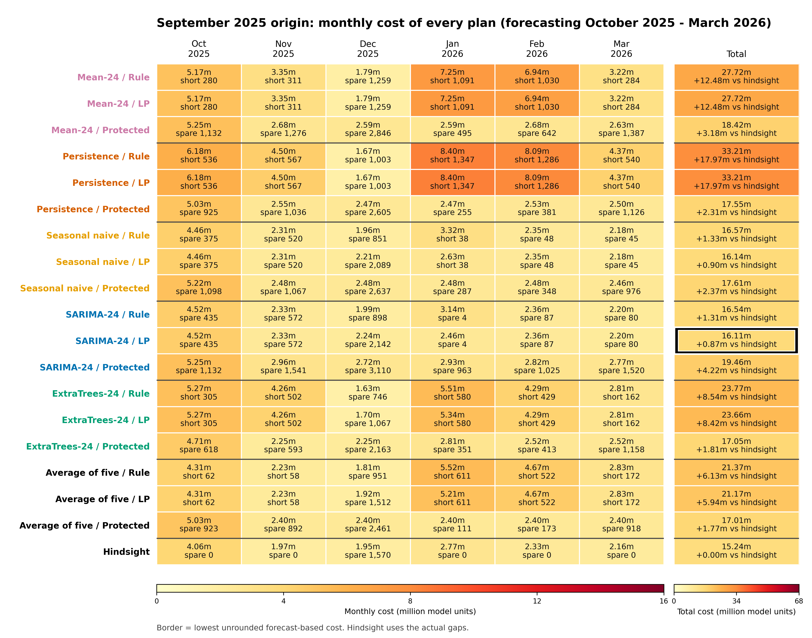
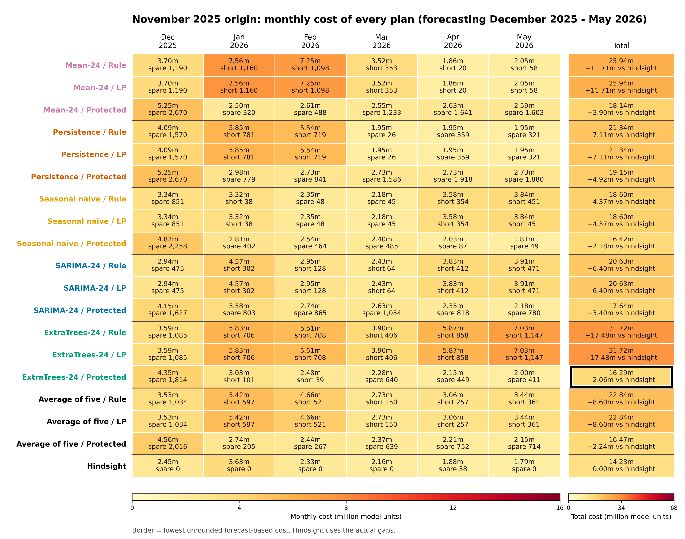
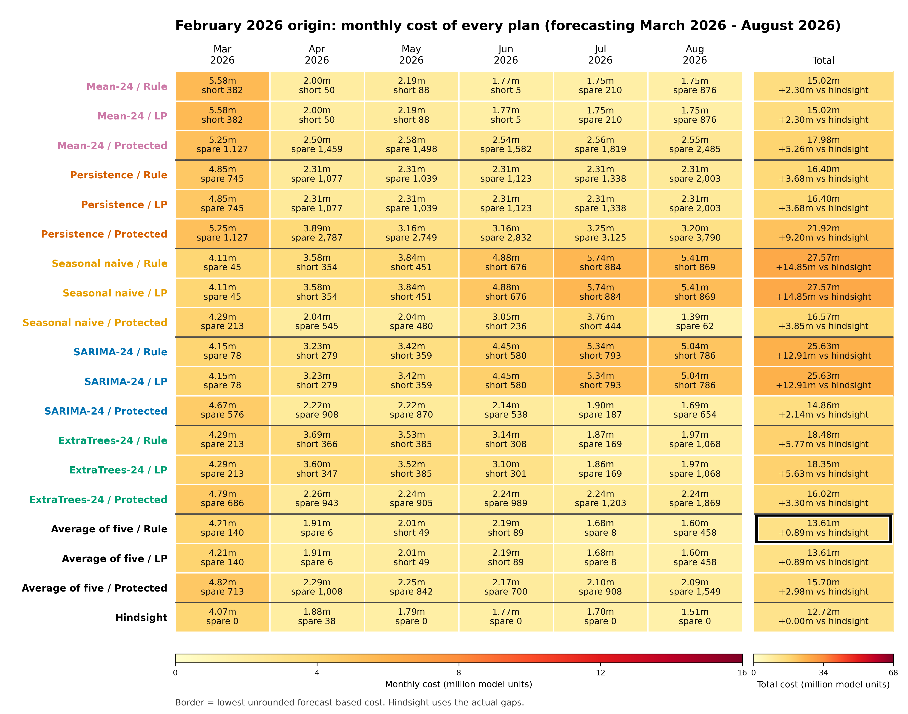
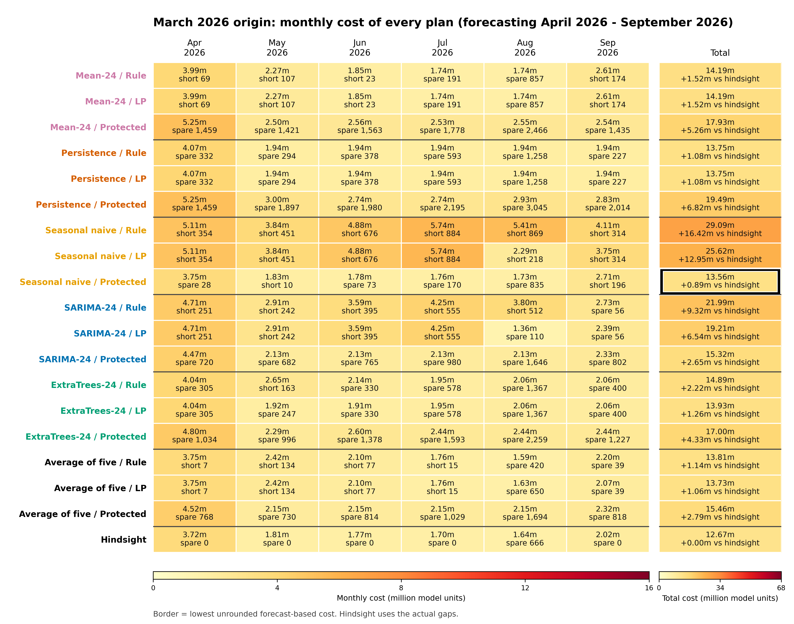

# Frozen bed-capacity plans: forecast, optimise, protect

## Question

How many extra NHS England general and acute beds should be open if the next six months must be planned today? At each origin we freeze a schedule using five forecasts and their equal-weight average. Does optimising the schedule improve on following the forecast, and when does protection against error pay? Does averaging the forecasts improve the plan?

## Method

An origin is the last observed month. Each method forecasts occupied and available beds separately from a 24-month training window, then we fix all six monthly decisions. The planning gap is **occupied / 0.90 − available**, the extra capacity needed for a 90% occupancy target.

- **Mean-24** repeats the training average.
- **Persistence** repeats the latest observation.
- **Seasonal naive** repeats the same calendar month from the previous year.
- **SARIMA-24** uses a fixed seasonal time-series model.
- **ExtraTrees-24** uses a fixed tree ensemble with lagged observations and calendar features.
- **Average of five** gives each method equal weight for occupied beds and for available beds. October 2025 and January 2026 use an **Average of four** because SARIMA-24 failed to converge.

**Rule** follows the forecast gap within the limits. **LP** uses the same forecast and chooses the lowest-cost schedule across the window. Running costs 500 per bed-month, opening 550 per bed, closing 300 per bed and shortfall 5,000 per missing bed-month. Beds carry over from month to month. Capacity starts at zero, is capped at 15,000 and can change by up to 5,000 beds per month. There is no terminal closure charge. **Hindsight** uses the actual gaps and the same constraints. Costs are illustrative model units (validated: False).

### How protection (SAA) works

Without protection, the optimiser plans for one number per month: the forecast. With protection, it plans against about 30 possible futures, each made by adding one of that method's past six-month forecast errors to the forecast, and picks the single schedule with the lowest average cost across them. Because a missing bed costs 5,000 and a spare bed about 500, that schedule sits above the forecast. In September 2025 it lifted SARIMA-24's plan by roughly 700-1,400 beds a month. SARIMA-24 already forecast high, so those beds were not needed: spare bed-months rose from 3,320 to 9,291 and cost rose from 16.11m to 19.46m. Persistence forecast too low: without protection it was 4,276 bed-months short and cost 33.21m; with protection it was never short and cost 17.55m. Same origin, same tool, opposite result, because protection is built around the forecast. It adds a margin; it cannot tell whether the forecast is too high or too low.

| Forecast | Direction (signed error in beds) | LP cost · short / spare | Protected cost · short / spare | Saving from protection |
| --- | --- | --- | --- | --- |
| Mean-24 | Too low (+289.5) | 27.72m · 2,996 / 1,259 | 18.42m · 0 / 7,778 | +9.30m |
| Persistence | Too low (+545.5) | 33.21m · 4,276 / 1,003 | 17.55m · 0 / 6,328 | +15.66m |
| Seasonal naive | Too high (-300.3) | 16.14m · 38 / 3,078 | 17.61m · 0 / 6,413 | -1.47m |
| SARIMA-24 | Too high (-346.0) | 16.11m · 0 / 3,320 | 19.46m · 0 / 9,291 | -3.35m |
| ExtraTrees-24 | Too low (+205.4) | 23.66m · 1,978 / 1,067 | 17.05m · 0 / 5,295 | +6.61m |
| Average of five | Too low (+78.8) | 21.17m · 1,424 / 1,512 | 17.01m · 0 / 5,477 | +4.16m |

Signed error is actual gap minus forecast gap, averaged across the window. Short and spare sum bed-months across September's six target months. A positive protection effect means Protected cost less than LP.

## How to read the heatmaps

Each method has Rule, LP and Protected rows. Each monthly cell shows realised cost in millions and how many beds were short or spare against the actual gap, rounded to whole beds. Pale yellow is cheaper and deep red more expensive. All heatmaps use **0–16m for monthly cells** and **0–68m for totals**. The Total column also shows the extra cost over Hindsight. The thick border marks the cheapest available forecast-based plan before rounding. Grey cells mark unavailable forecasts.

## Main origin: September 2025

[Vector heatmap](figures/readme_heatmaps/origin_2025-09.svg)

January and February were the two most expensive LP months for Mean-24 and Persistence, when their flat forecasts left beds short. In December, Seasonal naive and SARIMA-24 kept beds open with LP that the Rule would have closed, saving 0.43m and 0.44m over the window. Protection removed Persistence's shortages, while it added spare beds to a SARIMA-24 schedule that already covered demand. The average ran 79 beds low, and its cost fell from 21.17m with LP to 17.01m with protection, cheapest among the Protected plans. SARIMA-24 LP still had the lowest overall cost at 16.11m.

## Protection depends on the forecast

[Vector scatter plot](figures/monthly_origins/protection_vs_error_direction.svg)

Each dot represents one of the five individual methods at one monthly origin. Protection helped in **26 of 29** cases where the forecast ran low and **8 of 34** where it ran high (Spearman rank correlation **0.926**). Its margin is sized from that method's past errors, and a high six-month average can still conceal a monthly shortage. The direction of the next error is unknown when the plan is frozen, so we judge protection by what it saves across windows.

## Did averaging the forecasts help?

The primary test used 23 origins, excluding September 2025 and March 2026, where the idea was formed. Excess cost is the six-month bill above that origin's Hindsight bill. Each origin counts equally.

| Forecast (ranked by LP cost) | Mean LP excess | Mean Protected excess | Extra planned beds | Forecast uncertainty margin (beds) | 90% upper forecast coverage |
| --- | --- | --- | --- | --- | --- |
| Seasonal naive | 4.30m | 3.66m | 1,009 | 1,802 | 95.7% (132/138) |
| Average of five | 6.00m | 3.13m | 1,072 | 1,374 | 99.3% (137/138) |
| ExtraTrees-24 | 6.88m | 3.94m | 1,032 | 1,424 | 96.4% (133/138) |
| Mean-24 | 7.28m | 6.38m | 1,942 | 2,970 | 100.0% (138/138) |
| SARIMA-24 | 10.48m | 4.54m | 1,122 | 1,619 | 94.2% (130/138) |
| Persistence | 14.52m | 7.53m | 1,711 | 2,419 | 92.8% (128/138) |

Extra planned beds is mean Protected capacity minus LP capacity per month. The forecast uncertainty margin is the distance from the point forecast to its 90% upper forecast. Coverage counts how often the actual gap was at or below that upper forecast.

With LP alone the average ranked second. Seasonal naive cost 1.70m less per origin. ExtraTrees-24, Mean-24, SARIMA-24 and Persistence followed in that order. Protecting the average then saved 2.87m, bringing its mean excess to 3.13m against 3.66m for Seasonal naive Protected.

Protecting the average produced the lowest mean cost. It had the smallest forecast uncertainty margin and the third-smallest increase in planned capacity.

### Where the costs and added beds went

Costs are millions per six-month origin, rounded after averaging. Operating total combines running, opening and closing. Short and spare are also means per origin. The last column totals the positive increases in planned bed-months over all 23 origins, grouped by whether the LP schedule was short or spare against actual demand that month. All added beds in a short month go in the first group, including any beyond what was needed to cover its shortage.

| Forecast | Plan | Operating total | Running | Opening | Closing | Shortfall cost | Short / spare bed-months | Added in LP-short / LP-spare months |
| --- | --- | --- | --- | --- | --- | --- | --- | --- |
| Average of five | LP | 12.91m | 10.47m | 2.26m | 0.19m | 6.50m | 1,300 / 1,708 | — |
| Average of five | Protected | 16.42m | 13.69m | 2.66m | 0.08m | 0.12m | 23 / 6,866 | 75,067 / 72,937 |
| Seasonal naive | LP | 13.79m | 10.74m | 2.66m | 0.38m | 3.93m | 785 / 1,746 | — |
| Seasonal naive | Protected | 16.79m | 13.77m | 2.80m | 0.23m | 0.28m | 57 / 7,070 | 68,798 / 70,397 |
| ExtraTrees-24 | LP | 13.23m | 10.69m | 2.33m | 0.20m | 7.06m | 1,412 / 2,269 | — |
| ExtraTrees-24 | Protected | 16.60m | 13.79m | 2.74m | 0.07m | 0.75m | 150 / 7,199 | 58,154 / 84,279 |

Against Seasonal naive Protected, the protected average spent 0.37m less on running, opening and closing combined and 0.17m less on shortages per origin. Against ExtraTrees-24 Protected, lower shortfall charges accounted for 0.63m of its 0.81m saving. The protected average left 23 bed-months short and 6,866 spare per origin, fewer of both than either protected comparator.

All five forecasts ran high in February 2025 and low in December 2025. Averaging preserved the direction of those shared misses, so the cost depended on how the protected schedule covered them.

## Every origin: April 2025 to April 2026

| Origin | Forecast months | Cheapest available plan | Excess over hindsight | Protection helped most? |
| --- | --- | --- | --- | --- |
| Apr 2025 | May 2025 – Oct 2025 | Average of five LP | 1.06m | No (0 of 6) |
| May 2025 | Jun 2025 – Nov 2025 | Average of five LP | 1.21m | No (1 of 6) |
| Jun 2025 | Jul 2025 – Dec 2025 | ExtraTrees-24 LP | 1.18m | No (1 of 6) |
| Jul 2025 | Aug 2025 – Jan 2026 | Seasonal naive LP | 1.92m | Half (3 of 6) |
| Aug 2025 | Sep 2025 – Feb 2026 | SARIMA-24 LP | 0.99m | Yes (4 of 6) |
| Sep 2025 | Oct 2025 – Mar 2026 | SARIMA-24 LP | 0.87m | Yes (4 of 6) |
| Oct 2025 | Nov 2025 – Apr 2026 | ExtraTrees-24 Protected | 1.02m | Yes (5 of 5) |
| Nov 2025 | Dec 2025 – May 2026 | ExtraTrees-24 Protected | 2.06m | Yes (6 of 6) |
| Dec 2025 | Jan 2026 – Jun 2026 | ExtraTrees-24 Protected | 0.88m | Yes (6 of 6) |
| Jan 2026 | Feb 2026 – Jul 2026 | ExtraTrees-24 Protected | 1.16m | Yes (4 of 5) |
| Feb 2026 | Mar 2026 – Aug 2026 | Average of five Rule (LP ties within tolerance) | 0.89m | Half (3 of 6) |
| Mar 2026 | Apr 2026 – Sep 2026 | Seasonal naive Protected | 0.89m | No (2 of 6) |
| Apr 2026 | May 2026 – Oct 2026 | Seasonal naive Protected | 0.95m | Half (3 of 6) |

Protection helped a forecast if its Protected plan cost less than its own LP. Counts include the average. The two origins with a missing SARIMA-24 fit compare only the plans available then. In February 2026 the average's Rule had the lowest unrounded cost and its LP tied within the saved relative tolerance of 1e-6.

<b>Apr 2025 origin</b> - cheapest: Average of five LP; protection helped 0 of 6 forecasts

[Vector heatmap](figures/readme_heatmaps/origin_2025-04.svg)

Average of five ran 282 beds high on average, and its most expensive LP month was May 2025 (3.50m). Keeping 548 more beds open than the Rule in Aug 2025 helped LP save 0.19m across the window. Protection added 2.72m to this method's bill.

<b>May 2025 origin</b> - cheapest: Average of five LP; protection helped 1 of 6 forecasts

[Vector heatmap](figures/readme_heatmaps/origin_2025-05.svg)

Average of five ran 267 beds high on average, and its most expensive LP month was Jun 2025 (3.37m). Keeping 508 more beds open than the Rule in Aug 2025 helped LP save 0.18m across the window. Protection added 2.65m to this method's bill.

<b>Jun 2025 origin</b> - cheapest: ExtraTrees-24 LP; protection helped 1 of 6 forecasts

[Vector heatmap](figures/readme_heatmaps/origin_2025-06.svg)

ExtraTrees-24 ran 536 beds high on average, and its most expensive LP month was Jul 2025 (3.14m). Keeping 217 more beds open than the Rule in Aug 2025 helped LP save 0.08m across the window. Protection added 3.76m to this method's bill.

<b>Jul 2025 origin</b> - cheapest: Seasonal naive LP; protection helped 3 of 6 forecasts

[Vector heatmap](figures/readme_heatmaps/origin_2025-07.svg)

Seasonal naive ran 245 beds high on average, and its most expensive LP month was Sep 2025 (2.90m). Keeping 1,238 more beds open than the Rule in Dec 2025 helped LP save 0.43m across the window. Protection added 0.95m to this method's bill.

<b>Aug 2025 origin</b> - cheapest: SARIMA-24 LP; protection helped 4 of 6 forecasts

[Vector heatmap](figures/readme_heatmaps/origin_2025-08.svg)

SARIMA-24 ran 381 beds high on average, and its most expensive LP month was Sep 2025 (3.58m). Keeping 1,253 more beds open than the Rule in Dec 2025 helped LP save 0.44m across the window. Protection added 3.89m to this method's bill.

<b>Sep 2025 origin</b> - cheapest: SARIMA-24 LP; protection helped 4 of 6 forecasts

[Vector heatmap](figures/readme_heatmaps/origin_2025-09.svg)

SARIMA-24 ran 346 beds high on average, and its most expensive LP month was Oct 2025 (4.52m). Keeping 1,244 more beds open than the Rule in Dec 2025 helped LP save 0.44m across the window. Protection added 3.35m to this method's bill.

<b>Oct 2025 origin</b> - cheapest: ExtraTrees-24 Protected; protection helped 5 of 5 forecasts

[Vector heatmap](figures/readme_heatmaps/origin_2025-10.svg)

ExtraTrees-24 ran 477 beds low on average. Its largest LP bill was 6.71m in Jan 2026, and protection cut its largest monthly shortage from 962 to 0 beds in Apr 2026. Across the six months that protected schedule saved 14.52m against its own LP.

<b>Nov 2025 origin</b> - cheapest: ExtraTrees-24 Protected; protection helped 6 of 6 forecasts

[Vector heatmap](figures/readme_heatmaps/origin_2025-11.svg)

ExtraTrees-24 ran 457 beds low on average. Its largest LP bill was 7.03m in May 2026, and protection cut its largest monthly shortage from 1,147 to 0 beds in May 2026. Across the six months that protected schedule saved 15.42m against its own LP.

<b>Dec 2025 origin</b> - cheapest: ExtraTrees-24 Protected; protection helped 6 of 6 forecasts

[Vector heatmap](figures/readme_heatmaps/origin_2025-12.svg)

ExtraTrees-24 ran 720 beds low on average. Its largest LP bill was 7.87m in Jan 2026, and protection cut its largest monthly shortage from 899 to 0 beds in May 2026. Across the six months that protected schedule saved 18.04m against its own LP.

<b>Jan 2026 origin</b> - cheapest: ExtraTrees-24 Protected; protection helped 4 of 5 forecasts

[Vector heatmap](figures/readme_heatmaps/origin_2026-01.svg)

ExtraTrees-24 ran 755 beds low on average. Its largest LP bill was 6.82m in May 2026, and protection cut its largest monthly shortage from 1,111 to 0 beds in May 2026. Across the six months that protected schedule saved 19.15m against its own LP.

<b>Feb 2026 origin</b> - cheapest: Average of five Rule (LP ties within tolerance); protection helped 3 of 6 forecasts

[Vector heatmap](figures/readme_heatmaps/origin_2026-02.svg)

The average ran 79 beds high on average. Its opening month, Mar 2026, had its largest Rule bill (4.21m). Rule and LP tied within solver tolerance, while protection added 2.10m.

<b>Mar 2026 origin</b> - cheapest: Seasonal naive Protected; protection helped 2 of 6 forecasts

[Vector heatmap](figures/readme_heatmaps/origin_2026-03.svg)

Seasonal naive ran 591 beds low on average. Its largest LP bill was 5.74m in Jul 2026, and protection cut its largest monthly shortage from 884 to 0 beds in Jul 2026. Across the six months that protected schedule saved 12.06m against its own LP.

<b>Apr 2026 origin</b> - cheapest: Seasonal naive Protected; protection helped 3 of 6 forecasts

[Vector heatmap](figures/readme_heatmaps/origin_2026-04.svg)

Seasonal naive ran 579 beds low on average. Its largest LP bill was 5.74m in Jul 2026, and protection cut its largest monthly shortage from 884 to 0 beds in Jul 2026. Across the six months that protected schedule saved 11.63m against its own LP.

## Findings

- **Optimisation paid when the forecast dipped.** Across the five individual methods it saved money in 30 of 30 forecasts with a fall followed by a rise, and tied in all 33 without a dip. It never materially cost more.
- **Protection depended on the forecast.** It saved money in 26 of 29 under-forecasts and 8 of 34 over-forecasts.
- **The cheapest plan changed with the window.** SARIMA-24 LP led in September 2025 and Seasonal naive Protected led in March 2026.
- **Averaging alone ranked second.** Seasonal naive had the cheapest LP on average in the primary test. With protection, the average had the lowest mean cost. Its protected plan had fewer short and spare bed-months than protected Seasonal naive and protected ExtraTrees-24.
- **The protection margins were conservative here.** The average's 90% upper forecast covered 137 of 138 origin-months, or 99.3%.

## Limitations

- Adjacent origins share up to five target months. The 13 monthly origins represent about two to three independent six-month windows, and the 23 primary origins about four.
- The monthly set contains a single winter peak in January 2026.
- Univariate forecasts use national monthly data. Local bottlenecks, staffing constraints and daily peaks are hidden.
- Costs are illustrative. Plan rankings depend on the assumed shortage price.

**Saved numerical sources**

- `outputs/clean_checkpoint/O1_sep2025/` — [totals.csv](outputs/clean_checkpoint/O1_sep2025/totals.csv)
- `outputs/clean_checkpoint/O2_mar2026/` — [totals.csv](outputs/clean_checkpoint/O2_mar2026/totals.csv)
- `outputs/fair_comparison/O1_sep2025/` — [totals.csv](outputs/fair_comparison/O1_sep2025/totals.csv)
- `outputs/fair_comparison/O2_mar2026/` — [totals.csv](outputs/fair_comparison/O2_mar2026/totals.csv)
- `outputs/fair_comparison_rolling/` — [plans.csv](outputs/fair_comparison_rolling/plans.csv)
- `outputs/forecast_combination/` — [actuals.csv](outputs/forecast_combination/actuals.csv), [banks.csv](outputs/forecast_combination/banks.csv), [config.json](outputs/forecast_combination/config.json), [costs.csv](outputs/forecast_combination/costs.csv), [coverage.csv](outputs/forecast_combination/coverage.csv), [decomposition_summary.csv](outputs/forecast_combination/decomposition_summary.csv), [endpoints.csv](outputs/forecast_combination/endpoints.csv), [forecasts.csv](outputs/forecast_combination/forecasts.csv), [monthly_costs.csv](outputs/forecast_combination/monthly_costs.csv), [origin_metrics.csv](outputs/forecast_combination/origin_metrics.csv), [plans.csv](outputs/forecast_combination/plans.csv), [quantiles.csv](outputs/forecast_combination/quantiles.csv)
- `outputs/monthly_origins/` — [availability.csv](outputs/monthly_origins/availability.csv), [costs.csv](outputs/monthly_origins/costs.csv), [interpretation.json](outputs/monthly_origins/interpretation.json), [method_origin.csv](outputs/monthly_origins/method_origin.csv), [monthly_costs.csv](outputs/monthly_origins/monthly_costs.csv)
