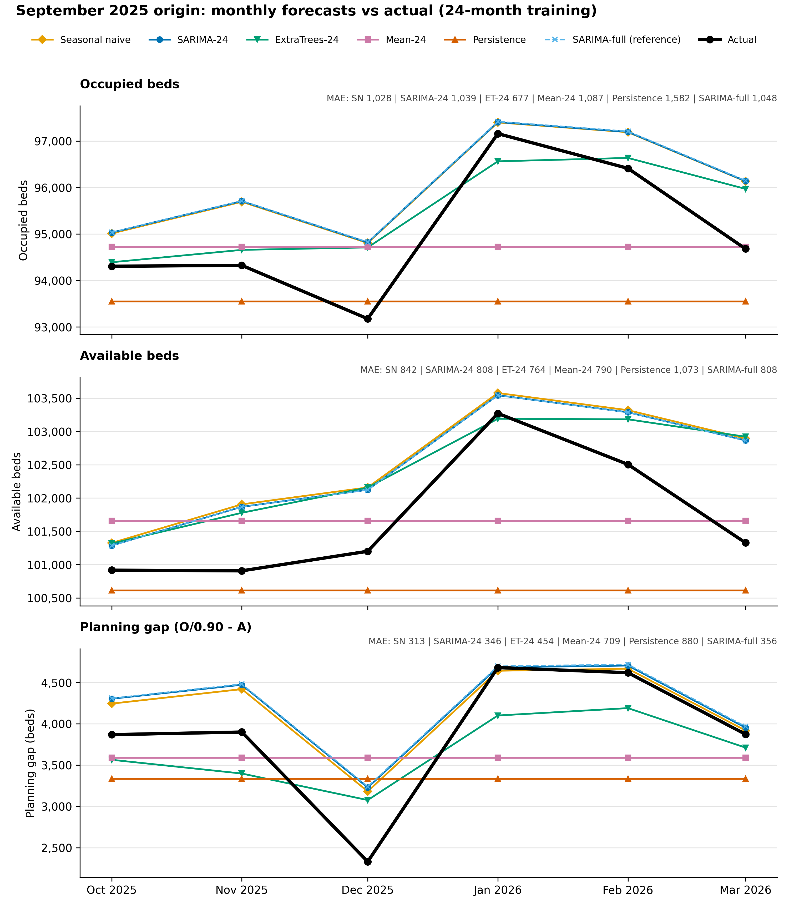

## Forecast vs decision method: September 2025 origin

All forecasting methods use the same 24 months before the origin (October 2023 - September 2025) and forecast the next six months (October 2025 - March 2026). "Rule" opens exactly the extra capacity the forecast says is needed each month, ignoring costs. "LP" feeds the same forecast into a linear program that chooses monthly extra capacity to minimise running (500 per bed-month), opening (550), closing (300) and shortfall (5,000 per bed-month) costs, with capacity carrying over between months, at most 5,000 beds opened or closed per month, at most 15,000 in total, and zero starting capacity. SARIMA-full (trained on all history) is shown only as a reference.

Each model forecasts occupied and available beds; the gap is derived from them as occupied / 0.90 - available.

| Forecast | Training data | Decision | Gap MAE (beds) | Mean signed gap error (beds) | Operating cost | Shortfall cost | Total realised cost | Excess over hindsight |
| --- | --- | --- | ---: | ---: | ---: | ---: | ---: | ---: |
| Mean-24 | 24 months | Rule | 709 | 289 | 12.74 | 14.98 | 27.72 | 12.48 |
| Mean-24 | 24 months | LP | 709 | 289 | 12.74 | 14.98 | 27.72 | 12.48 |
| Persistence | 24 months | Rule | 880 | 545 | 11.83 | 21.38 | 33.21 | 17.97 |
| Persistence | 24 months | LP | 880 | 545 | 11.83 | 21.38 | 33.21 | 17.97 |
| Seasonal naive | 24 months | Rule | 313 | -300 | 16.38 | 0.19 | 16.57 | 1.33 |
| Seasonal naive | 24 months | LP | 313 | -300 | 15.95 | 0.19 | 16.14 | 0.90 |
| SARIMA-24 | 24 months | Rule | 346 | -346 | 16.54 | 0.00 | 16.54 | 1.31 |
| SARIMA-24 | 24 months | LP | 346 | -346 | 16.11 | 0.00 | 16.11 | 0.87 |
| ExtraTrees-24 | 24 months | Rule | 454 | 205 | 13.88 | 9.89 | 23.77 | 8.54 |
| ExtraTrees-24 | 24 months | LP | 454 | 205 | 13.77 | 9.89 | 23.66 | 8.42 |
| SARIMA-full | full history (reference) | LP | 356 | -356 | 16.15 | 0.00 | 16.15 | 0.91 |
| Hindsight | - | LP | - | - | 15.24 | 0.00 | 15.24 | 0.00 |

Costs in millions of model cost units. Mean signed gap error = actual - forecast.

### Month by month: cost

Monthly cost includes running, opening and closing beds plus the 5,000-per-bed shortfall penalty; 'short' and 'spare' show how far each plan was below or above the actual gap that month.

**Result.** Seasonal naive had the lowest gap MAE (313 beds), and SARIMA-24 LP had the lowest realised cost (16.11m, 0.87m above hindsight). SARIMA-24 LP, Seasonal naive LP and SARIMA-full LP were within 0.04m of one another. Rule and LP plans were identical for Mean-24 and Persistence, and LP was cheaper than Rule by 0.43m for Seasonal naive, 0.44m for SARIMA-24 and 0.11m for ExtraTrees-24 (differences computed before rounding). This is a single origin (one six-month window), SARIMA-24 and ExtraTrees-24 are fitted on only 24 months, and costs are illustrative model units (validated: False).
