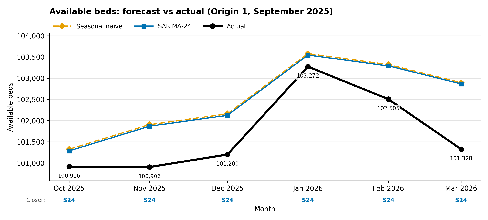
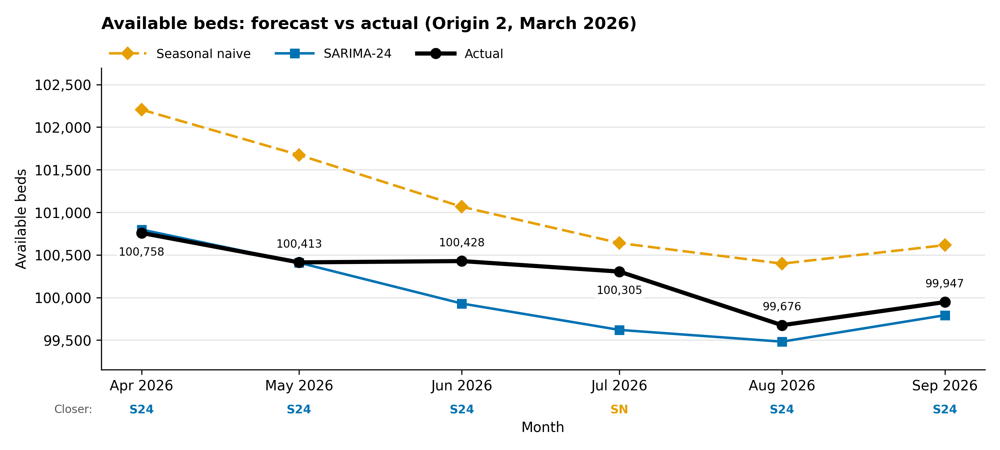
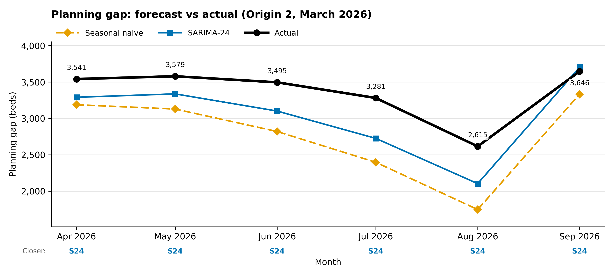
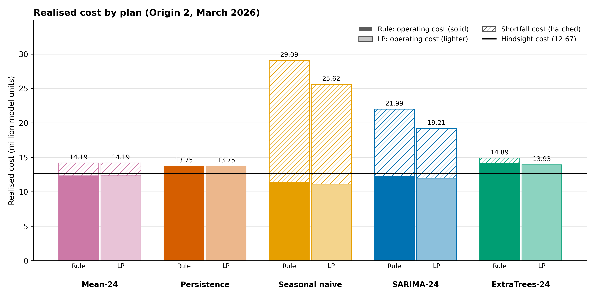
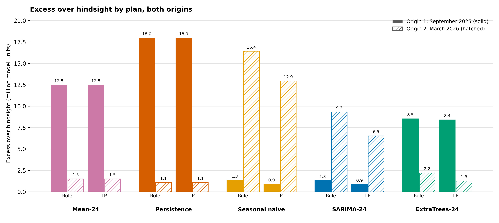
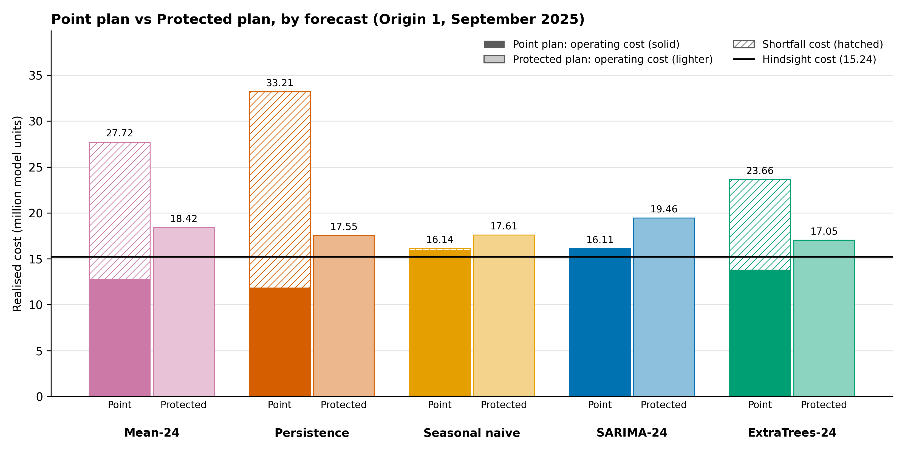
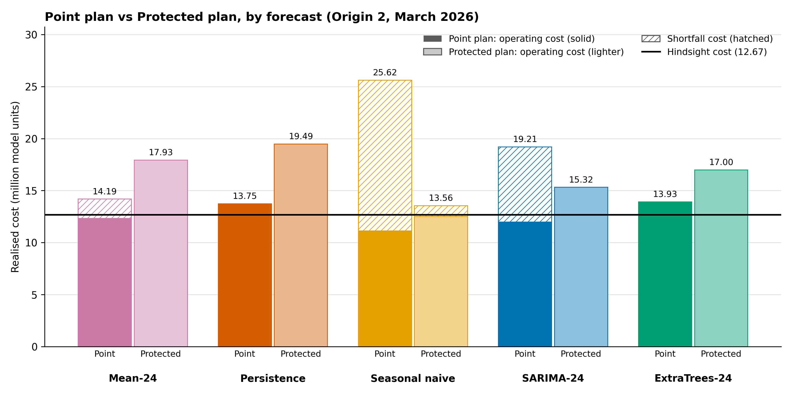
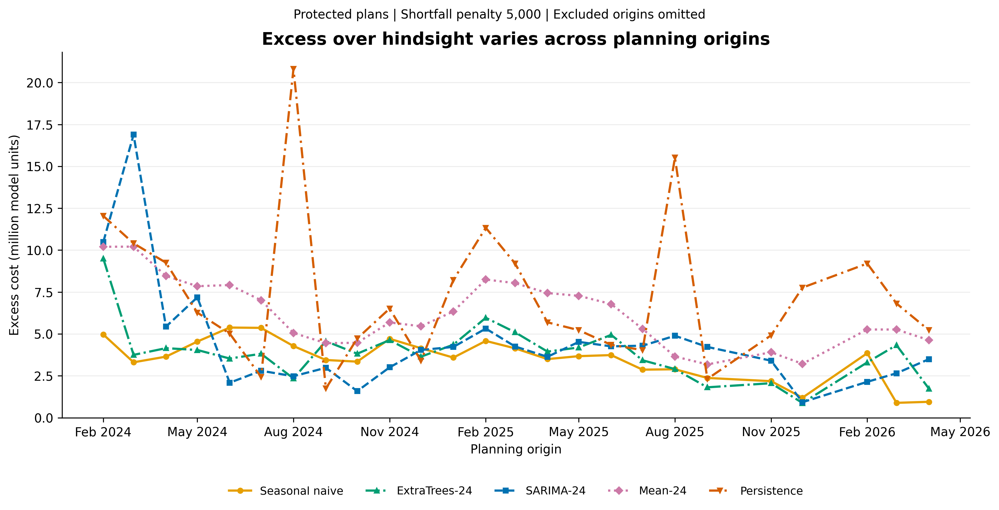
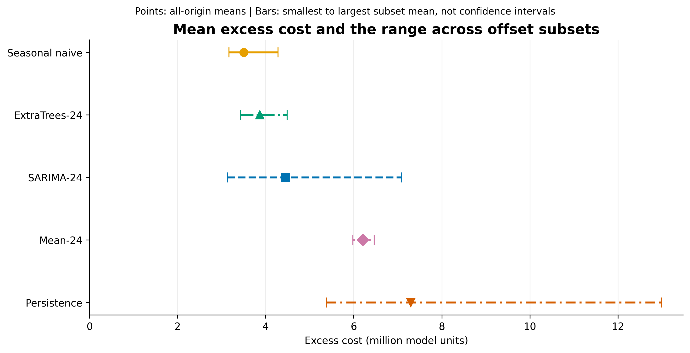
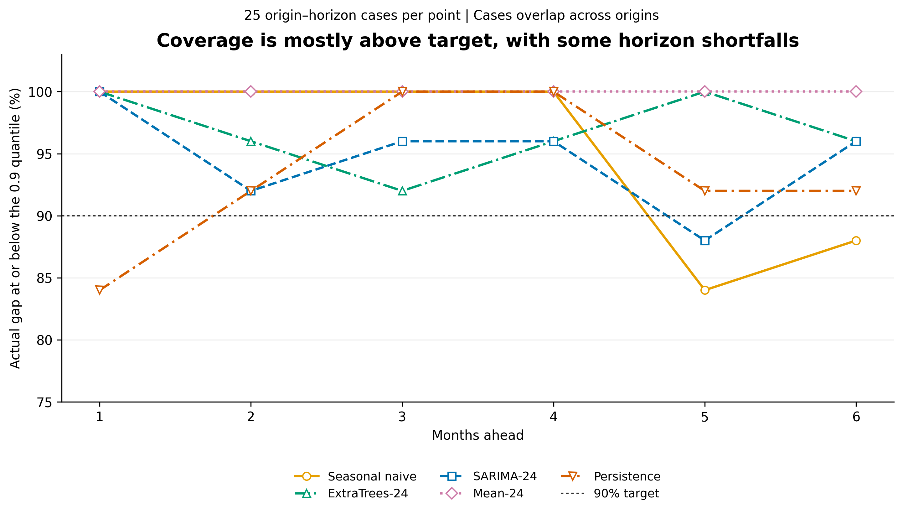

# Which forecast gives the best hospital capacity plan?

## Question

Hospitals in England need enough general and acute beds every month. We forecast bed numbers six months ahead and turn each forecast into a plan for extra beds. Which forecasting method, paired with which way of making the plan, gives the cheapest plan once the real numbers are known, and how much better is it than simple baselines and than simply following the forecast?

## Method

Five methods forecast occupied beds and available beds six months ahead, each from the same 24 months of NHS England data: the 24-month mean (Mean-24), the last month repeated (Persistence), the same month one year earlier (Seasonal naive), a seasonal time-series model (SARIMA-24) and a tree-based machine-learning model (ExtraTrees-24). The two forecasts give the planning gap, occupied / 0.90 - available: the extra beds needed to keep occupancy at 90%. Each gap forecast is turned into a plan in two ways. The Rule opens exactly the forecast gap each month. The LP (a linear program) finds the cheapest plan for the forecast gap, so it may keep beds open through a short dip instead of closing and reopening them. A bed costs 500 a month to run, 550 to open and 300 to close; each missing bed costs 5,000 a month. A plan starts with no extra beds, can hold at most 15,000 and can open or close at most 5,000 in a month. Each plan is then held fixed and costed against the actual gap. Hindsight is the LP solved with the actual gaps: no plan can cost less.

| Origin | Training window (24 months) | Forecast months |
| --- | --- | --- |
| Origin 1: September 2025 | October 2023 - September 2025 | October 2025 - March 2026 |
| Origin 2: March 2026 | April 2024 - March 2026 | April 2026 - September 2026 |

### How we pick a winner

These rules were written down and hashed before any forecast in this run was computed (config SHA-256 `8406460d682a6d5341579b30e6a9d576dd149fa6050b871697b101b6d6d56be9`).

- **Joint best.** At each origin the 10 plans are ranked by realised cost. Plans within 1% of that origin's hindsight cost of the cheapest plan are "joint best".
- **Overall ranking.** Plans are ranked by combined excess over hindsight: cost minus hindsight cost, added over the two origins.
- **Clear winner.** A plan that is joint best at both origins, or that beats the overall runner-up by more than the 1% band at each origin. Otherwise there is no clear winner.
- **Best forecast.** The method with the lowest mean gap MAE (mean absolute error) across the two origins. It is "clear" only if it is the lowest at both origins by more than 5 beds.

The rules were fixed in advance, but the test is not blind: the outcome months had already been used in earlier tests in this project.

## Origin 1: September 2025

Forecast months: October 2025 - March 2026. The figures show Seasonal naive and SARIMA-24 against the actual values; all five methods are in the table.

**Occupied beds:** Seasonal naive was closer in 6 of 6 months. Best of all five methods: ExtraTrees-24 (MAE 677 beds).

**Available beds:** SARIMA-24 was closer in 6 of 6 months. Best of all five methods: ExtraTrees-24 (MAE 764 beds).

**Planning gap:** Seasonal naive was closer in 5 of 6 months and SARIMA-24 in 1. Best of all five methods: Seasonal naive (MAE 313 beds).

| Forecast | Decision | Gap MAE (beds) | Mean signed gap error (beds) | Operating cost | Shortfall cost | Total | Excess over hindsight |
| --- | --- | ---: | ---: | ---: | ---: | ---: | ---: |
| Mean-24 | Rule | 709 | 289 | 12.74 | 14.98 | 27.72 | 12.48 |
| Mean-24 | LP | 709 | 289 | 12.74 | 14.98 | 27.72 | 12.48 |
| Persistence | Rule | 880 | 545 | 11.83 | 21.38 | 33.21 | 17.97 |
| Persistence | LP | 880 | 545 | 11.83 | 21.38 | 33.21 | 17.97 |
| Seasonal naive | Rule | 313 | -300 | 16.38 | 0.19 | 16.57 | 1.33 |
| Seasonal naive | LP | 313 | -300 | 15.95 | 0.19 | 16.14 | 0.90 |
| SARIMA-24 | Rule | 346 | -346 | 16.54 | 0.00 | 16.54 | 1.31 |
| SARIMA-24 | LP | 346 | -346 | 16.11 | 0.00 | 16.11 | 0.87 |
| ExtraTrees-24 | Rule | 454 | 205 | 13.88 | 9.89 | 23.77 | 8.54 |
| ExtraTrees-24 | LP | 454 | 205 | 13.77 | 9.89 | 23.66 | 8.42 |
| Hindsight | LP | - | - | 15.24 | 0.00 | 15.24 | 0.00 |

Costs in millions of model units. Mean signed gap error = actual - forecast: above zero means the forecast was too low.

**Result.** SARIMA-24 LP was the cheapest plan (16.11m, 0.87m above hindsight), and Seasonal naive LP (16.14m) was joint best with it. Seasonal naive had the most accurate gap forecast (MAE 313 beds). The LP was cheaper than the Rule by 0.43m for Seasonal naive, 0.44m for SARIMA-24 and 0.11m for ExtraTrees-24; for the two flat forecasts (Mean-24, Persistence) the Rule and the LP give the same plan.

## Origin 2: March 2026

Forecast months: April 2026 - September 2026. The figures show Seasonal naive and SARIMA-24 against the actual values; all five methods are in the table.

**Occupied beds:** Seasonal naive was closer in 3 of 6 months and SARIMA-24 in 3. Best of all five methods: Seasonal naive (MAE 449 beds).

**Available beds:** Seasonal naive was closer in 1 of 6 months and SARIMA-24 in 5. Best of all five methods: SARIMA-24 (MAE 262 beds).

**Planning gap:** SARIMA-24 was closer in 6 of 6 months. Best of all five methods: Mean-24 (MAE 237 beds).

| Forecast | Decision | Gap MAE (beds) | Mean signed gap error (beds) | Operating cost | Shortfall cost | Total | Excess over hindsight |
| --- | --- | ---: | ---: | ---: | ---: | ---: | ---: |
| Mean-24 | Rule | 237 | -113 | 12.33 | 1.87 | 14.19 | 1.52 |
| Mean-24 | LP | 237 | -113 | 12.33 | 1.87 | 14.19 | 1.52 |
| Persistence | Rule | 514 | -514 | 13.75 | 0.00 | 13.75 | 1.08 |
| Persistence | LP | 514 | -514 | 13.75 | 0.00 | 13.75 | 1.08 |
| Seasonal naive | Rule | 591 | 591 | 11.36 | 17.73 | 29.09 | 16.42 |
| Seasonal naive | LP | 591 | 591 | 11.14 | 14.48 | 25.62 | 12.95 |
| SARIMA-24 | Rule | 335 | 316 | 12.21 | 9.78 | 21.99 | 9.32 |
| SARIMA-24 | LP | 335 | 316 | 12.00 | 7.22 | 19.21 | 6.54 |
| ExtraTrees-24 | Rule | 524 | -469 | 14.08 | 0.81 | 14.89 | 2.22 |
| ExtraTrees-24 | LP | 524 | -469 | 13.93 | 0.00 | 13.93 | 1.26 |
| Hindsight | LP | - | - | 12.67 | 0.00 | 12.67 | 0.00 |

Costs in millions of model units. Mean signed gap error = actual - forecast: above zero means the forecast was too low.

**Result.** Persistence was the cheapest plan (13.75m, 1.08m above hindsight; its Rule and LP plans are the same), and no other plan was within the tie band. Mean-24 had the most accurate gap forecast (MAE 237 beds). Seasonal naive LP and SARIMA-24 LP, joint best at Origin 1, ranked 9th and 7th: their gap forecasts were below the actual gap in 6 and 5 of 6 months.

## Both origins together

| Plan | Origin 1 cost | Origin 1 rank | Origin 2 cost | Origin 2 rank | Combined excess over hindsight | Overall rank |
| --- | ---: | --- | ---: | --- | ---: | --- |
| SARIMA-24 LP | 16.11 | 1 (joint best) | 19.21 | 7 | 7.41 | 1 |
| ExtraTrees-24 LP | 23.66 | 5 | 13.93 | 3 | 9.69 | 2 |
| SARIMA-24 Rule | 16.54 | 3 | 21.99 | 8 | 10.63 | 3 |
| ExtraTrees-24 Rule | 23.77 | 6 | 14.89 | 6 | 10.76 | 4 |
| Seasonal naive LP | 16.14 | 2 (joint best) | 25.62 | 9 | 13.85 | 5 |
| Mean-24 Rule | 27.72 | 7= | 14.19 | 4= | 14.00 | 6= |
| Mean-24 LP | 27.72 | 7= | 14.19 | 4= | 14.00 | 6= |
| Seasonal naive Rule | 16.57 | 4 | 29.09 | 10 | 17.76 | 8 |
| Persistence LP | 33.21 | 9= | 13.75 | 1= (joint best) | 19.05 | 9= |
| Persistence Rule | 33.21 | 9= | 13.75 | 1= (joint best) | 19.05 | 9= |

Costs in millions of model units. Hindsight cost: 15.24m at Origin 1 and 12.67m at Origin 2, so the tie bands are 0.15m and 0.13m. "=" marks a shared rank: for a flat forecast the Rule and the LP give the same plan, and their costs differ by less than 1 model unit (solver rounding).

| Plan | Value of optimisation | Saving vs Persistence | Saving vs Seasonal naive | Avoidable cost removed, vs Persistence LP | Avoidable cost removed, vs Seasonal naive LP | Gap forecast skill vs Seasonal naive |
| --- | ---: | ---: | ---: | ---: | ---: | ---: |
| Mean-24 Rule | 0.00 / 0.00 / 0.00 | 5.49 / -0.44 / 5.05 | -11.15 / 14.90 / 3.75 | 31% / -41% / 26% | -1,285% / 88% / -1% | -1.27 / 0.60 / -0.05 |
| Mean-24 LP | 0.00 / 0.00 / 0.00 | 5.49 / -0.44 / 5.05 | -11.58 / 11.42 / -0.16 | 31% / -41% / 26% | -1,285% / 88% / -1% | -1.27 / 0.60 / -0.05 |
| Persistence Rule | 0.00 / 0.00 / 0.00 | 0.00 / 0.00 / 0.00 | -16.64 / 15.35 / -1.29 | 0% / 0% / 0% | -1,894% / 92% / -38% | -1.81 / 0.13 / -0.54 |
| Persistence LP | 0.00 / 0.00 / 0.00 | 0.00 / 0.00 / 0.00 | -17.07 / 11.87 / -5.21 | 0% / 0% / 0% | -1,894% / 92% / -38% | -1.81 / 0.13 / -0.54 |
| Seasonal naive Rule | 0.43 / 3.48 / 3.91 | 16.64 / -15.35 / 1.29 | 0.00 / 0.00 / 0.00 | 93% / -1,422% / 7% | -48% / -27% / -28% | 0.00 / 0.00 / 0.00 |
| Seasonal naive LP | 0.43 / 3.48 / 3.91 | 17.07 / -11.87 / 5.21 | 0.00 / 0.00 / 0.00 | 95% / -1,100% / 27% | 0% / 0% / 0% | 0.00 / 0.00 / 0.00 |
| SARIMA-24 Rule | 0.44 / 2.78 / 3.21 | 16.67 / -8.24 / 8.43 | 0.03 / 7.10 / 7.13 | 93% / -764% / 44% | -45% / 28% / 23% | -0.11 / 0.43 / 0.25 |
| SARIMA-24 LP | 0.44 / 2.78 / 3.21 | 17.10 / -5.46 / 11.64 | 0.03 / 6.40 / 6.43 | 95% / -506% / 61% | 3% / 49% / 46% | -0.11 / 0.43 / 0.25 |
| ExtraTrees-24 Rule | 0.11 / 0.96 / 1.07 | 9.44 / -1.14 / 8.30 | -7.20 / 14.20 / 7.00 | 53% / -106% / 44% | -847% / 83% / 22% | -0.45 / 0.11 / -0.08 |
| ExtraTrees-24 LP | 0.11 / 0.96 / 1.07 | 9.55 / -0.19 / 9.37 | -7.52 / 11.68 / 4.16 | 53% / -17% / 49% | -835% / 90% / 30% | -0.45 / 0.11 / -0.08 |

Each cell shows Origin 1 / Origin 2 / both origins; money in millions of model units. **Value of optimisation** = Rule cost - LP cost for the same forecast. **Saving** = baseline cost - plan cost, with the same decision method on both sides (Rule against Rule, LP against LP); below zero means the plan cost more than the baseline. **Avoidable cost removed** = (baseline LP cost - plan cost) / (baseline LP cost - hindsight cost); 100% would match hindsight, and the figure becomes large and negative when the baseline was already close to hindsight. **Skill** = 1 - gap MAE / Seasonal naive gap MAE; above zero is more accurate than Seasonal naive. Skill for occupied and available beds is in `outputs/clean_checkpoint/improvements.csv`.

## Answer

There is no clear winner: no plan was joint best at both origins (Origin 1: SARIMA-24 LP and Seasonal naive LP; Origin 2: Persistence, whose Rule and LP plans are the same). SARIMA-24 LP ranked first overall (7.41m above hindsight over both origins) and SARIMA-24 had the lowest mean gap MAE (341 beds), but it is not a clear best forecast: Seasonal naive was more accurate at Origin 1 and Mean-24 at Origin 2. Over both origins SARIMA-24 LP cost 11.64m less than Persistence LP, 6.43m less than Seasonal naive LP and 3.21m less than following its own forecast with the Rule, although at Origin 2 it cost 5.46m more than Persistence LP; the LP was never worse than the Rule, apart from rounding of less than 1 model unit where the two give the same plan. Two non-overlapping six-month windows show whether a ranking repeats once; they do not establish a general ranking. Costs are illustrative model units (validated: False).

## Methodology notes

A review of this design was written before anything was run (`outputs/clean_checkpoint/methodology_review.md`). Nothing was rated "must change". The points below need to be kept in mind when reading the results.

- **Fair in information.** Every method sees the same 24 months and faces the same six months, costs, limits and scoring. Hindsight uses the same LP.
- **Costs are lopsided.** A missing bed costs ten times as much as a spare bed, and neither decision method adds a safety margin. A forecast that is too high is protected; a forecast that is too low is punished. The cheapest plan is therefore not always the most accurate forecast. Read the mean signed gap error together with the MAE.
- **SARIMA-24 (departure).** It is fitted on all 24 months as labels. The project's original procedure dropped the first 12 months and needed at least 30 labels, so it could not run on a 24-month window. One seasonal difference leaves about 12 observations. All 4 fits converged.
- **ExtraTrees-24 (departure).** Its settings were selected earlier for occupied beds and are reused for available beds. Every fit had 12 training rows for 16 features. The results describe this model with very little data, not the model family in general.
- **Fixed in advance, not blind.** The rules were hashed before any forecast. But October 2025 - September 2026 actuals had been used in earlier, separate tests, and the model settings, the 24-month window and both origins were chosen with knowledge of that earlier work.
- **Data.** The October 2026 NHS England publication is used throughout (SHA-256 checked). NHS revised September 2026 between the September and October 2026 publications (available -87, occupied -2).
- **Start and end.** Each window starts from zero extra beds and has no closing charge at the end. This is the same for every plan, including hindsight.
- **Wording of the winner rule.** If more than one plan had met the "clear winner" definition, all would have been reported as joint winners. This did not arise.
- **Verification.** All checks in `outputs/clean_checkpoint/verification.md` pass: unit tests, date and constraint checks, independent recomputation of costs and rules, a full rerun, and a second LP solver. Origin 1 reproduces the earlier September 2025 results of this repository to within rounding error. Frozen-plan SHA-256: `7269b6c2aed2186de75d86a150be635a546ece970f78ba95dfe62f94949d6c86`.

Code: `scripts/clean_checkpoint/`. Results: `outputs/clean_checkpoint/`.

## Limitations

- Two origins only. Their training windows share 18 of 24 months, so the two tests are not independent.
- Small samples: each model sees 24 months. Model settings are fixed, not tuned.
- Point forecasts only. No plan includes a safety margin or a measure of uncertainty.
- Univariate models; no outside drivers such as weather, flu or staffing.
- Occupied and available beds are forecast separately and combined into the gap afterwards.
- National monthly totals; no trust or regional detail.
- A retrospective test on final published figures, not on the figures available at each origin.
- Costs are illustrative model units, not NHS cash.

## Fair comparison: equal protection for every forecast

### Why

A missing bed costs ten times as much as a spare bed, so the cheapest plan should sit above the most likely gap. In the comparison above, no plan had a deliberate margin: each method gave the planner one number. A forecast that happened to run high therefore got free insurance, and a forecast that happened to run low was punished. Persistence at Origin 2 is the clearest case: it carried a winter level into summer, was above the actual gap in every month, and had the cheapest plan. That comparison partly measures which forecast leaned high in a given window. Here every method gets the same deliberate protection, built from its own past errors, so leaning high is no longer a free advantage.

### Method

For each method we repeat its forecast at every earlier month that leaves 24 months of training data and six months of known outcomes before the origin (rolling backtests from November 2022, each refitted on its own 24 months). One backtest (January 2023) is dropped for all methods because SARIMA-24 did not converge, leaving 28 past six-month error paths at Origin 1 and 34 at Origin 2. Adding each error path to the method's forecast gives a set of scenarios; occupied and available errors from the same backtest stay together. The **Protected** plan is the one plan with the lowest average cost across those scenarios (sample average approximation, SAA), with the same costs and limits as before. The **Point** plan is the LP plan from the comparison above, with no protection. We also score each method's 0.9 quantile forecast (its forecast plus its 27th smallest of 28 past errors for that month at Origin 1, and the 32nd of 34 at Origin 2) with pinball loss. Pinball loss at 0.9 counts a bed too few nine times as heavily as a bed too many, which matches the costs; MAE counts them the same.

These rules were written down and hashed before any backtest or forecast was computed (config SHA-256 `164f4ba712b154929dc09cd8a34630af5c84867e740125e0b06466c41ab4c950`).

- **Main result.** The realised cost of the Protected plan, with the shortfall penalty at 5,000.
- **Joint best.** Protected plans within 1% of that origin's hindsight cost of the cheapest Protected plan.
- **Clear winner.** A method that is joint best at both origins, or that is first overall and beats the runner-up by more than the 1% band at each origin. Otherwise there is no clear winner.
- **Previous winner.** The method with the cheapest Point plan at an origin "still wins" if its Protected plan is joint best there.
- **Effect of protection.** Protection "helped" or "hurt" a method if it changed its cost by more than the 1% band.
- **Best-calibrated forecast.** Lowest mean pinball loss at 0.9 across both origins; "clear" only if lowest at both origins by more than 5 beds.
- **Robust.** The outcome is the same when the shortfall penalty is 1,000, 2,500, 5,000 and 10,000.

The rules were fixed in advance, but the test is not blind: the results of the comparison above were known when this design was written.

### Results

#### Origin 1: September 2025

| Forecast | Gap MAE (beds) | Pinball loss at 0.9 (beds) | Coverage at 0.9 | Point LP cost | Protected (SAA) cost | Excess over hindsight (Protected) | Effect of protection |
| --- | ---: | ---: | --- | ---: | ---: | ---: | --- |
| Mean-24 | 709 | 264 | 6 of 6 months | 27.72 | 18.42 | 3.18 | helped |
| Persistence | 880 | 179 | 6 of 6 months | 33.21 | 17.55 | 2.31 | helped |
| Seasonal naive | 313 | 199 | 6 of 6 months | 16.14 | 17.61 | 2.37 | hurt |
| SARIMA-24 | 346 | 203 | 6 of 6 months | 16.11 | 19.46 | 4.22 | hurt |
| ExtraTrees-24 | 454 | 126 | 6 of 6 months | 23.66 | 17.05 | 1.81 | helped |

Costs in millions of model units; hindsight cost 15.24m. Coverage: months in which the actual gap was at or below the method's 0.9 quantile forecast.

**Result.** ExtraTrees-24 had the cheapest Protected plan (17.05m) and no other method was within the tie band. SARIMA-24, which had the cheapest Point plan (16.11m), ranks 5th of 5 when protected (19.46m). Protection helped Mean-24, Persistence and ExtraTrees-24, whose forecasts had been too low on average, and hurt Seasonal naive and SARIMA-24, whose forecasts had been too high. The cheapest Protected plan was dearer than the cheapest Point plan.

#### Origin 2: March 2026

| Forecast | Gap MAE (beds) | Pinball loss at 0.9 (beds) | Coverage at 0.9 | Point LP cost | Protected (SAA) cost | Excess over hindsight (Protected) | Effect of protection |
| --- | ---: | ---: | --- | ---: | ---: | ---: | --- |
| Mean-24 | 237 | 219 | 6 of 6 months | 14.19 | 17.93 | 5.26 | hurt |
| Persistence | 514 | 273 | 6 of 6 months | 13.75 | 19.49 | 6.82 | hurt |
| Seasonal naive | 591 | 119 | 5 of 6 months | 25.62 | 13.56 | 0.89 | helped |
| SARIMA-24 | 335 | 96 | 6 of 6 months | 19.21 | 15.32 | 2.65 | helped |
| ExtraTrees-24 | 524 | 164 | 6 of 6 months | 13.93 | 17.00 | 4.33 | hurt |

Costs in millions of model units; hindsight cost 12.67m. Coverage: months in which the actual gap was at or below the method's 0.9 quantile forecast.

**Result.** Seasonal naive had the cheapest Protected plan (13.56m) and no other method was within the tie band. Persistence, which had the cheapest Point plan (13.75m), ranks 5th of 5 when protected (19.49m). Protection helped Seasonal naive and SARIMA-24, whose forecasts had been too low on average, and hurt Mean-24, Persistence and ExtraTrees-24, whose forecasts had been too high. The cheapest Protected plan was cheaper than the cheapest Point plan.

### Both origins: what protection changed

| Forecast | Value of protection | Part from removing bias | Part from the margin | Protected excess over hindsight, both origins | Overall rank |
| --- | ---: | ---: | ---: | ---: | --- |
| Seasonal naive | -1.47 / 12.06 / 10.59 | -1.15 / -1.53 / -2.68 | -0.32 / 13.59 / 13.27 | 3.26 | 1 |
| ExtraTrees-24 | 6.61 / -3.07 / 3.54 | -1.75 / 0.30 / -1.45 | 8.36 / -3.37 / 4.99 | 6.15 | 2 |
| SARIMA-24 | -3.35 / 3.89 / 0.54 | -0.18 / 0.73 / 0.55 | -3.17 / 3.16 / -0.01 | 6.88 | 3 |
| Mean-24 | 9.30 / -3.74 / 5.56 | 6.60 / 0.68 / 7.28 | 2.70 / -4.42 / -1.72 | 8.44 | 4 |
| Persistence | 15.66 / -5.74 / 9.93 | -3.39 / 0.05 / -3.33 | 19.05 / -5.79 / 13.26 | 9.13 | 5 |

Money in millions of model units; the first three columns show Origin 1 / Origin 2 / both origins. **Value of protection** = Point cost - Protected cost; below zero means protection cost more than it saved. It is split into the part from adding the method's average past error to its forecast (removing bias) and the part from the margin for uncertainty. Savings against baselines and skill scores are in `outputs/fair_comparison/improvements.csv`.

### Robustness

| Forecast | p = 1,000 (q* = 0.5) | p = 2,500 (q* = 0.8) | p = 5,000 (q* = 0.9, base) | p = 10,000 (q* = 0.95, indicative) | Service level, alpha = 0.10 | Service level, alpha = 0.05 (indicative) |
| --- | --- | --- | --- | --- | --- | --- |
| Mean-24 | 1 (0.42) | 4 (5.15) | 4 (8.44) | 4 (12.13) | 4 (42.40) | 5 (48.49) |
| Persistence | 5 (1.87) | 5 (6.85) | 5 (9.13) | 5 (15.32) | 5 (43.20) | 4 (46.24) |
| Seasonal naive | 4 (1.68) | 1 (3.43) | 1 (3.26) | 1 (6.88) | 1 (36.65) | 2 (41.93) |
| SARIMA-24 | 3 (1.31) | 3 (4.10) | 3 (6.88) | 2 (8.69) | 3 (38.40) | 3 (42.00) |
| ExtraTrees-24 | 2 (0.85) | 2 (3.59) | 2 (6.15) | 3 (8.72) | 2 (37.18) | 1 (39.36) |
| **Clear winner** | Mean-24 | no clear winner | no clear winner | Seasonal naive | not declared | not declared |

Each penalty cell shows the overall rank of the Protected plan and, in brackets, its excess over hindsight for both origins (millions); each level is planned and scored at its own penalty. q* = 1 - 500 / p is the quantile the plan aims at. The service-level plans use no shortfall penalty: capacity must be at least the method's (1 - alpha) scenario quantile each month, and the cell shows the rank and the cost for both origins. **Indicative:** with 28 and 34 error paths the 0.95 level is the largest past error, so p = 10,000 and alpha = 0.05 rest on one observation per month.

No service-level plan was short in any month, so these plans differ only in operating cost; Seasonal naive was cheapest at alpha = 0.10 and ExtraTrees-24 at alpha = 0.05. In 14 of 120 method-months the required level was above the 5,000 beds that can be opened in the first month and was lowered to 5,000. With errors centred (no bias removal) the outcome is also "no clear winner": Mean-24 and ExtraTrees-24 joint best at Origin 1 and Seasonal naive at Origin 2. The four penalty levels use the same forecasts and the same two windows; they test the cost assumption and are not independent confirmations.

### Answer

With equal protection there is still no clear winner: ExtraTrees-24 alone was joint best at Origin 1 and Seasonal naive alone at Origin 2. Neither previous winner still wins: SARIMA-24 (cheapest unprotected plan at Origin 1) and Persistence (cheapest at Origin 2) both rank 5th of 5 once every method is protected. Seasonal naive ranks first overall (3.26m above hindsight over both origins, against 6.15m for ExtraTrees-24), and ExtraTrees-24 has the lowest mean pinball loss at 0.9 (145 beds) but is not clearly the best calibrated, because SARIMA-24 was lower at Origin 2. The result is not robust to the shortfall penalty: Mean-24 is the clear winner at 1,000, there is no clear winner at 2,500 or 5,000, and Seasonal naive is the clear winner at 10,000 (indicative only). The margins were wider than these two windows needed (the 0.9 quantile covered the actual gap in 59 of 60 method-months), so protection helped every method that had forecast too low and hurt every method that had forecast too high; two windows cannot show which method is best.

### Limitations

- Two windows only. Equal protection removes the reward for leaning high on average; it does not remove chance in a single six-month window.
- Thin evidence for the margins: 28 and 34 error paths that overlap heavily, worth about 5 and 6 independent six-month blocks. The 0.95 level is the largest past error.
- The margins, built from errors since late 2022, were wider than these two windows needed: the 0.9 quantile covered the actual gap in 59 of 60 method-months, where a 90% level implies about 54. Coverage above 90% is over-protection, not good calibration.
- A method with large past errors gets a wide margin, and can be cheapest in a window with a large shortfall for that reason alone.
- All six months are fixed at the origin. A planner who revised monthly would need less protection.
- The gap is already measured against a 90% occupancy ceiling. A "shortfall" here means occupancy above 90%, not patients without beds.
- No source gives a measured cost for a missing bed. The 10:1 cost ratio is an assumption; costs are illustrative model units (validated: False).
- Not blind: the design was chosen knowing which forecasts had been biased in each window.
- The limitations of the comparison above still apply (small-sample models, national monthly totals, final published data).

Research notes, design review, config and verification are in `outputs/fair_comparison/`; code is in `scripts/fair_comparison/`. All checks in `outputs/fair_comparison/verification.md` pass. Frozen-plan SHA-256: `a3a0d180b952032cc51b76cb047d55ab742810431228e7359e0aec528093a131`.

### Sources

- **Decision-aware evaluation:** [Elmachtoub and Grigas, "Smart 'Predict, then Optimize'", Management Science (2022)](https://arxiv.org/abs/1710.08005); [Mandi et al., "Decision-Focused Learning: Foundations, State of the Art, Benchmark and Future Opportunities", JAIR (2024)](https://arxiv.org/abs/2307.13565); [Bertsimas and Kallus, "From Predictive to Prescriptive Analytics"](https://arxiv.org/abs/1402.5481); [Petropoulos, Wang and Disney, "The inventory performance of forecasting methods: evidence from the M3-competition data", IJF (2019)](https://researchportal.bath.ac.uk/en/publications/the-inventory-performance-of-forecasting-methods-evidence-from-th/); [Hewamalage, Ackermann and Bergmeir, "Forecast Evaluation for Data Scientists: Common Pitfalls and Best Practices"](https://arxiv.org/abs/2203.10716); [Granger and Pesaran, "Economic and Statistical Measures of Forecast Accuracy"](https://www.repository.cam.ac.uk/handle/1810/421).
- **Quantile and probabilistic forecast evaluation:** [Gneiting, "Making and Evaluating Point Forecasts", JASA (2011)](https://arxiv.org/abs/0912.0902); [Gneiting and Raftery, "Strictly Proper Scoring Rules, Prediction, and Estimation", JASA (2007)](https://sites.stat.washington.edu/raftery/Research/PDF/Gneiting2007jasa.pdf); [Hyndman and Athanasopoulos, Forecasting: Principles and Practice (3rd ed.), 5.9 distributional accuracy](https://otexts.com/fpp3/distaccuracy.html); [the same, 5.5 prediction intervals](https://otexts.com/fpp3/prediction-intervals.html); [Makridakis et al., "The M5 uncertainty competition: Results, findings and conclusions", IJF (2022)](https://ideas.repec.org/a/eee/intfor/v38y2022i4p1365-1385.html); [Nixtla, "Your MAE Went Down and You Still Lost Money"](https://www.nixtla.io/blog/stop-forecasting-the-mean); [Lokad, "Pinball loss function"](https://www.lokad.com/pinball-loss-function-definition); [scikit-learn, `mean_pinball_loss`](https://scikit-learn.org/stable/modules/generated/sklearn.metrics.mean_pinball_loss.html).
- **Planning with forecast errors:** [Levi, Perakis and Uichanco, "The Data-Driven Newsvendor Problem: New Bounds and Insights", Operations Research (2015)](https://dspace.mit.edu/handle/1721.1/111091); [Ban and Rudin, "The Big Data Newsvendor: Practical Insights from Machine Learning"](https://dspace.mit.edu/handle/1721.1/85658); [Trapero, Cardos and Kourentzes, "Empirical safety stock estimation based on kernel and GARCH models", Omega (2019)](https://eprints.lancs.ac.uk/id/eprint/125041); [Angelopoulos and Bates, "A Gentle Introduction to Conformal Prediction and Distribution-Free Uncertainty Quantification"](https://arxiv.org/abs/2107.07511); [Stankeviciute, Alaa and van der Schaar, "Conformal Time-series Forecasting", NeurIPS (2021)](https://proceedings.neurips.cc/paper/2021/hash/312f1ba2a72318edaaa995a67835fad5-Abstract.html); [Wang and Hyndman, "Online conformal inference for multi-step time series forecasting"](https://arxiv.org/abs/2410.13115); [Hyndman and Athanasopoulos, 5.10 time series cross-validation](https://otexts.com/fpp3/tscv.html).
- **Hospital capacity and shortage costs:** [Akbari-Moghaddam et al., "Data-Driven Bed Capacity Planning Using M_t/G_t/infinity Queueing Models"](https://arxiv.org/abs/2510.02852); [Xie, Loke, Sim and Lam, "The Analytics of Bed Shortages: Coherent Metric, Prediction, and Optimization", Operations Research (2023)](https://ideas.repec.org/a/inm/oropre/v71y2023i1p23-46.html); [Nuffield Trust, "Hospital bed occupancy"](https://www.nuffieldtrust.org.uk/resource/hospital-bed-occupancy); [Gaynor and Anderson, "Uncertain Demand, the Structure of Hospital Costs, and the Cost of Empty Hospital Beds", NBER w4460](https://www.nber.org/papers/w4460); [Green, Savin and Savva, "'Nursevendor Problem': Personnel Staffing in the Presence of Endogenous Absenteeism", Management Science (2013)](https://business.columbia.edu/sites/default/files-efs/pubfiles/4866/GreenSavinSavvaPaper.pdf); [Olivares, Terwiesch and Cassorla, "Structural Estimation of the Newsvendor Model: An Application to Reserving Operating Room Time", Management Science (2008)](https://econpapers.repec.org/RePEc:inm:ormnsc:v:54:y:2008:i:1:p:41-55).

What each source recommends and how it applies here is in `outputs/fair_comparison/research_notes.md`.

## Fair comparison across many origins

Two six-month windows were not enough to establish a stable ranking. We repeat the same fair comparison at every eligible monthly origin, using the same forecasting methods and protection rule.

### Method

Each method uses 24 months of training and predicts the next 6 months. An origin is eligible only when its training and target windows are complete and it has at least 9 complete historical error paths. The models, raw paired error paths, SAA capacity model and realized-cost scoring are unchanged. Both SARIMA targets must converge; otherwise the origin is excluded for all methods before scoring. The last month with both bed observations is October 2026; later blank template rows are ignored. Every plan starts with no extra capacity and stays fixed for its whole horizon.

Of 42 training/target candidates, 17 were excluded: 15 from November 2022 through January 2024 had too few error paths, and 2 failed the planning-origin convergence check below. This leaves 25 origins.

| Excluded planning origin | Nonconvergent target | Treatment |
| --- | --- | --- |
| 2025-10 | occupied | Excluded for all five methods |
| 2026-01 | available | Excluded for all five methods |

Retained origins and their error-bank sizes (paths per method):

| Year | Origin month (retained paths) |
| --- | --- |
| 2024 | Feb (9), Mar (10), Apr (11), May (12), Jun (13), Jul (14), Aug (15), Sep (16), Oct (17), Nov (18), Dec (19) |
| 2025 | Jan (20), Feb (21), Mar (22), Apr (23), May (24), Jun (25), Jul (26), Aug (27), Sep (28), Nov (30), Dec (31) |
| 2026 | Feb (33), Mar (34), Apr (34) |

Historical backtests at January 2023 (available beds) and October 2025 (occupied beds) are also dropped for every method, under the original rule. The [complete origin inventory](outputs/fair_comparison_rolling/origin_inventory.csv) includes all exclusions.

The primary comparison uses Protected plans at a shortfall penalty of 5,000. Point plans at 5,000 provide the reference for the value of protection. Protected plans and their own hindsight benchmarks are also computed at 2,500 and 10,000; 10,000 is indicative because the historical tail samples are small. To save computation, this extension omits the original bias-corrected, centered-error, service-level and 1,000-penalty variants, and Point-plan penalty sensitivities.

The rules were registered before new scoring:

- At each origin, Protected plans within 1% of that origin’s hindsight cost of the cheapest plan are joint best.
- Rank methods by mean excess over hindsight, giving each origin equal weight.
- For each reporting scope, sort retained origins and take every sixth origin from each of six starting offsets. Members within a subset have non-overlapping target windows; the subsets overlap each other.
- A clear winner must have the lowest mean excess, the lowest subset mean in at least four of six subsets, and more wins than losses against the overall runner-up. Pairwise ties use the same 1% band.
- Call the result robust only if the same clear winner or top method holds at all three penalties.
- Apply the rules again after excluding the two original origins, and separately before and from January 2025.

Config SHA-256: `8715467371b89f2f10a0124613ce7387bdc9296d9f05026c0a91b6e63ca85e48`.
Frozen plans SHA-256: `f797670d1363ffd9fe3256854b4b6cce98a2a52fd0949c44ff64dd139dae54ff`.

The earlier `1d93530a...` registration was superseded before scoring to add the authorized planning-origin convergence rule. The approved blank-row correction and registration history are recorded in [verification.md](outputs/fair_comparison_rolling/verification.md). The rules were fixed before this run was scored, but the wider research is not blind: earlier results and some outcome months had already been inspected.

### Results

| Method | Mean excess over hindsight (m) | Joint-best origins | Win/tie/loss vs Seasonal naive | Mean pinball loss at 0.9 (beds) | 0.9 coverage | Mean value of protection (m) |
| --- | --- | --- | --- | --- | --- | --- |
| Seasonal naive | 3.50 | 14 | 0/25/0 | 194.3 | 95.3% (143/150) | 1.01 |
| ExtraTrees-24 | 3.87 | 6 | 8/3/14 | 167.7 | 96.7% (145/150) | 2.84 |
| SARIMA-24 | 4.45 | 7 | 8/2/15 | 160.6 | 94.7% (142/150) | 5.49 |
| Mean-24 | 6.21 | 0 | 0/0/25 | 309.2 | 100.0% (150/150) | 1.05 |
| Persistence | 7.30 | 3 | 4/1/20 | 264.5 | 93.3% (140/150) | 6.82 |

Costs are millions of illustrative model units per six-month plan. Lower excess and pinball loss are better. Positive value of protection means the Point plan cost more than its matching Protected plan. Joint-best counts can sum to more than the number of origins. Seasonal naive compared with itself is always a tie. Coverage counts are origin–horizon cases, not distinct independent months.

Error bars show the range of the six subset means. They are descriptive ranges, not confidence intervals.

Coverage above 90% indicates that the upper forecast met or exceeded the actual gap more often than targeted. It does not prove that every capacity margin was unnecessary, or that the SAA plan equals the monthly quantile.

### Results outside the original two origins and by period

#### Excluding September 2025 and March 2026 — 23 origins

| Method | Mean excess over hindsight (m) | Joint-best origins | Win/tie/loss vs Seasonal naive | Mean pinball loss at 0.9 (beds) | 0.9 coverage | Mean value of protection (m) |
| --- | --- | --- | --- | --- | --- | --- |
| Seasonal naive | 3.66 | 13 | 0/23/0 | 197.4 | 95.7% (132/138) | 0.64 |
| ExtraTrees-24 | 3.94 | 5 | 7/3/13 | 169.6 | 96.4% (133/138) | 2.94 |
| SARIMA-24 | 4.54 | 7 | 8/2/13 | 161.5 | 94.2% (130/138) | 5.94 |
| Mean-24 | 6.38 | 0 | 0/0/23 | 315.1 | 100.0% (138/138) | 0.90 |
| Persistence | 7.53 | 3 | 4/0/19 | 267.9 | 92.8% (128/138) | 6.98 |

Top method: **Seasonal naive**; runner-up: **ExtraTrees-24**. Lowest subset mean in 2 of six subsets; wins/ties/losses against the runner-up: 13/3/7. Registered outcome: **no clear winner**.

#### Origins through December 2024 — 11 origins

| Method | Mean excess over hindsight (m) | Joint-best origins | Win/tie/loss vs Seasonal naive | Mean pinball loss at 0.9 (beds) | 0.9 coverage | Mean value of protection (m) |
| --- | --- | --- | --- | --- | --- | --- |
| Seasonal naive | 4.28 | 3 | 0/11/0 | 224.5 | 98.5% (65/66) | -0.03 |
| ExtraTrees-24 | 4.34 | 2 | 5/1/5 | 185.6 | 93.9% (62/66) | 4.14 |
| SARIMA-24 | 5.36 | 4 | 6/1/4 | 169.3 | 87.9% (58/66) | 11.24 |
| Mean-24 | 6.98 | 0 | 0/0/11 | 342.5 | 100.0% (66/66) | 1.76 |
| Persistence | 7.51 | 3 | 4/0/7 | 278.7 | 92.4% (61/66) | 7.43 |

Top method: **Seasonal naive**; runner-up: **ExtraTrees-24**. Lowest subset mean in 3 of six subsets; wins/ties/losses against the runner-up: 5/1/5. Registered outcome: **no clear winner**.

#### Origins from January 2025 — 14 origins

| Method | Mean excess over hindsight (m) | Joint-best origins | Win/tie/loss vs Seasonal naive | Mean pinball loss at 0.9 (beds) | 0.9 coverage | Mean value of protection (m) |
| --- | --- | --- | --- | --- | --- | --- |
| Seasonal naive | 2.89 | 11 | 0/14/0 | 170.6 | 92.9% (78/84) | 1.83 |
| ExtraTrees-24 | 3.50 | 4 | 3/2/9 | 153.6 | 98.8% (83/84) | 1.82 |
| SARIMA-24 | 3.73 | 3 | 2/1/11 | 153.7 | 100.0% (84/84) | 0.97 |
| Mean-24 | 5.61 | 0 | 0/0/14 | 283.1 | 100.0% (84/84) | 0.48 |
| Persistence | 7.13 | 0 | 0/1/13 | 253.3 | 94.0% (79/84) | 6.34 |

Top method: **Seasonal naive**; runner-up: **ExtraTrees-24**. Lowest subset mean in 5 of six subsets; wins/ties/losses against the runner-up: 9/2/3. Registered outcome: **Seasonal naive**.

Coverage by horizon for every reporting scope

**All retained origins**

| Method | H1 | H2 | H3 | H4 | H5 | H6 |
| --- | --- | --- | --- | --- | --- | --- |
| Mean-24 | 100.0% | 100.0% | 100.0% | 100.0% | 100.0% | 100.0% |
| Persistence | 84.0% | 92.0% | 100.0% | 100.0% | 92.0% | 92.0% |
| Seasonal naive | 100.0% | 100.0% | 100.0% | 100.0% | 84.0% | 88.0% |
| SARIMA-24 | 100.0% | 92.0% | 96.0% | 96.0% | 88.0% | 96.0% |
| ExtraTrees-24 | 100.0% | 96.0% | 92.0% | 96.0% | 100.0% | 96.0% |

**Excluding September 2025 and March 2026**

| Method | H1 | H2 | H3 | H4 | H5 | H6 |
| --- | --- | --- | --- | --- | --- | --- |
| Mean-24 | 100.0% | 100.0% | 100.0% | 100.0% | 100.0% | 100.0% |
| Persistence | 82.6% | 91.3% | 100.0% | 100.0% | 91.3% | 91.3% |
| Seasonal naive | 100.0% | 100.0% | 100.0% | 100.0% | 87.0% | 87.0% |
| SARIMA-24 | 100.0% | 91.3% | 95.7% | 95.7% | 87.0% | 95.7% |
| ExtraTrees-24 | 100.0% | 95.7% | 91.3% | 95.7% | 100.0% | 95.7% |

**Origins through December 2024**

| Method | H1 | H2 | H3 | H4 | H5 | H6 |
| --- | --- | --- | --- | --- | --- | --- |
| Mean-24 | 100.0% | 100.0% | 100.0% | 100.0% | 100.0% | 100.0% |
| Persistence | 81.8% | 90.9% | 100.0% | 100.0% | 90.9% | 90.9% |
| Seasonal naive | 100.0% | 100.0% | 100.0% | 100.0% | 90.9% | 100.0% |
| SARIMA-24 | 100.0% | 81.8% | 90.9% | 90.9% | 72.7% | 90.9% |
| ExtraTrees-24 | 100.0% | 90.9% | 81.8% | 90.9% | 100.0% | 100.0% |

**Origins from January 2025**

| Method | H1 | H2 | H3 | H4 | H5 | H6 |
| --- | --- | --- | --- | --- | --- | --- |
| Mean-24 | 100.0% | 100.0% | 100.0% | 100.0% | 100.0% | 100.0% |
| Persistence | 85.7% | 92.9% | 100.0% | 100.0% | 92.9% | 92.9% |
| Seasonal naive | 100.0% | 100.0% | 100.0% | 100.0% | 78.6% | 78.6% |
| SARIMA-24 | 100.0% | 100.0% | 100.0% | 100.0% | 100.0% | 100.0% |
| ExtraTrees-24 | 100.0% | 100.0% | 100.0% | 100.0% | 100.0% | 92.9% |

Full [subset means](outputs/fair_comparison_rolling/subset_means.csv), [per-origin ranks](outputs/fair_comparison_rolling/per_origin_ranks.csv), [pairwise wins and cost differences](outputs/fair_comparison_rolling/pairwise.csv), [coverage by horizon](outputs/fair_comparison_rolling/coverage_by_horizon.csv), and [all summaries](outputs/fair_comparison_rolling/summary.csv) cover every reporting scope and penalty.

### Robustness

| Scope | Shortfall penalty | Top method | Clear winner |
| --- | --- | --- | --- |
| All retained origins | 2,500 | Seasonal naive | Seasonal naive |
| All retained origins | 5,000 | Seasonal naive | Seasonal naive |
| All retained origins | 10,000 (indicative) | ExtraTrees-24 | No clear winner |
| Excluding September 2025 and March 2026 | 2,500 | Seasonal naive | Seasonal naive |
| Excluding September 2025 and March 2026 | 5,000 | Seasonal naive | No clear winner |
| Excluding September 2025 and March 2026 | 10,000 (indicative) | ExtraTrees-24 | No clear winner |
| Origins through December 2024 | 2,500 | Seasonal naive | Seasonal naive |
| Origins through December 2024 | 5,000 | Seasonal naive | No clear winner |
| Origins through December 2024 | 10,000 (indicative) | ExtraTrees-24 | No clear winner |
| Origins from January 2025 | 2,500 | Seasonal naive | Seasonal naive |
| Origins from January 2025 | 5,000 | Seasonal naive | Seasonal naive |
| Origins from January 2025 | 10,000 (indicative) | Seasonal naive | No clear winner |

Across all origins, the top method changes at the indicative high penalty, so the primary result is **not robust across all penalties**. For origins from January 2025, Seasonal naive remains top at all penalties, but the clear-winner condition is not met at 10,000.

### Answer

Seasonal naive is the clear winner under the registered primary rule: mean excess 3.50m versus 3.87m for ExtraTrees-24, lowest mean in 4 of six subsets, and 14 wins, 3 ties and 8 losses against that runner-up. The original Seasonal-naive-first ranking holds after removing the two original origins, but the clear-winner label does not; it holds in the later-period split and not in the earlier split. The ranking is not robust across penalties, because ExtraTrees-24 is top at the indicative 10,000 penalty, with no clear winner. The upper forecasts generally over-cover overall, but Seasonal naive under-covers at H5 and H6, Persistence at H1, and SARIMA-24 at H5, so calibration is uneven by horizon. Neighbouring origins share up to five target months, so origins are not independent; costs are illustrative model units (validated: False).
