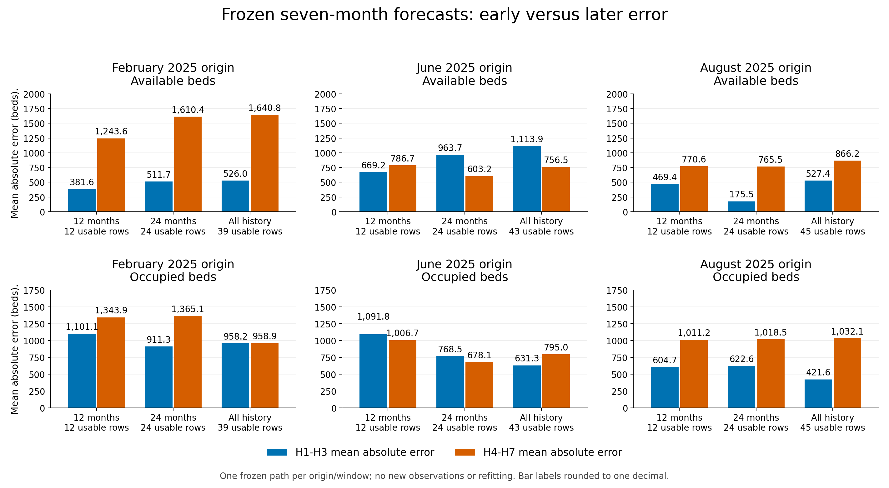
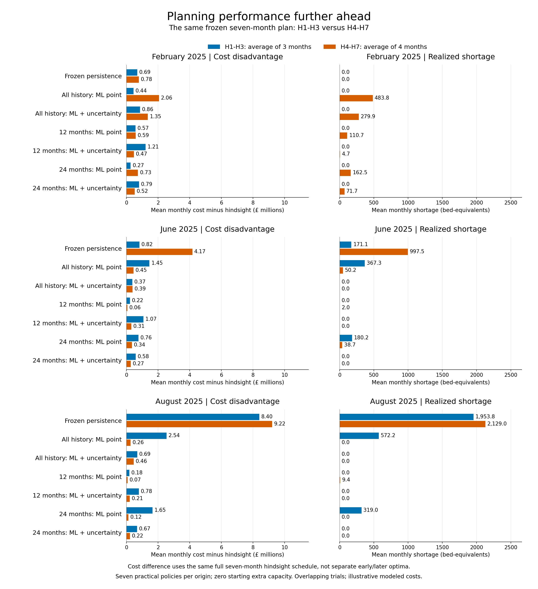
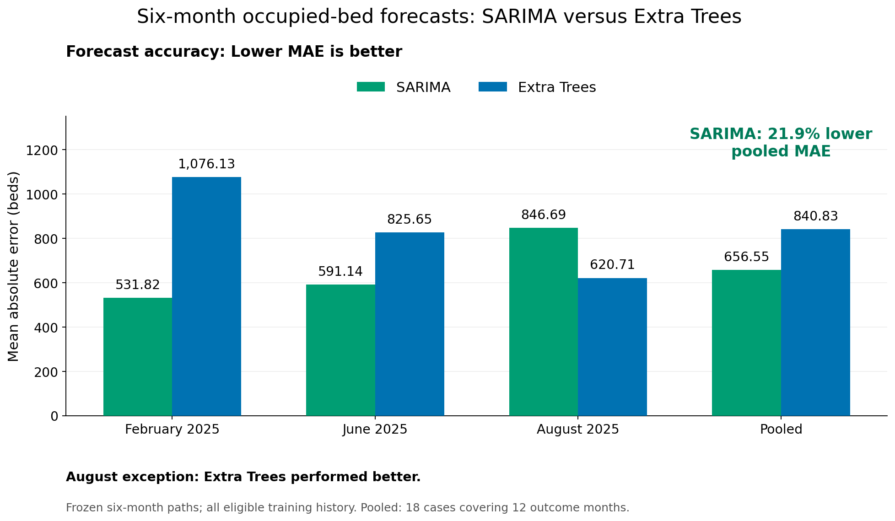
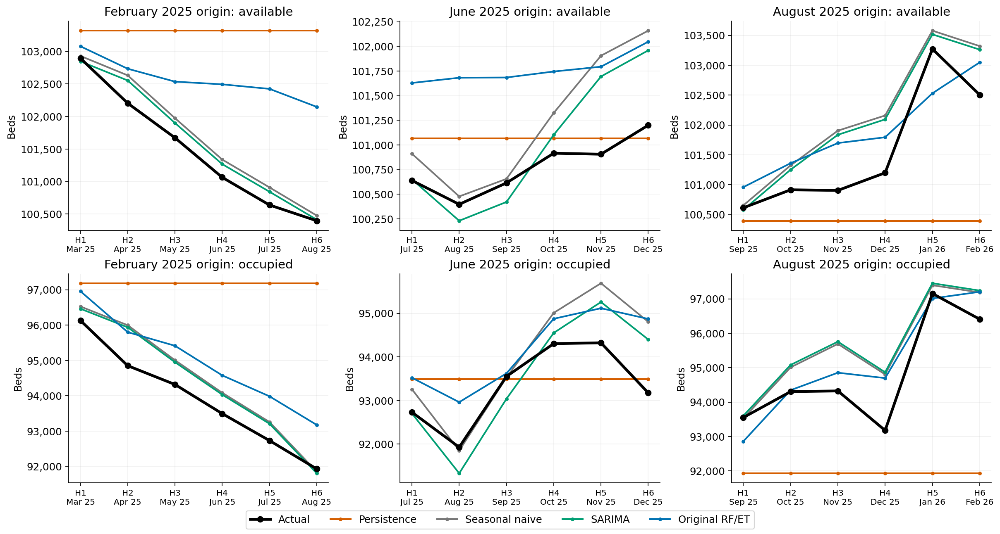
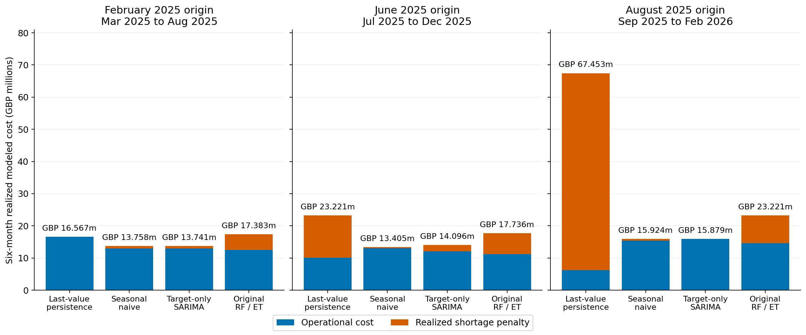

# NHS frozen forecast-to-capacity planning

Read `nhs_frozen_three_month_uncertainty_optimization.ipynb`. It is the only
notebook in this repository; saved execution outputs are included. Cells 45-47
show the three simple total-cost comparisons.

| Origin | Frozen planning months |
| --- | --- |
| August 2025 | September-November 2025 |
| November 2025 | December 2025-February 2026 |
| February 2026 | March-May 2026 |

Three policies: latest-value persistence with deterministic optimization; locked
Random Forest available-bed and Extra Trees occupied-bed points with deterministic
optimization; the same ML points with 13 equally weighted, centered historical
paired error paths and expected-cost stochastic optimization. All three monthly
decisions stay frozen within each block. Each policy carries its own capacity
state into the next block. No CQR or CVaR is used in this experiment.

The series has 66 monthly national all-acute aggregate observations, not daily,
provider-level or patient-level records. G&A means General and Acute beds,
excluding maternity and mental health. Only occupied and available beds enter
planning; the threshold requirement is occupied / 0.90.

## Forecast accuracy further ahead

A separate saved analysis from `nhs_frozen_seven_month_three_origins.ipynb`
(not included here) compares 12-month, 24-month and all-history training.
At each origin, we forecast the next seven months without admitting new actual
observations or refitting. H1-H3 and H4-H7 are portions of **one frozen forecast
path per training window**, not separate runs.

| Origin | Forecast months | Observed pattern |
| --- | --- | --- |
| February 2025 | March-September 2025 | Later errors increased in five of six target/window combinations; one stayed almost unchanged (+0.08%). |
| June 2025 | July 2025-January 2026 | Later errors increased in two combinations and decreased in four. |
| August 2025 | September 2025-March 2026 | Later errors increased in all six combinations. |

Later forecasts were generally less accurate in February and August, while June
was mixed. Errors fluctuated rather than increasing every month. These findings
concern individual bed forecasts; capacity-gap accuracy and planning costs are
evaluated separately.

Limitations: three overlapping historical trials; short-window fits are
exploratory; February/June use retrospectively selected models.

## Planning performance further ahead

Using the same saved seven-month analysis (cells 37-39), we evaluated frozen
capacity plans against actual bed outcomes. We compared monthly-average
shortages and cost disadvantage relative to the **full seven-month hindsight
benchmark** in H1-H3 versus H4-H7. These are portions of one plan, not separate
optimization runs. Worse later forecasts did not consistently produce worse
later planning.

| Origin | Later performance worsened | Improved | Mixed |
| --- | --- | --- | --- |
| February 2025 | 5 | 0 | 2 |
| June 2025 | 2 | 4 | 1 |
| August 2025 | 1 | 5 | 1 |

Counts cover **seven practical policies per origin**: persistence and point /
uncertainty planning for each of three training windows. Classification considers
shortages and disadvantage relative to hindsight, **not total expenditure alone**.
One worsening diagnostic with the other unchanged counts as worsened; opposing
changes are mixed.

- **February:** all ML plans developed later shortages; some scheduled capacity
  reductions went too far despite lower actual requirements.
- **June:** performance varied; several plans improved despite higher later
  requirements.
- **August:** all six ML plans had a smaller later cost disadvantage despite worse
  individual forecast accuracy. Persistence worsened; 12-month point planning
  had mixed results.

Uncertainty reduced later-period average monthly costs in **five of nine**
comparisons: all three windows in February and two in June, but none in August.
It cost more for all three windows in August's later period. This differs from
whole-plan results: early protection still made August's all-history and
24-month uncertainty plans cheaper overall.

These are overlapping historical trials with illustrative modeled costs, not
NHS cash savings. The result concerns **frozen-plan performance, not solver
failure**; an optimal plan for forecast inputs can perform poorly against actuals.

## Uncertainty and capacity optimization explained

The following two presentation cells describe the separate seven-month analysis
in `nhs_frozen_seven_month_three_origins.ipynb` (not included here), discussed
above. Its February, June, and August 2025 plans each start with zero additional
capacity and use 3, 7, and 9 historical error paths respectively. The included
three-month notebook instead uses 13 paths and carries capacity between blocks.

### How we represent uncertainty

We start with the ML forecasts of available and occupied beds.

- Look back at complete **seven-month forecast error paths** (actual minus predicted), using only outcomes known by that origin.
- Keep available/occupied errors paired and retain their month order.
- Subtract the average historical error separately for each bed series at each horizon, then add these centered paths to its ML forecast. The resulting possible futures average back to the original forecasts.
- Give every historical path equal weight. Verified paths per training window: **February 2025: 3; June 2025: 7; August 2025: 9** (weights 1/3, 1/7 and 1/9).

These are empirical scenarios, not guaranteed confidence intervals. February's three overlapping paths provide particularly limited evidence.

**The ML prediction stays the same; uncertainty lets the planner consider how that prediction could be wrong.**

#### Worked SAA example

**Hypothetical one-month example, starting with zero additional capacity.** SAA (sample average approximation) means choosing a plan using the average cost across scenarios.

The ML capacity-gap prediction is 10 beds. Centered historical errors of $-2$ and $+2$ give equally weighted gaps of 8 and 12; their average is still 10.
Opening and operating one extra bed costs **£1,050**: £500 active + £500 addition + £50 change. Each remaining shortage bed costs **£5,000**.

| Extra beds chosen | Opening + operating cost | Shortage penalty: gap 8 | Shortage penalty: gap 12 | Average total cost |
| --- | --- | --- | --- | --- |
| 8 | £8,400 | £0 | £20,000 | £18,400 |
| 10 | £10,500 | £0 | £10,000 | £15,500 |
| 12 | £12,600 | £0 | £0 | £12,600 |

$$\text{Average cost of choosing 10}=10{,}500+\frac{0+10{,}000}{2}=15{,}500.$$

**The point forecast chooses 10 beds. SAA chooses 12 here because £2,100 of additional capacity avoids £5,000 of average shortage penalties. The forecast average remains 10; the cost of being wrong changes the decision.**

**If the actual gap is only 8, the SAA plan costs £2,100 more than the point plan. This explains why uncertainty can help on average across scenarios but hurt in a particular outcome.**

Our real optimizer makes one shared seven-month schedule using complete historical error paths and the actual capacity constraints.

### How uncertainty enters the optimization

**We choose how much extra capacity to keep, add, or remove each month, balancing its cost against the penalty for being short.**

- $x_h$: active extra capacity.
- $a_h,r_h$: capacity added and removed.
- $s_{j,h},u_{j,h}$: shortage and unused capacity in scenario $j$.
- $p_j$: the scenario's assigned weight.
- $h$: planning month; $j$: possible future path.

$A_{j,h}$ and $O_{j,h}$ are available and occupied beds in that scenario. With costs in GBP:

$$\min \sum_h(500x_h+550a_h+300r_h)+5000\sum_jp_j\sum_hs_{j,h}.$$

$$A_{j,h}+x_h+s_{j,h}=O_{j,h}/0.90+u_{j,h},\qquad x_h=x_{h-1}+a_h-r_h.$$

**We choose one seven-month capacity schedule shared across all scenarios. Each scenario can produce a different shortage. The objective includes their weighted average shortage penalty. Extra protection is worthwhile only when the expected penalty reduction outweighs its capacity cost.**

All quantities are nonnegative; active extra capacity is capped at 15,000, additions/removals at 5,000 each per month, and each origin starts at $x_0=0$.
The 550 and 300 include the 50-per-bed change cost. Unused capacity has no separate penalty, but maintaining extra capacity still costs money.

**Future actual bed numbers are used afterward to score the frozen plan. All monetary costs and the 90% threshold are illustrative assumptions.**

## Six-month SARIMA forecasts and frozen capacity planning

We re-evaluated the original approach for a different task: forecasting **six months from one frozen information cutoff**. Each origin starts independently with **zero extra capacity**; all six forecasts and capacity decisions stay frozen. Actual bed outcomes score the plan afterward. This is separate from the three- and seven-month studies above.

| Last observed month | Frozen forecast / planning months |
| --- | --- |
| February 2025 | March-August 2025 |
| June 2025 | July-December 2025 |
| August 2025 | September 2025-February 2026 |

Target-only SARIMA was the **retrospectively observed pooled-MAE winner**: available beds **352.8 versus 426.6**, occupied beds **656.6 versus 694.4** for seasonal naive. It did not win every origin; earlier validation did not reliably identify subsequent winners.

Adding historical LOS7+/21+ counts at lags6/12 improved occupied-bed Extra Trees pooled MAE from **840.8 to 720.1**, still above seasonal naive's **694.4**. This does not establish that every other predictor is unhelpful.

### Occupied-bed forecast accuracy

SARIMA had lower occupied-bed MAE than target-only Extra Trees in February and June, and approximately 21.9% lower pooled MAE. Extra Trees performed better in August. These are retrospective frozen six-month comparisons.

This figure measures **forecast accuracy**, not optimization costs. The optimization figure's **Original RF/ET** label remains a two-model pair: Random Forest for available beds and Extra Trees for occupied beds. Pooled results cover 18 forecast cases across 12 distinct months.

### Did better forecasts make cheaper plans?

Same deterministic solver, 90% threshold, costs and limits for every policy. Original RF/ET means Random Forest for available beds and Extra Trees for occupied beds, not a newly chosen pair. Totals below are **realized modeled costs in GBP millions**, including operational costs and shortage penalties.

| Origin | Last-value persistence | Seasonal naive | SARIMA | Original RF/ET |
| --- | ---: | ---: | ---: | ---: |
| February 2025 | 16.567 | 13.758 | 13.741 | 17.383 |
| June 2025 | 23.221 | 13.405 | 14.096 | 17.736 |
| August 2025 | 67.453 | 15.924 | 15.879 | 23.221 |

SARIMA signed reduction = baseline cost minus SARIMA cost. **Negative means SARIMA cost more.**

| Origin | Versus last-value persistence | Versus seasonal naive |
| --- | ---: | ---: |
| February 2025 | GBP +2,826,042 (+17.06%) | GBP +17,202 (+0.13%) |
| June 2025 | GBP +9,125,463 (+39.30%) | GBP -690,393 (-5.15%) |
| August 2025 | GBP +51,573,818 (+76.46%) | GBP +44,995 (+0.28%) |

SARIMA cost less than persistence at **3/3 origins**, and less than seasonal naive at **2/3**. Individual-target MAE is not planning cost: the signed required-capacity gap is `occupied / 0.90 - available`. The two forecast errors can offset. Underestimating the gap can cause shortages costing GBP5,000 per deficit bed-month; overestimating it can buy unnecessary capacity. Monthly additions/removals and their timing also matter.

In June, SARIMA had lower adjusted-gap MAE (**309.68 versus 382.54 bed-equivalents**), yet cost **GBP 690,393 more**. Operating costs fell by GBP 1.067m, but shortage penalties rose by GBP 1.757m. July/September shortages outweighed the cheaper capacity schedule; a near-zero average gap error hid those underestimates.

Assumptions: GBP500 per active extra bed-month, GBP550 per added bed and GBP300 per removed bed (including change costs); extra capacity capped at 15,000, monthly additions/removals at 5,000 each. Costs and limits are illustrative, not NHS-validated.

[Full-precision costs and deficits](results/six_month_sarima_planning_costs.csv) | [Signed cost reductions](results/six_month_sarima_cost_reductions.csv) | [Saved forecast inputs and actuals](results/six_month_sarima_forecasts.csv) | [Forecasting summary](results/forecast_research_summary.csv).

Sources: saved scope-comparison, model-behaviour audit and occupied-predictor-ablation records. Nine matching deterministic plans were verified and reused; only three missing SARIMA plans were solved. No forecasts were refitted or selected for this update. These outcomes have been repeatedly inspected: **18 overlapping origin-horizon cases cover 12 distinct months**, not 18 independent months. Any cross-origin cost sum describes repeated hypothetical trials, not one continuous operating period. Historical publication timing/revisions remain unresolved. These are **illustrative modeled costs and reductions, not NHS cash savings**.
