## Forecast vs decision method: September 2025 origin

All forecasting methods use the same 24 months before the origin (October 2023 - September 2025) and forecast the next six months (October 2025 - March 2026). "Rule" opens exactly the extra capacity the forecast says is needed each month, ignoring costs. "LP" feeds the same forecast into a linear program that chooses monthly extra capacity to minimise running (500 per bed-month), opening (550), closing (300) and shortfall (5,000 per bed-month) costs, with capacity carrying over between months, at most 5,000 beds opened or closed per month, at most 15,000 in total, and zero starting capacity. SARIMA-full (trained on all history) is shown only as a reference.

### Forecasts by series

Seasonal naive and SARIMA-24 are shown against the actual values; all methods are in the table below.

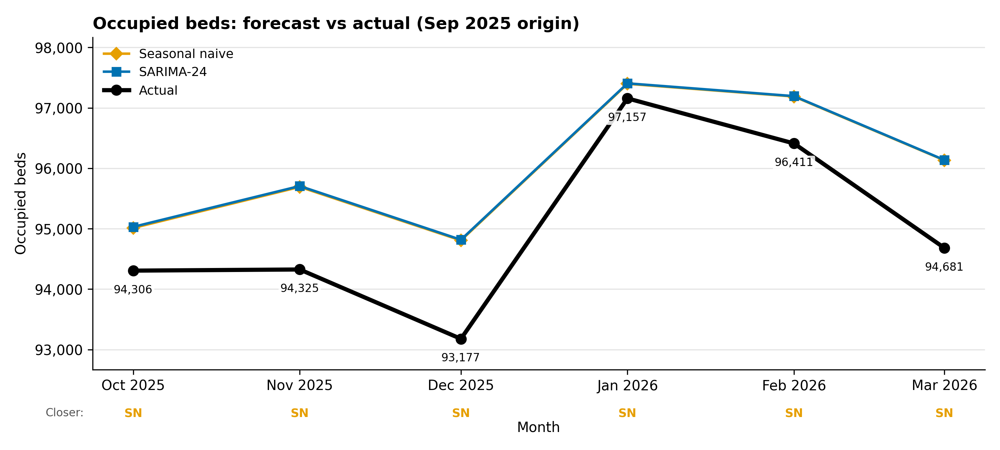

**Occupied beds:** Seasonal naive was closer in 6 of 6 months (MAE 1,028 vs 1,039). Best of all methods: ExtraTrees-24 (MAE 677).

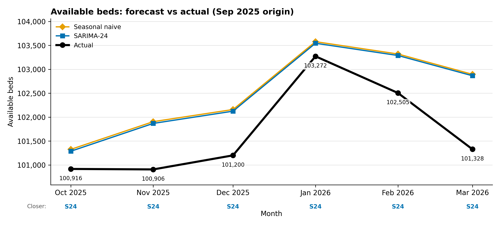

**Available beds:** SARIMA-24 was closer in 6 of 6 months (MAE 808 vs 842). Best of all methods: ExtraTrees-24 (MAE 764).

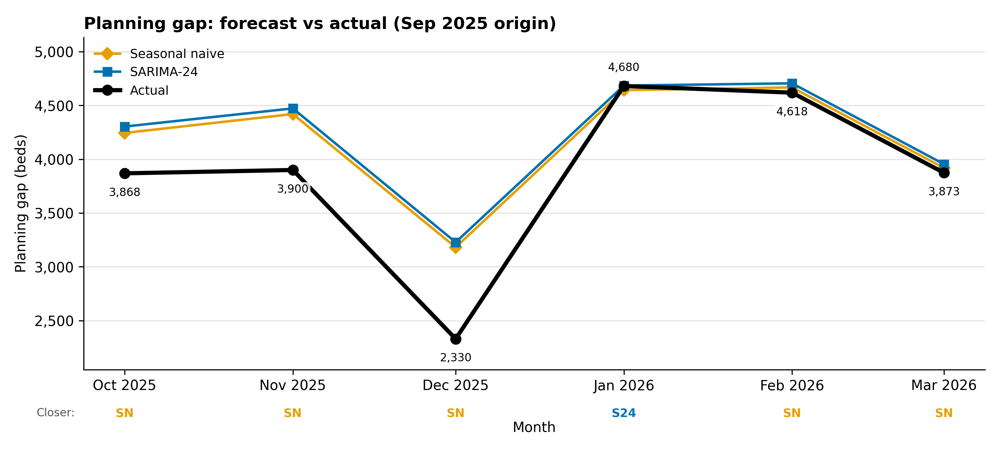

**Planning gap:** Seasonal naive was closer in 5 of 6 months; SARIMA-24 in 1 (January). Best of all methods: Seasonal naive (MAE 313).

### Why the gap is the forecast that matters

The planner never uses occupied or available beds on their own; it uses the gap, occupied / 0.90 - available. Errors in the two forecasts can cancel or add up: overestimating occupied beds raises the gap, while overestimating available beds lowers it. Seasonal naive and SARIMA-24 both overestimated occupied and available beds by similar amounts, so their errors largely cancelled and their gaps were close to the actual values. ExtraTrees-24 was the most accurate on both bed series, but it overestimated available beds by more than occupied beds in most months, so its gap came out too low and its plans ran short.

| Forecast | Training data | Decision | Gap MAE (beds) | Mean signed gap error (beds) | Operating cost | Shortfall cost | Total realised cost | Excess over hindsight |
| --- | --- | --- | ---: | ---: | ---: | ---: | ---: | ---: |
| Mean-24 | 24 months | Rule | 709 | 289 | 12.74 | 14.98 | 27.72 | 12.48 |
| Mean-24 | 24 months | LP | 709 | 289 | 12.74 | 14.98 | 27.72 | 12.48 |
| Persistence | 24 months | Rule | 880 | 545 | 11.83 | 21.38 | 33.21 | 17.97 |
| Persistence | 24 months | LP | 880 | 545 | 11.83 | 21.38 | 33.21 | 17.97 |
| Seasonal naive | 24 months | Rule | 313 | -300 | 16.38 | 0.19 | 16.57 | 1.33 |
| Seasonal naive | 24 months | LP | 313 | -300 | 15.95 | 0.19 | 16.14 | 0.90 |
| SARIMA-24 | 24 months | Rule | 346 | -346 | 16.54 | 0.00 | 16.54 | 1.31 |
| SARIMA-24 | 24 months | LP | 346 | -346 | 16.11 | 0.00 | 16.11 | 0.87 |
| ExtraTrees-24 | 24 months | Rule | 454 | 205 | 13.88 | 9.89 | 23.77 | 8.54 |
| ExtraTrees-24 | 24 months | LP | 454 | 205 | 13.77 | 9.89 | 23.66 | 8.42 |
| SARIMA-full | full history (reference) | LP | 356 | -356 | 16.15 | 0.00 | 16.15 | 0.91 |
| Hindsight | - | LP | - | - | 15.24 | 0.00 | 15.24 | 0.00 |

Costs in millions of model cost units. Mean signed gap error = actual - forecast.

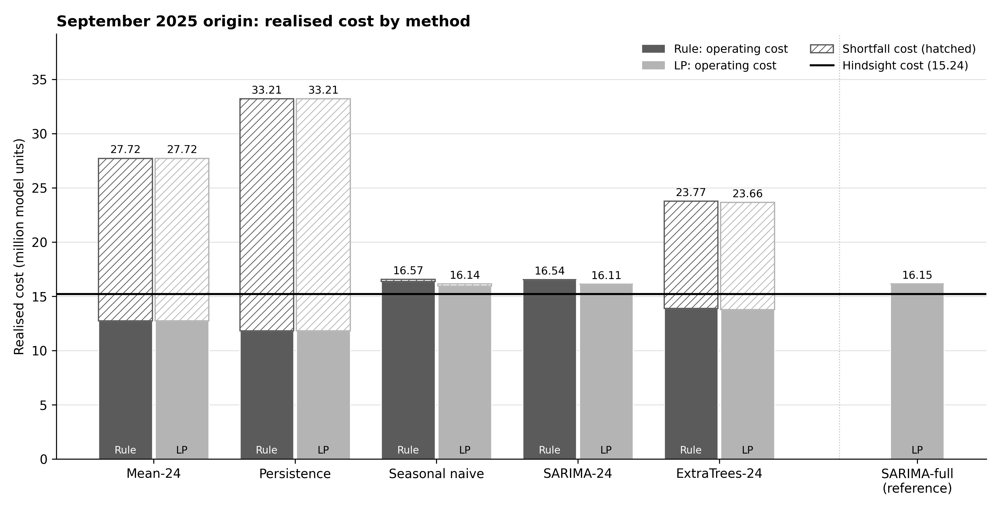

### Month by month: cost

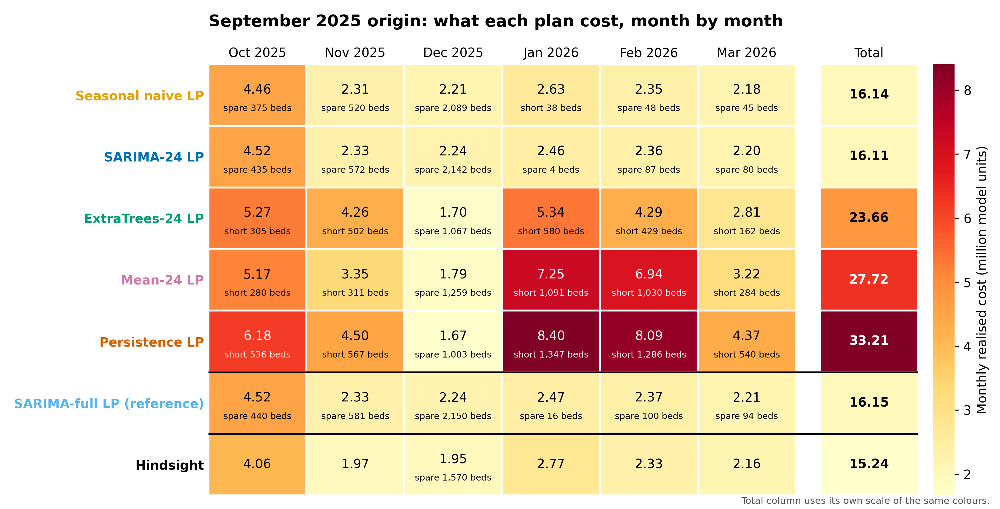

Monthly cost includes running, opening and closing beds plus the 5,000-per-bed shortfall penalty; 'short' and 'spare' show how far each plan was below or above the actual gap that month.

**Result.** Seasonal naive had the lowest gap MAE (313 beds), and SARIMA-24 LP had the lowest realised cost (16.11m, 0.87m above hindsight). SARIMA-24 LP, Seasonal naive LP and SARIMA-full LP were within 0.04m of one another. Rule and LP plans were identical for Mean-24 and Persistence, and LP was cheaper than Rule by 0.43m for Seasonal naive, 0.44m for SARIMA-24 and 0.11m for ExtraTrees-24 (differences computed before rounding). This is a single origin (one six-month window), SARIMA-24 and ExtraTrees-24 are fitted on only 24 months, and costs are illustrative model units (validated: False).

## Does more training data help? 24 vs 36 months vs full history (September 2025 origin)

SARIMA and ExtraTrees are retrained on 24 months, 36 months and all history before the origin, with unchanged specifications; Seasonal naive is the same in every case and serves as the benchmark.

| Model | Training window | Training rows / labels | Occupied MAE | Available MAE | Gap MAE | Gap months closer than SN | LP total cost | Shortfall cost | Excess over hindsight |
| --- | --- | --- | ---: | ---: | ---: | ---: | ---: | ---: | ---: |
| Seasonal naive | same month one year earlier | - | 1,028 | 842 | 313 | - | 16.14 | 0.19 | 0.90 |
| SARIMA-24 | Oct 2023 - Sep 2025 | 24 labels | 1,039 | 808 | 346 | 1 of 6 | 16.11 | 0.00 | 0.87 |
| SARIMA-36 | Oct 2022 - Sep 2025 | 36 labels | 1,037 | 815 | 339 | 1 of 6 | 16.11 | 0.03 | 0.87 |
| SARIMA-full | Dec 2020 - Sep 2025 | 58 labels | 1,050 | 805 | 362 | 1 of 6 | 16.17 | 0.00 | 0.93 |
| ExtraTrees-24 | Oct 2023 - Sep 2025 | 12 rows | 677 | 764 | 454 | 3 of 6 | 23.66 | 9.89 | 8.42 |
| ExtraTrees-36 | Oct 2022 - Sep 2025 | 24 rows | 834 | 688 | 272 | 3 of 6 | 16.00 | 0.50 | 0.76 |
| ExtraTrees-full | Dec 2020 - Sep 2025 | 46 rows | 889 | 792 | 272 | 3 of 6 | 16.73 | 1.49 | 1.49 |
| Hindsight | - | - | - | - | - | - | 15.24 | 0.00 | 0.00 |

Costs in millions of model cost units. SARIMA-full here fits all 58 months as labels, so it differs from the SARIMA-full reference in the section above (46 labels).

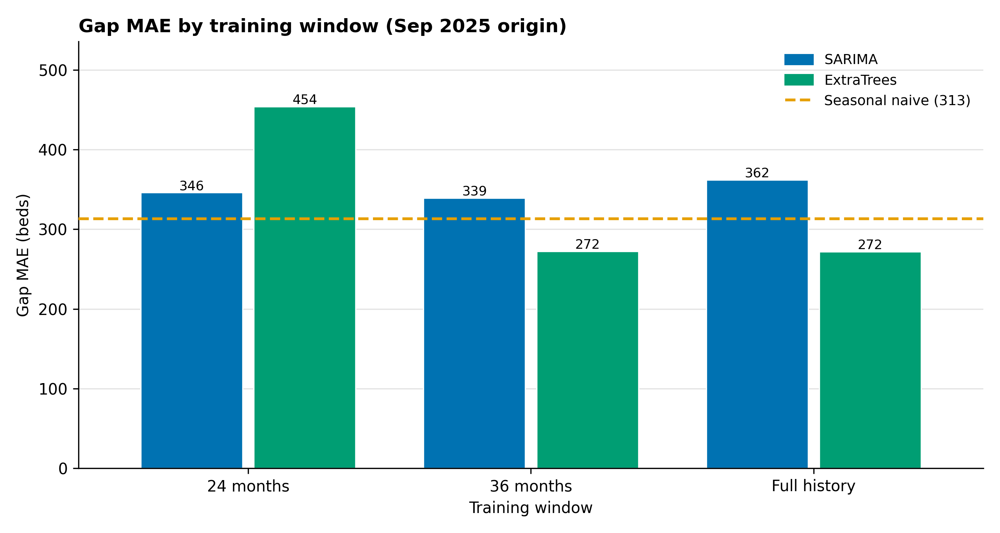

ExtraTrees-full (271.8) and ExtraTrees-36 (272.5) had the lowest gap MAEs; all three SARIMA variants (339-362) were above Seasonal naive (313).

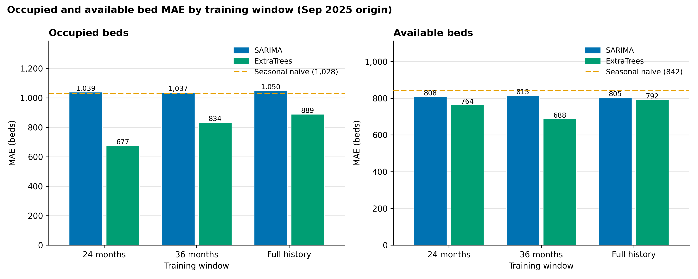

ExtraTrees-24 had the lowest occupied-bed MAE (677) and ExtraTrees-36 the lowest available-bed MAE (688); every SARIMA variant was above Seasonal naive on occupied beds and below it on available beds.

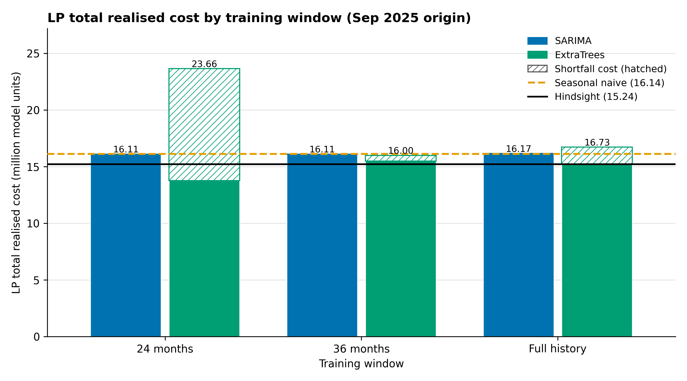

ExtraTrees-36 LP had the lowest total realised cost (16.00m), followed by SARIMA-36 LP and SARIMA-24 LP (both 16.11m); Seasonal naive LP cost 16.14m and Hindsight 15.24m.

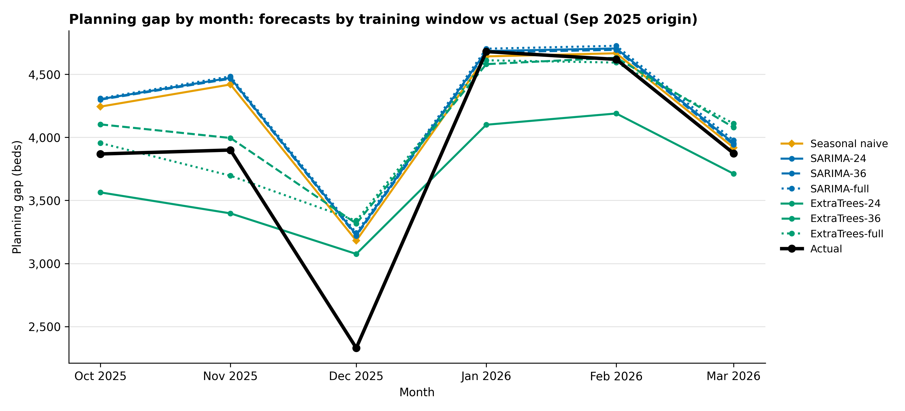

ExtraTrees-24 gave the lowest gap forecast in every month, and every forecast was above the actual gap in December 2025.

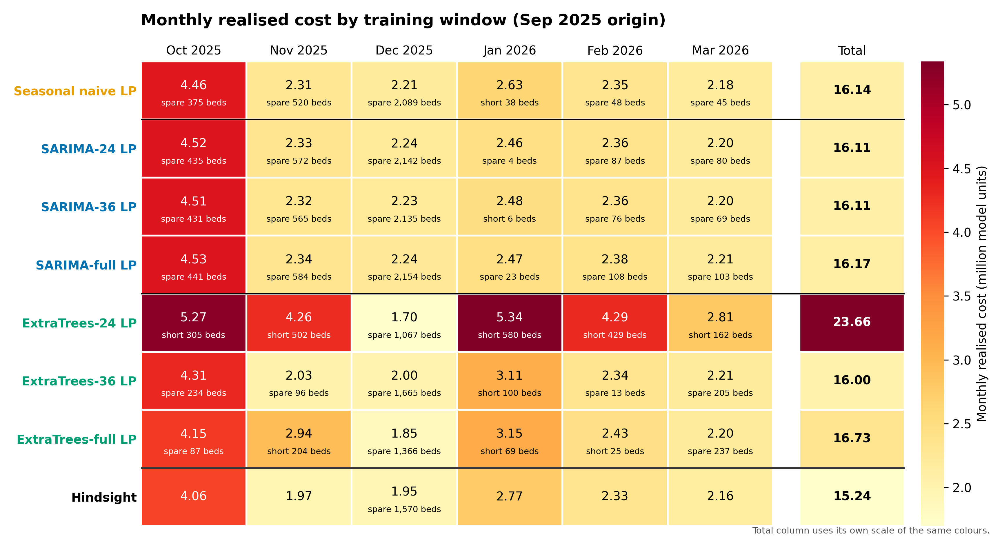

ExtraTrees-24 LP was short in 5 of 6 months, ExtraTrees-full LP in 3, ExtraTrees-36 LP, SARIMA-36 LP and Seasonal naive LP in 1 (January 2026), and SARIMA-24 LP and SARIMA-full LP in none.

**Result.** For SARIMA, more data did not consistently lower gap MAE or cost (gap MAE 346, 339, 362 and LP cost 16.11m, 16.11m, 16.17m for 24 months, 36 months and full history); for ExtraTrees, moving from 24 to 36 months lowered gap MAE from 454 to 272 and LP cost from 23.66m to 16.00m, while full history gave a gap MAE of 272 and an LP cost of 16.73m. ExtraTrees-36 and ExtraTrees-full beat Seasonal naive on gap MAE (313), and ExtraTrees-36, SARIMA-36 and SARIMA-24 beat it on LP cost (16.14m), by at most 0.14m. This is a single origin (one six-month window); costs are illustrative model units (validated: False).

## ExtraTrees-36 vs Seasonal naive across 12 origins

The 36-month window for ExtraTrees was chosen at the September 2025 origin, so this tests it at every v6 origin (April 2025 - March 2026) with the design, endpoints and tie rules fixed in advance (config SHA-256 `915d7416c07723b590e06c8ae32266bb2402f1175670bb4c560b956b5f181ce4`). Each origin forecasts the following six months and plans with the LP; "win" means ExtraTrees-36 beat Seasonal naive by more than 5 beds of gap MAE, or by more than 1% of that origin's hindsight cost, and "tie" means within that margin.

| Origin | Gap MAE: SN / ET-36 / SARIMA-24 / SARIMA-36 | LP cost: SN / ET-36 / SARIMA-24 / SARIMA-36 | Hindsight | ET-36 vs SN (gap) | ET-36 vs SN (cost) |
| --- | ---: | ---: | ---: | :---: | :---: |
| Apr 2025 | 295 / 381 / 213 / 168 | 13.28 / 14.27 / 14.49 / 12.66 | 11.72 | loss | loss |
| May 2025 | 304 / 308 / 248 / 267 | 13.46 / 15.40 / 13.29 / 13.09 | 11.86 | tie | loss |
| Jun 2025 | 383 / 449 / 350 / 388 | 13.41 / 15.47 / 13.71 / 13.42 | 11.73 | loss | loss |
| Jul 2025 | 337 / 481 / 372 / 385 | 15.21 / 18.87 / 16.64 / 16.23 | 13.29 | loss | loss |
| Aug 2025 | 317 / 389 / 381 / 366 | 15.92 / 20.40 / 15.74 / 15.68 | 14.74 | loss | loss |
| Sep 2025 (selection origin) | 313 / 272 / 346 / 339 | 16.14 / 16.00 / 16.11 / 16.11 | 15.24 | win | tie |
| Oct 2025 | 309 / 274 / - / 263 | 17.60 / 17.14 / - / 16.98 | 15.17 | win | win |
| Nov 2025 | 298 / 358 / 309 / 219 | 18.60 / 17.70 / 20.63 / 16.67 | 14.23 | loss | win |
| Dec 2025 | 269 / 286 / 787 / 459 | 21.89 / 21.67 / 35.82 / 26.86 | 14.84 | loss | win |
| Jan 2026 | 410 / 452 / - / 347 | 25.13 / 25.68 / - / 22.75 | 14.15 | loss | loss |
| Feb 2026 | 546 / 517 / 479 / 321 | 27.57 / 26.07 / 25.63 / 21.07 | 12.72 | win | win |
| Mar 2026 | 577 / 522 / 350 / 384 | 25.19 / 25.29 / 19.21 / 19.98 | 12.58 | win | tie |
| **Mean, all 12** | 363 / 391 / 383 / 325 | 18.62 / 19.50 / 19.13 / 17.62 | 13.52 | | |
| **Mean, excluding Sep 2025** | 368 / 402 / 387 / 324 | 18.84 / 19.82 / 19.46 / 17.76 | 13.37 | | |
| **Win / tie / loss, all 12** | | | | 4 / 1 / 7 | 4 / 2 / 6 |
| **Win / tie / loss, excluding Sep 2025** | | | | 3 / 1 / 7 | 4 / 1 / 6 |

Costs in millions of model cost units. SARIMA-24 did not converge at the October 2025 and January 2026 origins and is excluded there (pre-registered rule), so its means cover 10 origins; every ExtraTrees-36 fit had 24 training rows per target.

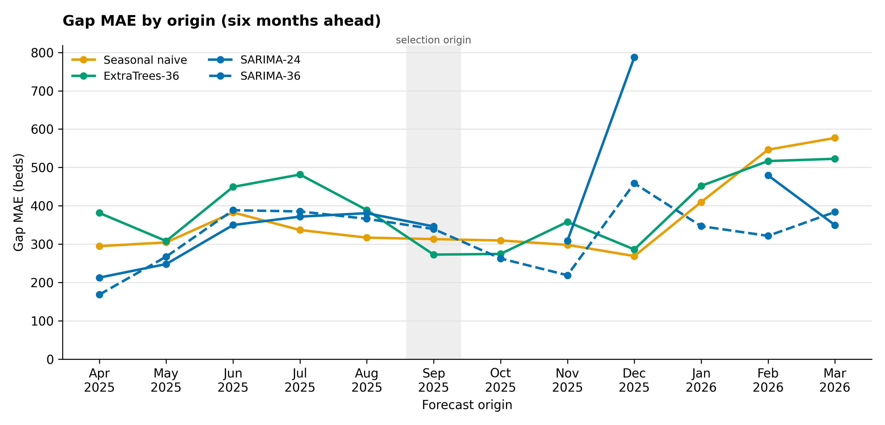

ExtraTrees-36 had a lower gap MAE than Seasonal naive at 4 of 12 origins (Sep 2025, Oct 2025, Feb 2026, Mar 2026); SARIMA-36 had the lowest gap MAE of the four models at 5 origins.

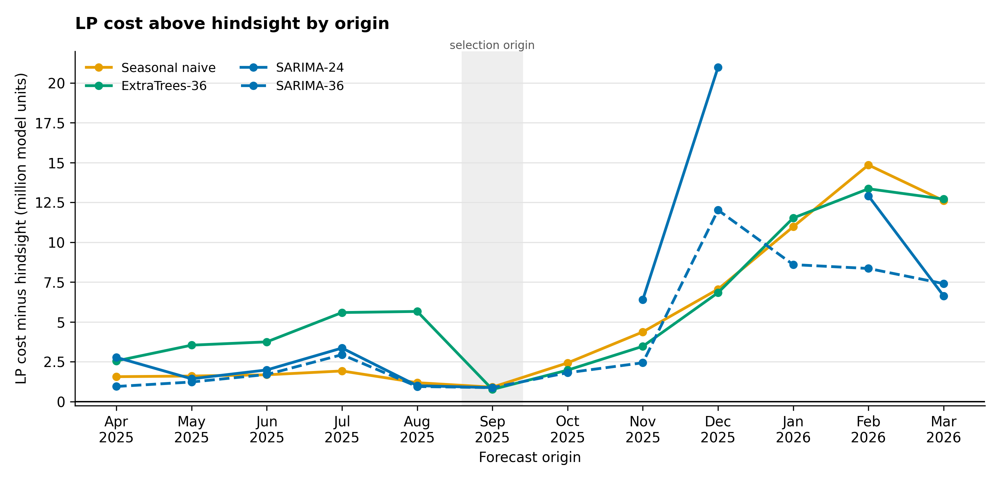

SARIMA-36 had the lowest mean excess over hindsight (4.10m, against 5.09m for Seasonal naive and 5.97m for ExtraTrees-36), and SARIMA-24 had the largest single excess (20.98m, December 2025).

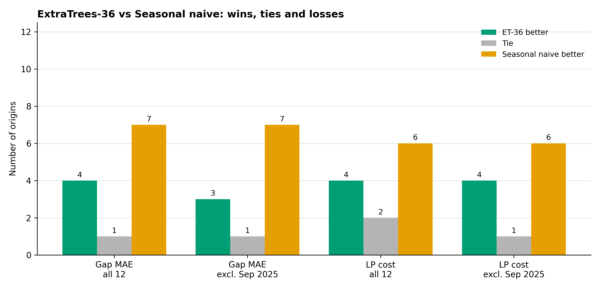

ExtraTrees-36 lost to Seasonal naive more often than it won on both gap MAE and LP cost, with and without the selection origin.

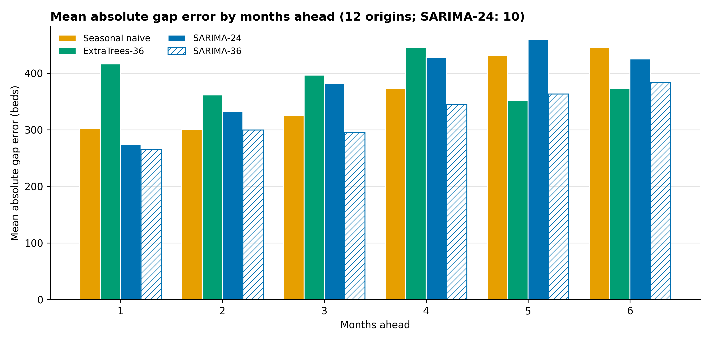

SARIMA-36 had the lowest mean absolute gap error at 1-4 months ahead and ExtraTrees-36 at 5-6 months ahead; ExtraTrees-36 had the highest at 1-4 months ahead.

**Result.** The pre-stated hypothesis did not hold, for all 12 origins or for the 11 excluding September 2025: ExtraTrees-36 vs Seasonal naive was 4 wins / 1 tie / 7 losses on gap MAE and 4 / 2 / 6 on LP cost (3 / 1 / 7 and 4 / 1 / 6 excluding September 2025). Across the six non-overlapping subsets of two origins, ExtraTrees-36 won 0 to 2 on gap MAE and 0 to 1 on cost. Mean LP cost over the 12 origins was 18.62m for Seasonal naive, 19.50m for ExtraTrees-36, 17.62m for SARIMA-36 and 19.13m for SARIMA-24 (10 origins), against 13.52m in hindsight. Neighbouring origins share up to five target months, so origins are not independent; costs are illustrative model units (validated: False).
