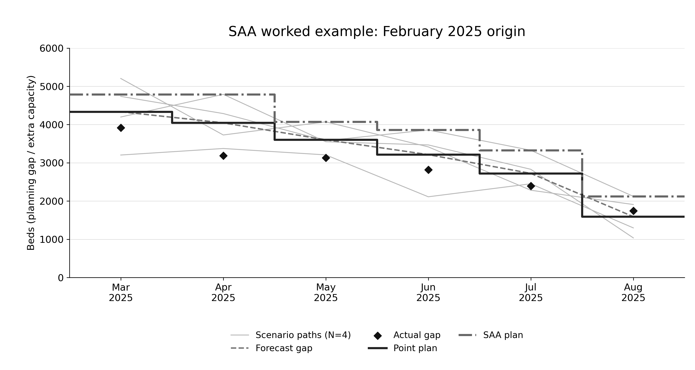

## SARIMA forecast performance

SARIMA is fitted separately to occupied and available beds at each origin using all eligible data available up to that origin, and forecasts six months ahead. MAE is the mean absolute difference between actual and forecast beds, reported for months 1-3 and 4-6. Actuals are from the NHS England publication dated 8 October 2026.

| Origin | Forecast months | Occupied MAE H1-H3 (beds) | Occupied MAE H4-H6 (beds) | Available MAE H1-H3 (beds) | Available MAE H4-H6 (beds) |
| --- | --- | ---: | ---: | ---: | ---: |
| Feb 2025 | Mar 2025-Aug 2025 | 683.7 | 379.9 | 208.0 | 141.6 |
| Jun 2025 | Jul 2025-Dec 2025 | 380.2 | 802.1 | 123.6 | 578.0 |
| Aug 2025 | Sep 2025-Feb 2026 | 752.9 | 940.5 | 434.1 | 631.3 |
| Feb 2026 | Mar 2026-Aug 2026 | 366.4 | 792.6 | 686.0 | 149.9 |
| Mar 2026 | Apr 2026-Sep 2026 | 731.3 | 1,183.3 | 313.9 | 696.3 |


## Capacity planning optimisation

At each origin, the next six months of forecasts are converted into a planning gap, and a linear program chooses how much extra capacity to operate in each month. The whole six-month schedule is fixed at the origin and is not revised as months occur. The objective balances running, opening and closing costs against a penalty for falling short of the occupancy-based planning requirement. Costs are illustrative model units (**validated: False**), not NHS cash values.

### Planning gap

```text
d_t = O_t / 0.90 - A_t
```

O_t is occupied beds, A_t is available beds, and tau = 0.90 is the planning occupancy threshold. Positive d_t is the extra capacity needed to keep occupancy at or below 90%, while negative d_t indicates baseline headroom; this is a planning target, not a count of patients denied care.

The gap follows the occupied/rho and capacity-balance calculation in [optimization_evaluation.py:577-581](optimization_evaluation.py#L577-L581). The six-month horizon, 0.90 threshold and zero starting capacity are the study settings recorded in local `sarima_six_month_saa_comparison.py:55-56,212-213,257-258`; the generic solver receives these as inputs. Code links below use the repository's line numbers.

### Decision variables

| Variable | Meaning | Unit |
| --- | --- | --- |
| x_t | Extra capacity active in month t ([code:553-558](optimization_evaluation.py#L553-L558)) | beds |
| a_t | Extra capacity added in month t ([code:559-564](optimization_evaluation.py#L559-L564)) | beds |
| r_t | Extra capacity removed in month t ([code:565-570](optimization_evaluation.py#L565-L570)) | beds |
| s_t | Shortfall against the planning requirement ([code:571](optimization_evaluation.py#L571)) | beds |
| u_t | Capacity above the planning requirement ([code:572](optimization_evaluation.py#L572)) | beds |

All variables are continuous: fractional bed-equivalents are allowed. These declarations use PuLP's default continuous category, not integer variables.

### Parameters

| Symbol | Value | Meaning |
| --- | ---: | --- |
| c | 500 | Running cost per bed-month ([code:97](optimization_evaluation.py#L97)) |
| a+ | 550 | Cost per bed added: 500 activation + 50 change charge ([code:98-101](optimization_evaluation.py#L98-L101), [585-587](optimization_evaluation.py#L585-L587)) |
| a- | 300 | Cost per bed removed: 250 removal + 50 change charge ([code:99-101](optimization_evaluation.py#L99-L101), [586-587](optimization_evaluation.py#L586-L587)) |
| p | 5,000 | Penalty per bed-month of shortfall ([code:100](optimization_evaluation.py#L100)) |
| R+ | 5,000 | Maximum additions per month ([code:103](optimization_evaluation.py#L103)) |
| R- | 5,000 | Maximum removals per month ([code:104](optimization_evaluation.py#L104)) |
| X | 15,000 | Maximum extra capacity ([code:102](optimization_evaluation.py#L102)) |
| x_0 | 0 | Extra capacity at the origin ([code:524](optimization_evaluation.py#L524)); fixed to zero in this study |

The cost parameters are explicitly unvalidated ([optimization_evaluation.py:106](optimization_evaluation.py#L106)).

### Objective

```text
min sum_{t=1..6} (500 x_t + 550 a_t + 300 r_t + 5000 s_t)
```

The 500 x_t term pays to run active extra capacity each month ([code:584](optimization_evaluation.py#L584)).
The 550 a_t term pays for additions, including the change charge ([code:585-587](optimization_evaluation.py#L585-L587)).
The 300 r_t term pays for removals, including the change charge ([code:586-587](optimization_evaluation.py#L586-L587)).
The 5000 s_t term penalises shortfall each month; baseline shortfall multipliers are one ([code:535-538](optimization_evaluation.py#L535-L538), [588](optimization_evaluation.py#L588)).

### Constraints

```text
x_t + s_t - u_t = d_t
```

Shortfall or surplus accounts for the difference between extra capacity and the planning gap ([optimization_evaluation.py:577-581](optimization_evaluation.py#L577-L581)).

```text
x_t = x_{t-1} + a_t - r_t
```

Capacity carries over between months, and changing it requires additions or removals ([optimization_evaluation.py:575-576](optimization_evaluation.py#L575-L576)).

```text
0 <= x_t <= 15000
```

Active extra capacity cannot be negative or exceed 15,000 beds ([optimization_evaluation.py:554-555](optimization_evaluation.py#L554-L555)).

```text
0 <= a_t <= 5000,  0 <= r_t <= 5000
```

At most 5,000 beds can be added and at most 5,000 removed in any month ([optimization_evaluation.py:560-567](optimization_evaluation.py#L560-L567)).

```text
s_t, u_t >= 0,  x_0 = 0
```

Shortfall and surplus are nonnegative, and the study starts with no extra capacity ([optimization_evaluation.py:571-572](optimization_evaluation.py#L571-L572), [524](optimization_evaluation.py#L524)).

### Modelling assumptions

- All six months of capacity decisions are made once at the origin: no adaptive capacity-decision recourse; SAA has scenario-specific shortfall/surplus accounting ([code:715-756](optimization_evaluation.py#L715-L756)).
- There is no terminal charge for capacity left open after month six ([objective:583-590](optimization_evaluation.py#L583-L590)); there is no requirement to close it.
- Surplus u_t has no separate penalty; any extra capacity kept active still incurs its running cost ([objective:583-590](optimization_evaluation.py#L583-L590)).
- The baseline is risk-neutral: minimise total cost, or average cost with scenarios, with CVaR disabled ([code:685](optimization_evaluation.py#L685), [758-778](optimization_evaluation.py#L758-L778)).
- Point planning uses one forecast path; SAA extends the same program to several scenarios with one shared capacity schedule ([code:715-756](optimization_evaluation.py#L715-L756), [772-776](optimization_evaluation.py#L772-L776)).

The next section shows how SAA replaces the single forecast gap with several scenario gaps while keeping one shared capacity plan.

## Uncertainty-aware planning (SAA)

The point planner optimises against a single forecast path. Sample Average Approximation (SAA) instead builds **N = 4 equally weighted possible futures** by adding centred historical SARIMA forecast errors to the current forecast, then chooses one six-month capacity plan minimising average cost across those futures. Capacity, additions and removals are shared by all scenarios; shortfall and unused capacity can differ. The point plan is the special case with one scenario equal to the forecast.

### Step 1 - The point forecast

February 2025 origin; March-August 2025 stay frozen. Gap = occupied / 0.90 - available; tables show whole beds here and in Step 7, with unrounded values used in calculations.

| Month | h | Forecast occupied | Forecast available | Forecast gap |
| --- | --- | --- | --- | --- |
| Mar 2025 | 1 | 96,465 | 102,848 | 4,336 |
| Apr 2025 | 2 | 95,939 | 102,554 | 4,045 |
| May 2025 | 3 | 94,952 | 101,901 | 3,602 |
| Jun 2025 | 4 | 94,034 | 101,269 | 3,214 |
| Jul 2025 | 5 | 93,210 | 100,844 | 2,723 |
| Aug 2025 | 6 | 91,805 | 100,415 | 1,591 |

### Step 2 - Where the past mistakes come from

At each earlier backtest origin, the saved SARIMA fit uses only history ending there and predicts six months; mistake = NHS actual minus forecast, retaining occupied/available pairing and month order. The archived pool admits complete paths ending by February 2025 (30-33 fitting labels); historical publication availability was not verified, so this is an outcome-month cutoff, not a release-time guarantee.

For March's H1 scenario, each path contributes its own first historical forecast month; O = occupied and A = available. The original May 2026 workbook snapshot supplies these historical actuals.

| Backtest origin | Historical target month (H1) | SARIMA forecast | NHS actual | Raw gap mistake |
| --- | --- | --- | --- | --- |
| May 2024 | Jun 2024 | O: 94,538.30<br>A: 101,699.88<br>gap: 3,342.67 | O: 94,086.00<br>A: 101,339.00<br>gap: 3,201.00 | -141.67 |
| Jun 2024 | Jul 2024 | O: 91,998.72<br>A: 100,377.27<br>gap: 1,843.53 | O: 93,259.00<br>A: 100,911.00<br>gap: 2,710.11 | 866.59 |
| Jul 2024 | Aug 2024 | O: 93,119.91<br>A: 100,752.22<br>gap: 2,714.35 | O: 91,851.00<br>A: 100,478.00<br>gap: 1,578.67 | -1,135.68 |
| Aug 2024 | Sep 2024 | O: 92,932.52<br>A: 100,391.66<br>gap: 2,866.70 | O: 93,529.00<br>A: 100,656.00<br>gap: 3,265.11 | 398.42 |
| Mean raw mistake | - | - | - | -3.09 |

The May 2024 path's arithmetic (full-precision inputs; results shown to six decimals):

```text
forecast gap = 94538.29759531304 / 0.90 - 101699.88249385744 = 3342.670390
actual gap   = 94086.0 / 0.90 - 101339.0 = 3201.000000
raw mistake = actual gap - forecast gap = -141.670390
```

### Step 3 - Centring

Mean raw gap mistakes, in bed-equivalents: **H1: -3.09, H2: -6.00, H3: -386.00, H4: -271.06, H5: -265.58, H6: -230.32**. The existing generator subtracts the historical mean separately for occupied and available beds at each horizon; combining those centred errors gives zero-mean gap mistakes.

Centred March gap mistakes: **May 2024: -138.58; Jun 2024: 869.67; Jul 2024: -1,132.59; Aug 2024: 401.50**.

### Step 4 - The scenarios

For each path and month: scenario O = forecast O + centred O mistake; scenario A = forecast A + centred A mistake; scenario gap = scenario O / 0.90 - scenario A. Equivalently, scenario gap = forecast gap + centred gap mistake; each complete path has weight **1/4 = 0.25**. Values below are bed-equivalents; the unrounded averages equal the point gaps within **1e-6** at every horizon.

| Scenario | Mar 2025 | Apr 2025 | May 2025 | Jun 2025 | Jul 2025 | Aug 2025 |
| --- | --- | --- | --- | --- | --- | --- |
| May 2024 path | 4,197.41 | 4,790.76 | 3,551.01 | 3,467.62 | 2,830.08 | 1,036.16 |
| Jun 2024 path | 5,205.66 | 3,727.61 | 4,072.14 | 3,416.27 | 2,282.31 | 1,909.03 |
| Jul 2024 path | 3,203.40 | 3,374.32 | 3,206.90 | 2,111.21 | 2,450.83 | 1,297.45 |
| Aug 2024 path | 4,737.49 | 4,287.90 | 3,578.09 | 3,859.08 | 3,327.06 | 2,121.38 |
| Average | 4,335.99 | 4,045.15 | 3,602.03 | 3,213.54 | 2,722.57 | 1,591.01 |

### Step 5 - The optimisation

This is the program from 'Capacity planning optimisation', with the shortfall term averaged over N scenarios.

```text
min  sum_t (500 x_t + 550 a_t + 300 r_t)
     + 5000 (1/N) sum_s sum_t s_{s,t}
s.t. x_t + s_{s,t} - u_{s,t} = d_{s,t}  for every scenario s and month t
     x_t = x_{t-1} + a_t - r_t;  x_0 = 0
     0 <= x_t <= 15000;  0 <= a_t, r_t <= 5000;  s_{s,t}, u_{s,t} >= 0
```

Here x is active extra capacity, a/r are additions/removals, s/u are shortfall/unused capacity, and d is the scenario gap; addition/removal coefficients include the archived 50-unit change charge, with no terminal charge and CVaR disabled. The point planner solves the same program with one scenario, d_hat.

### Step 6 - Simplified intuition for one month

Ignoring inter-month links and bounds for this marginal illustration, an extra March bed costs **550 + 500 = 1,050**, while a missing bed costs **5,000**: add a bed while 5,000 x the share of scenarios needing it exceeds 1,050. The four March scenario gaps, sorted, are **3,203.40, 4,197.41, 4,737.49, 5,205.66**; even one remaining scenario gives **5,000 / 4 = 1,250 > 1,050**, so the unconstrained calculation picks **5,205.66 bed-equivalents (5,206 whole beds)**. That exceeds the actual first-month opening limit of 5,000; the actual solver can choose differently because transition costs and ramps link the months.

### Step 7 - The resulting plans

| Frozen plan / input | Mar 2025 | Apr 2025 | May 2025 | Jun 2025 | Jul 2025 | Aug 2025 |
| --- | --- | --- | --- | --- | --- | --- |
| Forecast gap | 4,336 | 4,045 | 3,602 | 3,214 | 2,723 | 1,591 |
| Point plan x_t | 4,336 | 4,045 | 3,602 | 3,214 | 2,723 | 1,591 |
| SAA plan x_t | 4,791 | 4,791 | 4,072 | 3,859 | 3,327 | 2,121 |



### Step 8 - How a plan is scored

After the months occur, each plan stays fixed and actual gaps are substituted into the same cost accounting. Hindsight is the same full six-month program solved with actual gaps, under identical costs, bounds and zero starting capacity.

```text
realised cost = sum_t (500 x_t + 550 a_t + 300 r_t)
                + 5000 sum_t max(0, actual_gap_t - x_t)
```

Monetary columns are **millions of illustrative model cost units (validated: False)**, not NHS cash savings; shortfall remains in bed-months. Operating cost includes running, opening and closing. This is realised cost, not the optimizer's expected scenario objective.

| Plan | Operating cost (million) | Realised shortfall (bed-months) | Shortfall cost (million) | Total realised cost (million) | Excess over hindsight (million) |
| --- | --- | --- | --- | --- | --- |
| Point | 12.96 | 155.44 | 0.78 | 13.74 | 2.34 |
| SAA | 14.92 | 0.00 | 0.00 | 14.92 | 3.51 |
| Hindsight | 11.40 | 0.00 | 0.00 | 11.40 | 0.00 |

Numerical convention: the archived scorer sets shortfalls below 0.001 bed to zero. For hindsight this removes approximately 0.777778 model cost units attributable to rounded solver decisions; the table retains the saved scores exactly, rather than silently changing this convention.

Source records (local, not added to the repository): `outputs/frozen_six_month_sarima_saa_comparison/calibration_errors.csv`, `centered_scenarios.csv`, `calibration_fit_audit.csv`, `scenario_mean_checks.csv`, `frozen_decisions.csv`, `realized_monthly_results.csv`, `policy_comparison.csv` and `experiment_design.json`; `outputs/six_month_sarima_frozen_planning_publication/six_month_sarima_forecasts.csv` and `frozen_decisions.csv`; `outputs/frozen_six_month_method_window_saa_comparison/frozen_decisions.csv`, `realized_monthly_results.csv` and `realized_policy_summary.csv`. Cached historical fits and the saved E0 reproduction decisions independently corroborate the inputs and plans. Gaps, means, centring identities and cost accounting are arithmetic checks on saved values; no forecasts, scenario banks, plans or scores are regenerated.
