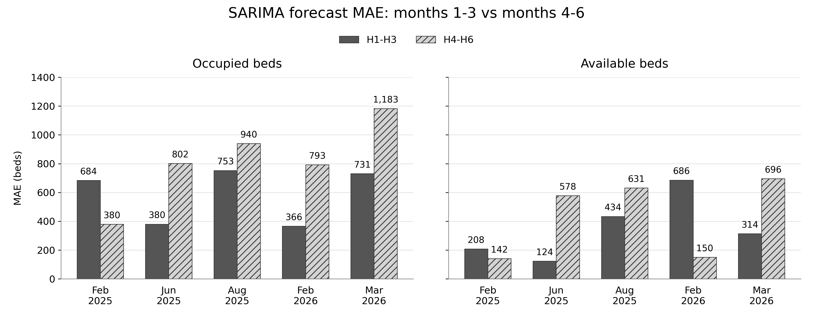
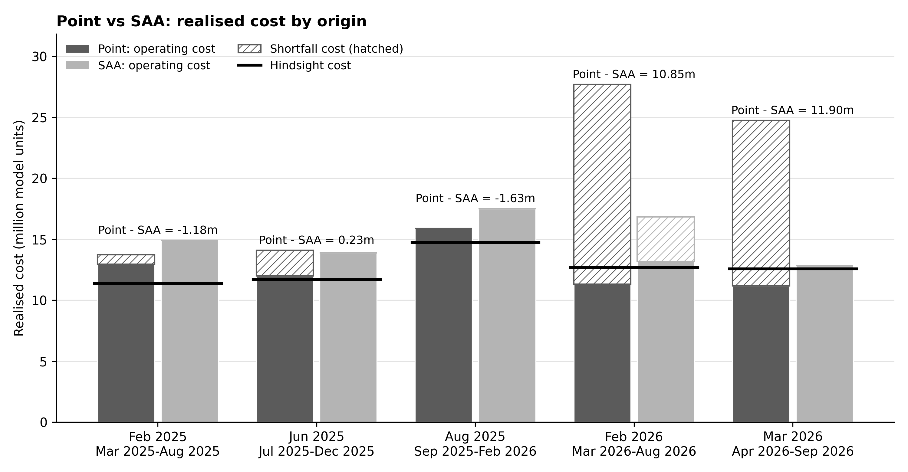
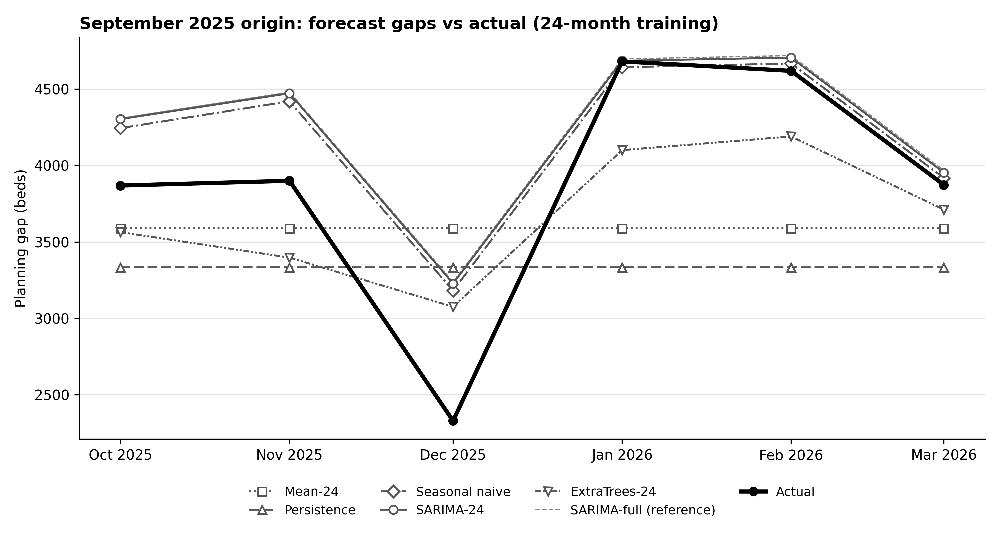

## SARIMA forecast performance

SARIMA is fitted separately to occupied and available beds at each origin using all eligible data available up to that origin, and forecasts six months ahead. MAE is the mean absolute difference between actual and forecast beds, reported for months 1-3 and 4-6. Actuals are from the NHS England publication dated 8 October 2026.

| Origin | Forecast months | Occupied MAE H1-H3 (beds) | Occupied MAE H4-H6 (beds) | Available MAE H1-H3 (beds) | Available MAE H4-H6 (beds) |
| --- | --- | ---: | ---: | ---: | ---: |
| Feb 2025 | Mar 2025-Aug 2025 | 683.7 | 379.9 | 208.0 | 141.6 |
| Jun 2025 | Jul 2025-Dec 2025 | 380.2 | 802.1 | 123.6 | 578.0 |
| Aug 2025 | Sep 2025-Feb 2026 | 752.9 | 940.5 | 434.1 | 631.3 |
| Feb 2026 | Mar 2026-Aug 2026 | 366.4 | 792.6 | 686.0 | 149.9 |
| Mar 2026 | Apr 2026-Sep 2026 | 731.3 | 1,183.3 | 313.9 | 696.3 |



## Optimisation problem

Planning gap:

```math
d_t = \frac{O_t}{0.90} - A_t
```

Point planning:

```math
\begin{aligned}
\min_{x,\,a,\,r,\,s,\,u}\quad & \sum_{t=1}^{6}\left(500\,x_t + 550\,a_t + 300\,r_t + 5000\,s_t\right)\\
\text{s.t.}\quad & x_t + s_t - u_t = d_t, && t = 1,\dots,6\\
& x_t = x_{t-1} + a_t - r_t, && t = 1,\dots,6\\
& 0 \le x_t \le 15000, && t = 1,\dots,6\\
& 0 \le a_t \le 5000,\quad 0 \le r_t \le 5000, && t = 1,\dots,6\\
& s_t \ge 0,\quad u_t \ge 0, && t = 1,\dots,6\\
& x_0 = 0
\end{aligned}
```

SAA (N equally weighted scenarios $j$):

```math
\begin{aligned}
\min_{x,\,a,\,r,\,s,\,u}\quad & \sum_{t=1}^{6}\left(500\,x_t + 550\,a_t + 300\,r_t\right) + \frac{5000}{N}\sum_{j=1}^{N}\sum_{t=1}^{6} s_{j,t}\\
\text{s.t.}\quad & x_t + s_{j,t} - u_{j,t} = d_{j,t}, && j = 1,\dots,N,\; t = 1,\dots,6\\
& x_t = x_{t-1} + a_t - r_t, && t = 1,\dots,6\\
& 0 \le x_t \le 15000,\quad 0 \le a_t \le 5000,\quad 0 \le r_t \le 5000, && t = 1,\dots,6\\
& s_{j,t} \ge 0,\quad u_{j,t} \ge 0, && j = 1,\dots,N,\; t = 1,\dots,6\\
& x_0 = 0
\end{aligned}
```

Variables:

- $x_t$: extra capacity active in month $t$ (beds)
- $a_t$: extra capacity added in month $t$ (beds)
- $r_t$: extra capacity removed in month $t$ (beds)
- $s_t$, $s_{j,t}$: shortfall against the planning requirement (beds)
- $u_t$, $u_{j,t}$: capacity above the planning requirement (beds)
- $O_t$, $A_t$: occupied and available beds (forecast inputs)
- $d_t$, $d_{j,t}$: planning gap (point forecast, or scenario $j$)

## Point vs SAA: realised cost by origin

Each origin's plans are fixed at the origin and scored on the six months that followed. Neighbouring origins share target months, so rows are not independent.

Point - SAA > 0 means SAA had the lower realised cost. Costs are illustrative model units (validated: False), not NHS cash.

| Origin | Forecast months | N | Point operating | Point shortfall cost | Point total | SAA operating | SAA shortfall cost | SAA total | Hindsight total | Point - SAA |
| --- | --- | ---: | ---: | ---: | ---: | ---: | ---: | ---: | ---: | ---: |
| Feb 2025 | Mar 2025-Aug 2025 | 4 | 12.96 | 0.78 | 13.74 | 14.92 | 0.00 | 14.92 | 11.40 | -1.18 |
| Jun 2025 | Jul 2025-Dec 2025 | 8 | 12.00 | 2.10 | 14.10 | 13.87 | 0.00 | 13.87 | 11.73 | 0.23 |
| Aug 2025 | Sep 2025-Feb 2026 | 10 | 15.88 | 0.00 | 15.88 | 17.51 | 0.00 | 17.51 | 14.74 | -1.63 |
| Feb 2026 | Mar 2026-Aug 2026 | 16 | 11.33 | 16.36 | 27.69 | 13.18 | 3.65 | 16.84 | 12.72 | 10.85 |
| Mar 2026 | Apr 2026-Sep 2026 | 17 | 11.17 | 13.58 | 24.75 | 12.85 | 0.00 | 12.85 | 12.58 | 11.90 |



### Conclusion

Point plans fewer beds, so it pays less for beds but risks big shortage penalties. SAA plans more beds, so it pays more for beds but rarely gets caught short. Which one wins depends on whether reality came in above or below the forecast.

For example, at the August 2025 origin reality came in below the forecast: point had no shortfall, and SAA's extra beds cost 1.63m more. At the March 2026 origin reality came in above the forecast: point ran short (13.58m in shortfall penalties), while SAA had none and finished 11.90m cheaper.

## Forecast vs decision method: September 2025 origin

All forecasting methods use the same 24 months before the origin (October 2023 - September 2025) and forecast the next six months (October 2025 - March 2026). "Rule" opens exactly the extra capacity the forecast says is needed each month, ignoring costs, while "LP" solves the optimisation problem above with that forecast. SARIMA-full (trained on all history) is shown only as a reference.



| Forecast | Training data | Decision | Gap MAE (beds) | Mean signed gap error (beds) | Operating cost | Shortfall cost | Total realised cost | Excess over hindsight |
| --- | --- | --- | ---: | ---: | ---: | ---: | ---: | ---: |
| Mean-24 | 24 months | Rule | 709 | 289 | 12.74 | 14.98 | 27.72 | 12.48 |
| Mean-24 | 24 months | LP | 709 | 289 | 12.74 | 14.98 | 27.72 | 12.48 |
| Persistence | 24 months | Rule | 880 | 545 | 11.83 | 21.38 | 33.21 | 17.97 |
| Persistence | 24 months | LP | 880 | 545 | 11.83 | 21.38 | 33.21 | 17.97 |
| Seasonal naive | 24 months | Rule | 313 | -300 | 16.38 | 0.19 | 16.57 | 1.33 |
| Seasonal naive | 24 months | LP | 313 | -300 | 15.95 | 0.19 | 16.14 | 0.90 |
| SARIMA-24 | 24 months | Rule | 346 | -346 | 16.54 | 0.00 | 16.54 | 1.31 |
| SARIMA-24 | 24 months | LP | 346 | -346 | 16.11 | 0.00 | 16.11 | 0.87 |
| ExtraTrees-24 | 24 months | Rule | 454 | 205 | 13.88 | 9.89 | 23.77 | 8.54 |
| ExtraTrees-24 | 24 months | LP | 454 | 205 | 13.77 | 9.89 | 23.66 | 8.42 |
| SARIMA-full | full history (reference) | LP | 356 | -356 | 16.15 | 0.00 | 16.15 | 0.91 |
| Hindsight | - | LP | - | - | 15.24 | 0.00 | 15.24 | 0.00 |

Costs in millions of model cost units. Mean signed gap error = actual - forecast.


**Result.** Seasonal naive had the lowest gap MAE (313 beds), and SARIMA-24 LP had the lowest realised cost (16.11m, 0.87m above hindsight). Rule and LP plans were identical for Mean-24 and Persistence, and LP was cheaper than Rule by 0.43m for Seasonal naive, 0.44m for SARIMA-24 and 0.11m for ExtraTrees-24 (differences computed before rounding). This is a single origin (one six-month window), SARIMA-24 and ExtraTrees-24 are fitted on only 24 months, and costs are illustrative model units (validated: False).
