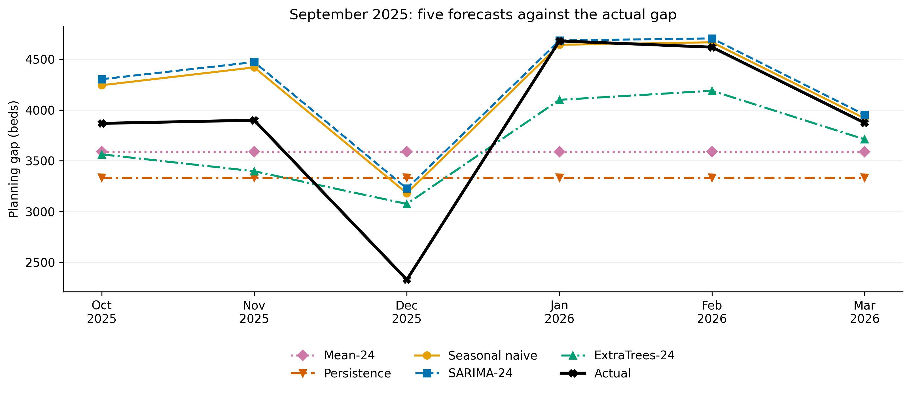
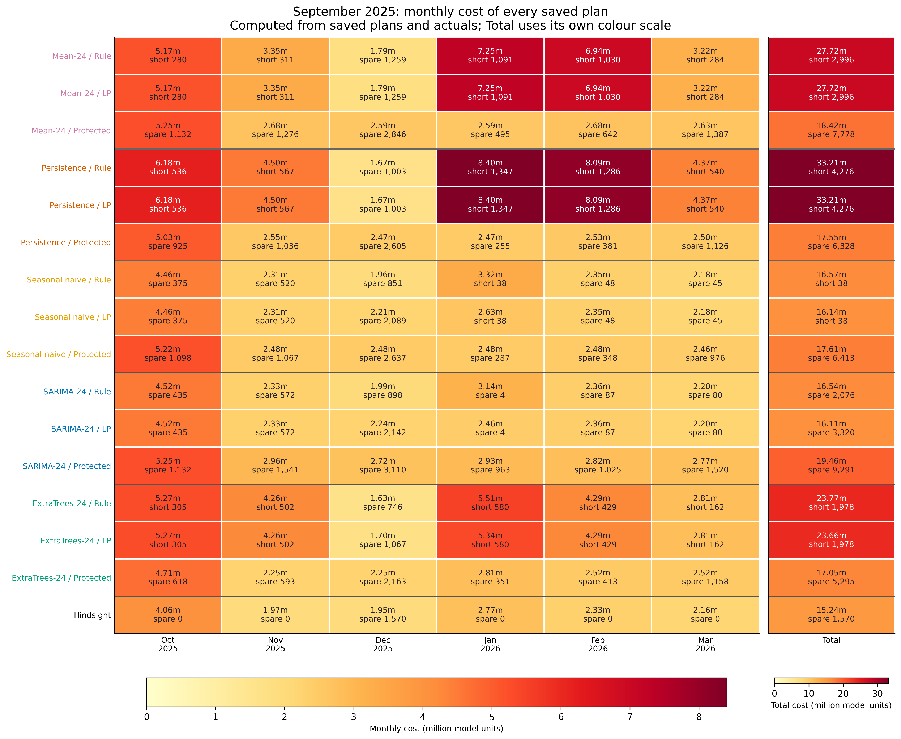
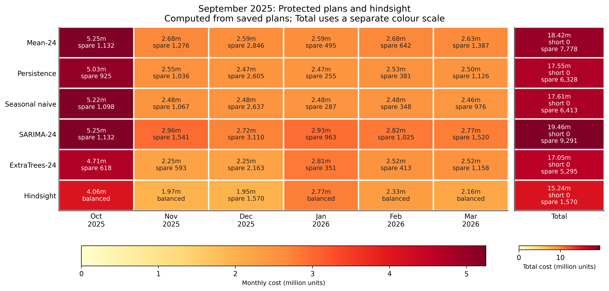
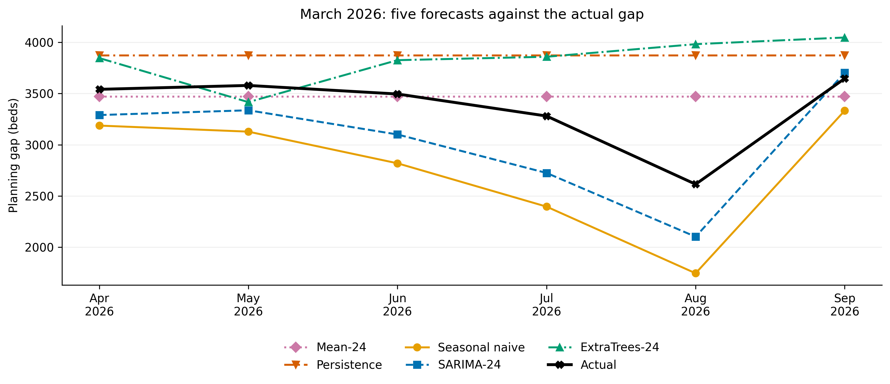
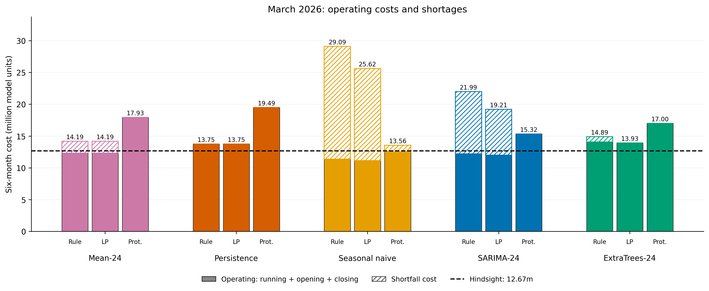
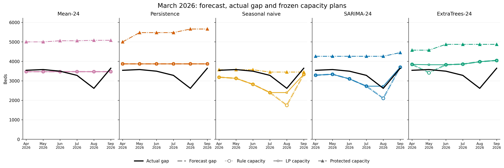
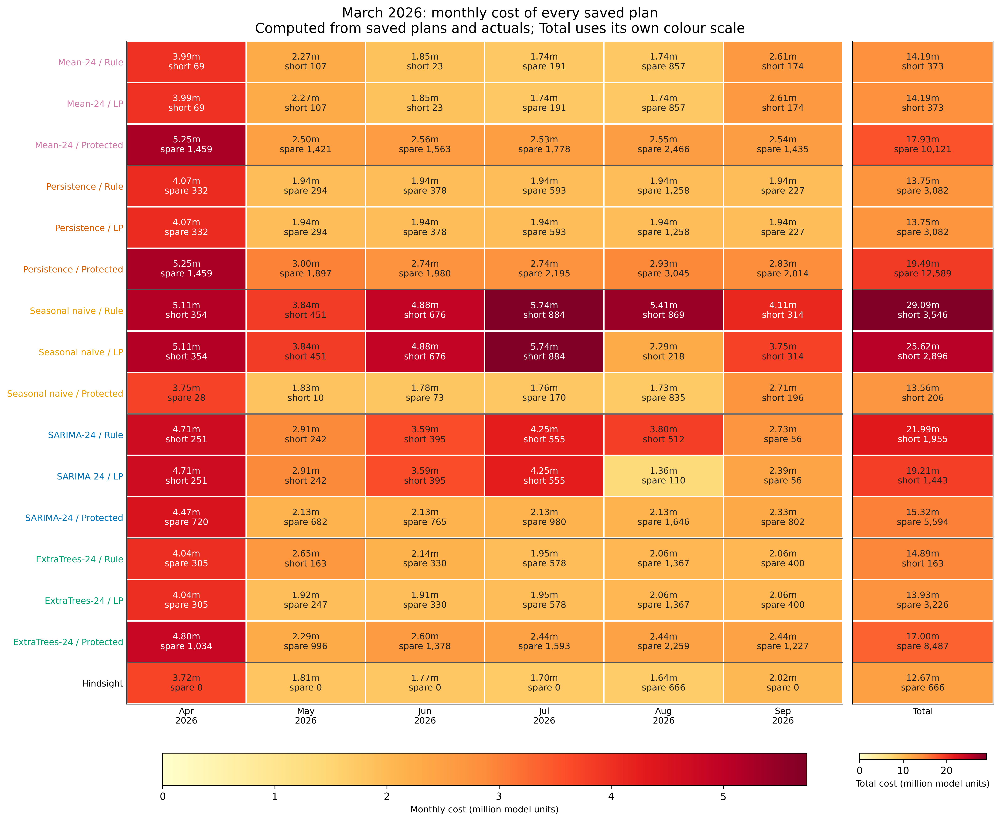

# Does optimisation improve a bed-capacity forecast? Two frozen origins

## Question

We freeze a bed-capacity plan before knowing the next six months of demand. Five methods forecast NHS England general and acute (G&A) beds, then we either follow each forecast, optimise the schedule, or optimise with protection against forecast error. Does optimisation make the realised plan cheaper, why, and by how much? How much does protection add on top?

## Method

At each origin, only observations available up to that month are used. Each method uses the 24-month window ending at the origin and forecasts the next six months: **September 2025** covers **October 2025 to March 2026**, and **March 2026** covers **April to September 2026**. All six decisions stay fixed; there is no monthly replanning.

The planning gap is **occupied / 0.90 - available**, measured in beds. It is the additional capacity needed to keep occupancy at or below 90%. A shortfall here means falling short of that capacity target.

Each method forecasts occupied and available beds separately:

- **Mean-24:** repeats the average of its training window.
- **Persistence:** repeats the last observed month.
- **Seasonal naive:** repeats the same calendar month from the previous year.
- **SARIMA-24:** a fixed seasonal time-series model using the training window.
- **ExtraTrees-24:** a fixed tree ensemble using earlier values and calendar features; predictions feed later forecast steps.

**Rule** follows the forecast gap, opening the requested non-negative capacity as far as the limits allow. **LP** optimises the entire schedule: running costs 500 per bed-month, opening 550 per bed opened, closing 300 per bed closed, and shortfall 5,000 per missing bed-month. Capacity carries over between months, starts at zero, is capped at 15,000 beds, and can rise or fall by at most 5,000 beds per month; there is no terminal closing charge.

**Protected** uses the same optimisation with scenarios formed from the method's own past forecast errors, adding a data-driven safety margin. **Hindsight** uses the actual future gap: it is the best possible schedule under these same constraints. All forecasts, plans and total scores below were already saved; nothing was refitted, re-solved or rescored.

Costs are **illustrative model units (validated: False)**, not NHS expenditure estimates. Cost tables use **millions**. Operating cost means running + opening + closing; total cost adds the shortfall penalty. Small solver-rounding differences are treated as equal using the saved relative tolerance of 1e-6.

## Origin 1: September 2025

### What happened

[SVG](figures/case_study/sep2025_actual_gap.svg)

The gap dipped to **2,330 beds in December**, then peaked at **4,680 in January**. It remained at 4,618 in February before easing to 3,873 in March.

### What each method forecast

[SVG](figures/case_study/sep2025_forecasts.svg)

MAE is the average absolute gap error, in beds. Signed error is **actual minus forecast**: positive means the forecast was too low on average; negative means too high.

| Method | Gap MAE (beds) | Mean signed error (beds) | Forecast on average |
| --- | --- | --- | --- |
| Mean-24 | 709.1 | +289.5 | Too low |
| Persistence | 879.8 | +545.5 | Too low |
| Seasonal naive | 313.0 | -300.3 | Too high |
| SARIMA-24 | 346.0 | -346.0 | Too high |
| ExtraTrees-24 | 454.0 | +205.4 | Too low |

Source: [saved accuracy](outputs/fair_comparison/O1_sep2025/accuracy.csv).

### The cost chain

Each cell is **total (operating + shortfall)**, in millions. Bold marks the cheapest forecast-based plan; hindsight is a benchmark. Cost components are **computed from saved plans** and checked against saved scores. Rounded components may differ from rounded totals.

| Method | Rule | LP | Protected | Hindsight |
| --- | --- | --- | --- | --- |
| Mean-24 | 27.72 (12.74 + 14.98) | 27.72 (12.74 + 14.98) | 18.42 (18.42 + 0.00) | 15.24 (15.24 + 0.00) |
| Persistence | 33.21 (11.83 + 21.38) | 33.21 (11.83 + 21.38) | 17.55 (17.55 + 0.00) | 15.24 (15.24 + 0.00) |
| Seasonal naive | 16.57 (16.38 + 0.19) | 16.14 (15.95 + 0.19) | 17.61 (17.61 + 0.00) | 15.24 (15.24 + 0.00) |
| SARIMA-24 | 16.54 (16.54 + 0.00) | **16.11** (16.11 + 0.00) | 19.46 (19.46 + 0.00) | 15.24 (15.24 + 0.00) |
| ExtraTrees-24 | 23.77 (13.88 + 9.89) | 23.66 (13.77 + 9.89) | 17.05 (17.05 + 0.00) | 15.24 (15.24 + 0.00) |

[SVG](figures/case_study/sep2025_chain.svg)

Source: [saved total scores](outputs/fair_comparison/O1_sep2025/totals.csv) and [saved Rule/LP/Protected monthly costs](outputs/optimisation_value/monthly_costs.csv).

### Month by month

[SVG](figures/case_study/sep2025_monthly_plans.svg)

Capacity below the actual line is short; capacity above it is spare. Overlapping lines show equal values.

[SVG](figures/case_study/sep2025_monthly_cost_all_plans.svg)

**Computed from saved plans and actuals.** Costs are millions of model units; short/spare values are rounded beds. In Total, short is summed shortfall bed-months; if that rounds to zero, spare is summed spare bed-months. Total has its own colour scale, and the unrounded monthly costs sum to the saved total for every plan.

Actual and forecast gaps, rounded to whole beds:

| Month | Actual gap | Mean-24 | Persistence | Seasonal naive | SARIMA-24 | ExtraTrees-24 |
| --- | --- | --- | --- | --- | --- | --- |
| Oct 2025 | 3,868 | 3,589 | 3,333 | 4,244 | 4,303 | 3,564 |
| Nov 2025 | 3,900 | 3,589 | 3,333 | 4,419 | 4,472 | 3,397 |
| Dec 2025 | 2,330 | 3,589 | 3,333 | 3,181 | 3,228 | 3,076 |
| Jan 2026 | 4,680 | 3,589 | 3,333 | 4,642 | 4,684 | 4,100 |
| Feb 2026 | 4,618 | 3,589 | 3,333 | 4,667 | 4,705 | 4,189 |
| Mar 2026 | 3,873 | 3,589 | 3,333 | 3,918 | 3,953 | 3,711 |

Sources: [saved actuals](outputs/fair_comparison/O1_sep2025/actuals.csv) and [saved forecasts](outputs/fair_comparison/O1_sep2025/forecasts.csv).

January and February drive the largest bills for Mean-24 and Persistence under Rule and LP, while October includes the opening costs. In December, LP keeps Seasonal naive and SARIMA-24 capacity open through the dip; Protected keeps every method above the actual gap throughout this window.

### Why optimisation helped

The tables show additional beds open (**x**), additions (**+**) and removals (**-**) each month. All values are beds, rounded to one decimal. These are the frozen schedules, not decisions updated after observing demand.

**Seasonal naive**

| Month | Rule x | Rule + | Rule - | LP x | LP + | LP - |
| --- | --- | --- | --- | --- | --- | --- |
| Oct 2025 | 4,243.9 | 4,243.9 | 0.0 | 4,243.9 | 4,243.9 | 0.0 |
| Nov 2025 | 4,419.4 | 175.6 | 0.0 | 4,419.4 | 175.6 | 0.0 |
| Dec 2025 | 3,181.0 | 0.0 | 1,238.4 | 4,419.4 | 0.0 | 0.0 |
| Jan 2026 | 4,642.0 | 1,461.0 | 0.0 | 4,642.0 | 222.6 | 0.0 |
| Feb 2026 | 4,666.7 | 24.7 | 0.0 | 4,666.7 | 24.7 | 0.0 |
| Mar 2026 | 3,918.3 | 0.0 | 748.3 | 3,918.3 | 0.0 | 748.3 |

LP kept the November capacity through December, reducing the amount that had to reopen next month. It saved **0.43m**: 0.43m in operating cost and 0.00m in shortfall cost.

**SARIMA-24**

| Month | Rule x | Rule + | Rule - | LP x | LP + | LP - |
| --- | --- | --- | --- | --- | --- | --- |
| Oct 2025 | 4,303.2 | 4,303.2 | 0.0 | 4,303.2 | 4,303.2 | 0.0 |
| Nov 2025 | 4,471.9 | 168.7 | 0.0 | 4,471.9 | 168.7 | 0.0 |
| Dec 2025 | 3,227.9 | 0.0 | 1,244.0 | 4,471.9 | 0.0 | 0.0 |
| Jan 2026 | 4,684.2 | 1,456.4 | 0.0 | 4,684.2 | 212.3 | 0.0 |
| Feb 2026 | 4,705.0 | 20.8 | 0.0 | 4,705.0 | 20.8 | 0.0 |
| Mar 2026 | 3,953.4 | 0.0 | 751.6 | 3,953.4 | 0.0 | 751.6 |

LP kept the November capacity through December, reducing the amount that had to reopen next month. It saved **0.44m**: 0.44m in operating cost and 0.00m in shortfall cost.

Mean-24 and Persistence have flat forecasts, so **Rule = LP within solver precision**. Holding beds through a dip can cost more in that month but avoid a larger closing-and-reopening bill; it can also cover demand that the forecast underestimated.

### Why protection helped or hurt

Protection uses past errors, not knowledge of this future. A forecast that is already high can already provide spare capacity; adding protection can then increase cost. The effect below is LP minus Protected, with the saved tie band of 1% of hindsight cost.

| Method | Forecast on average | Point LP cost | Protected cost | Effect |
| --- | --- | --- | --- | --- |
| Mean-24 | Too low | 27.72 | 18.42 | Helped by 9.30m |
| Persistence | Too low | 33.21 | 17.55 | Helped by 15.66m |
| Seasonal naive | Too high | 16.14 | 17.61 | Hurt by 1.47m |
| SARIMA-24 | Too high | 16.11 | 19.46 | Hurt by 3.35m |
| ExtraTrees-24 | Too low | 23.66 | 17.05 | Helped by 6.61m |

### Where the Protected-plan costs occurred

[SVG](figures/case_study/sep2025_protected_heatmap.svg)

**Computed from saved plans.** Each monthly cell shows cost and the shortfall or spare capacity, rounded to whole beds. Balanced means neither is visible after rounding. Total cells sum costs and show both shortfall and spare bed-months; they use a separate colour scale. The totals include opening costs at the start of the plan.

### Result

**SARIMA-24 + LP** was the cheapest forecast-based combination, at **16.11m**. Protection helped Mean-24, Persistence and ExtraTrees-24, but made Seasonal naive and SARIMA-24 more expensive. ExtraTrees-24 was the cheapest Protected plan, at 17.05m.

## Origin 2: March 2026

### What happened

[SVG](figures/case_study/mar2026_actual_gap.svg)

The April-to-September gap averaged **3,360 beds in 2026**, compared with **2,768** in the same months of 2025. It fell to 2,615 in August, then rose to 3,646 in September.

### What each method forecast

[SVG](figures/case_study/mar2026_forecasts.svg)

MAE is the average absolute gap error, in beds. Signed error is **actual minus forecast**: positive means the forecast was too low on average; negative means too high.

| Method | Gap MAE (beds) | Mean signed error (beds) | Forecast on average |
| --- | --- | --- | --- |
| Mean-24 | 237.0 | -112.5 | Too high |
| Persistence | 513.6 | -513.6 | Too high |
| Seasonal naive | 591.1 | +591.1 | Too low |
| SARIMA-24 | 335.3 | +316.5 | Too low |
| ExtraTrees-24 | 523.8 | -469.5 | Too high |

Source: [saved accuracy](outputs/fair_comparison/O2_mar2026/accuracy.csv).

### The cost chain

Each cell is **total (operating + shortfall)**, in millions. Bold marks the cheapest forecast-based plan; hindsight is a benchmark. Cost components are **computed from saved plans** and checked against saved scores. Rounded components may differ from rounded totals.

| Method | Rule | LP | Protected | Hindsight |
| --- | --- | --- | --- | --- |
| Mean-24 | 14.19 (12.33 + 1.87) | 14.19 (12.33 + 1.87) | 17.93 (17.93 + 0.00) | 12.67 (12.67 + 0.00) |
| Persistence | 13.75 (13.75 + 0.00) | 13.75 (13.75 + 0.00) | 19.49 (19.49 + 0.00) | 12.67 (12.67 + 0.00) |
| Seasonal naive | 29.09 (11.36 + 17.73) | 25.62 (11.14 + 14.48) | **13.56** (12.53 + 1.03) | 12.67 (12.67 + 0.00) |
| SARIMA-24 | 21.99 (12.21 + 9.78) | 19.21 (12.00 + 7.22) | 15.32 (15.32 + 0.00) | 12.67 (12.67 + 0.00) |
| ExtraTrees-24 | 14.89 (14.08 + 0.81) | 13.93 (13.93 + 0.00) | 17.00 (17.00 + 0.00) | 12.67 (12.67 + 0.00) |

[SVG](figures/case_study/mar2026_chain.svg)

Source: [saved total scores](outputs/fair_comparison/O2_mar2026/totals.csv) and [saved Rule/LP/Protected monthly costs](outputs/optimisation_value/monthly_costs.csv).

### Month by month

[SVG](figures/case_study/mar2026_monthly_plans.svg)

Capacity below the actual line is short; capacity above it is spare. Overlapping lines show equal values.

[SVG](figures/case_study/mar2026_monthly_cost_all_plans.svg)

**Computed from saved plans and actuals.** Costs are millions of model units; short/spare values are rounded beds. In Total, short is summed shortfall bed-months; if that rounds to zero, spare is summed spare bed-months. Total has its own colour scale, and the unrounded monthly costs sum to the saved total for every plan.

Actual and forecast gaps, rounded to whole beds:

| Month | Actual gap | Mean-24 | Persistence | Seasonal naive | SARIMA-24 | ExtraTrees-24 |
| --- | --- | --- | --- | --- | --- | --- |
| Apr 2026 | 3,541 | 3,472 | 3,873 | 3,187 | 3,290 | 3,846 |
| May 2026 | 3,579 | 3,472 | 3,873 | 3,128 | 3,337 | 3,416 |
| Jun 2026 | 3,495 | 3,472 | 3,873 | 2,819 | 3,101 | 3,825 |
| Jul 2026 | 3,281 | 3,472 | 3,873 | 2,397 | 2,725 | 3,859 |
| Aug 2026 | 2,615 | 3,472 | 3,873 | 1,746 | 2,103 | 3,982 |
| Sep 2026 | 3,646 | 3,472 | 3,873 | 3,333 | 3,703 | 4,047 |

Sources: [saved actuals](outputs/fair_comparison/O2_mar2026/actuals.csv) and [saved forecasts](outputs/fair_comparison/O2_mar2026/forecasts.csv).

Opening costs raise April's bills, while Seasonal naive's Rule and LP bills peak in July. LP keeps Seasonal naive and SARIMA-24 capacity open through August; Protected reduces their shortfalls while leaving Mean-24, Persistence and ExtraTrees-24 above the actual gap throughout the window.

### Why optimisation helped

The tables show additional beds open (**x**), additions (**+**) and removals (**-**) each month. All values are beds, rounded to one decimal. These are the frozen schedules, not decisions updated after observing demand.

**Seasonal naive**

| Month | Rule x | Rule + | Rule - | LP x | LP + | LP - |
| --- | --- | --- | --- | --- | --- | --- |
| Apr 2026 | 3,187.2 | 3,187.2 | 0.0 | 3,187.2 | 3,187.2 | 0.0 |
| May 2026 | 3,128.1 | 0.0 | 59.1 | 3,128.1 | 0.0 | 59.1 |
| Jun 2026 | 2,819.4 | 0.0 | 308.7 | 2,819.4 | 0.0 | 308.7 |
| Jul 2026 | 2,396.7 | 0.0 | 422.8 | 2,396.7 | 0.0 | 422.8 |
| Aug 2026 | 1,746.4 | 0.0 | 650.2 | 2,396.7 | 0.0 | 0.0 |
| Sep 2026 | 3,332.8 | 1,586.3 | 0.0 | 3,332.8 | 936.1 | 0.0 |

LP kept the July capacity through August, reducing the amount that had to reopen next month. It saved **3.48m**: 0.23m in operating cost and 3.25m in shortfall cost.

**SARIMA-24**

| Month | Rule x | Rule + | Rule - | LP x | LP + | LP - |
| --- | --- | --- | --- | --- | --- | --- |
| Apr 2026 | 3,290.1 | 3,290.1 | 0.0 | 3,290.1 | 3,290.1 | 0.0 |
| May 2026 | 3,336.6 | 46.5 | 0.0 | 3,336.6 | 46.5 | 0.0 |
| Jun 2026 | 3,100.6 | 0.0 | 236.0 | 3,100.6 | 0.0 | 236.0 |
| Jul 2026 | 2,725.2 | 0.0 | 375.4 | 2,725.2 | 0.0 | 375.4 |
| Aug 2026 | 2,102.9 | 0.0 | 622.2 | 2,725.2 | 0.0 | 0.0 |
| Sep 2026 | 3,702.7 | 1,599.8 | 0.0 | 3,702.7 | 977.5 | 0.0 |

LP kept the July capacity through August, reducing the amount that had to reopen next month. It saved **2.78m**: 0.22m in operating cost and 2.56m in shortfall cost.

Mean-24 and Persistence have flat forecasts, so **Rule = LP within solver precision**. Holding beds through a dip can cost more in that month but avoid a larger closing-and-reopening bill; it can also cover demand that the forecast underestimated.

### Why protection helped or hurt

Protection uses past errors, not knowledge of this future. A forecast that is already high can already provide spare capacity; adding protection can then increase cost. The effect below is LP minus Protected, with the saved tie band of 1% of hindsight cost.

| Method | Forecast on average | Point LP cost | Protected cost | Effect |
| --- | --- | --- | --- | --- |
| Mean-24 | Too high | 14.19 | 17.93 | Hurt by 3.74m |
| Persistence | Too high | 13.75 | 19.49 | Hurt by 5.74m |
| Seasonal naive | Too low | 25.62 | 13.56 | Helped by 12.06m |
| SARIMA-24 | Too low | 19.21 | 15.32 | Helped by 3.89m |
| ExtraTrees-24 | Too high | 13.93 | 17.00 | Hurt by 3.07m |

### Where the Protected-plan costs occurred

[SVG](figures/case_study/mar2026_protected_heatmap.svg)

**Computed from saved plans.** Each monthly cell shows cost and the shortfall or spare capacity, rounded to whole beds. Balanced means neither is visible after rounding. Total cells sum costs and show both shortfall and spare bed-months; they use a separate colour scale. The totals include opening costs at the start of the plan.

### Result

**Seasonal naive + Protected** was the cheapest forecast-based combination, at **13.56m**. Protection helped the low Seasonal naive and SARIMA-24 forecasts, but hurt the other methods, whose forecasts were high on average.

## The two origins side by side

Costs and benefits are millions. Each cost chain is **Rule / LP / Protected / Hindsight**; each benefit pair is **optimisation / protection**. Positive benefits mean a saving; negative benefits mean an extra cost.

| Method | Sep 2025 cost chain | Mar 2026 cost chain | Sep 2025 benefits | Mar 2026 benefits |
| --- | --- | --- | --- | --- |
| Mean-24 | 27.72 / 27.72 / 18.42 / 15.24 | 14.19 / 14.19 / 17.93 / 12.67 | +0.00 / +9.30 | +0.00 / -3.74 |
| Persistence | 33.21 / 33.21 / 17.55 / 15.24 | 13.75 / 13.75 / 19.49 / 12.67 | +0.00 / +15.66 | +0.00 / -5.74 |
| Seasonal naive | 16.57 / 16.14 / 17.61 / 15.24 | 29.09 / 25.62 / 13.56 / 12.67 | +0.43 / -1.47 | +3.48 / +12.06 |
| SARIMA-24 | 16.54 / 16.11 / 19.46 / 15.24 | 21.99 / 19.21 / 15.32 / 12.67 | +0.44 / -3.35 | +2.78 / +3.89 |
| ExtraTrees-24 | 23.77 / 23.66 / 17.05 / 15.24 | 14.89 / 13.93 / 17.00 / 12.67 | +0.11 / +6.61 | +0.96 / -3.07 |

[SVG](figures/case_study/two_origin_chain.svg)

Optimisation helped Seasonal naive, SARIMA-24 and ExtraTrees-24 at both origins, while the flat forecasts were unchanged within tolerance. Protection helped Mean-24, Persistence and ExtraTrees-24 in September but hurt them in March, while Seasonal naive and SARIMA-24 switched from hurt to helped. In these two windows, the protection flip coincided with a switch in average forecast direction: the former group went from too low to too high, and the latter group went from too high to too low. This is an observed pattern in these two windows, not a general rule about protection.

## Answer

At both origins, optimisation never materially increased cost compared with following the forecast, and it saved up to 3.48m, mainly by keeping beds open through forecast dips. The cheapest plan was SARIMA-24 with optimisation in September 2025 (16.11m, close to Seasonal naive with optimisation at 16.14m) and Seasonal naive with protection in March 2026 (13.56m). Protection helped the methods that under-forecast in each window and added cost for those whose forecasts ran high; because the methods switched direction between the two windows, protection's effect flipped for every method. These are two six-month windows, so they show how the methods behaved, not a general ranking.

## Limitations

- These are two six-month windows, so the results describe these cases.
- The models are univariate and do not use staffing, admissions, discharge or policy variables.
- Occupied and available beds are forecast separately.
- National monthly totals hide local bottlenecks and daily peaks.
- Model specifications were fixed, not tuned for these windows.
- Costs are illustrative (validated: False); capacity is not a full staffing or clinical feasibility model.
- Results depend on the assumed shortage price and capacity limits.

Saved sources, verification and reproduction

The builder verifies the existing SHA-256 manifests, agreement between the saved two-origin records, Rule agreement with the clean checkpoint, monthly sums, hindsight bounds, numerical provenance, table structure and figure links. All checks passed. Monthly cost arithmetic only reconstructs components of the saved plans; no model or optimisation routine is called.

Checker correction: Rule, LP and Protected are checked against their hashed frozen plans. Hindsight is checked against the saved scored plans and totals from both the fair comparison and clean checkpoint, which agree to 1e-6 relative. A scored-only unit test covers this distinction; no saved data or results changed.

The source files are:

- **September 2025:** [actuals](outputs/fair_comparison/O1_sep2025/actuals.csv), [forecasts](outputs/fair_comparison/O1_sep2025/forecasts.csv), [accuracy](outputs/fair_comparison/O1_sep2025/accuracy.csv), [plans](outputs/fair_comparison/O1_sep2025/plans.csv), [totals](outputs/fair_comparison/O1_sep2025/totals.csv); [clean-checkpoint totals](outputs/clean_checkpoint/O1_sep2025/totals.csv); [clean-checkpoint scored plans](outputs/clean_checkpoint/O1_sep2025/plans.csv).
- **March 2026:** [actuals](outputs/fair_comparison/O2_mar2026/actuals.csv), [forecasts](outputs/fair_comparison/O2_mar2026/forecasts.csv), [accuracy](outputs/fair_comparison/O2_mar2026/accuracy.csv), [plans](outputs/fair_comparison/O2_mar2026/plans.csv), [totals](outputs/fair_comparison/O2_mar2026/totals.csv); [clean-checkpoint totals](outputs/clean_checkpoint/O2_mar2026/totals.csv); [clean-checkpoint scored plans](outputs/clean_checkpoint/O2_mar2026/plans.csv).
- **Rule and common scoring:** [rule_plans](outputs/optimisation_value/rule_plans.csv), [monthly_costs](outputs/optimisation_value/monthly_costs.csv), [costs](outputs/optimisation_value/costs.csv).
- **Prior-year comparison:** Seasonal naive's [saved March forecast](outputs/fair_comparison/O2_mar2026/forecasts.csv) repeats the same calendar months of 2025.
- **Definitions:** [fair-comparison configuration](outputs/fair_comparison/config.json) and [registered optimisation-value configuration](outputs/optimisation_value/config.json).

Refresh the monthly figures and this README with `python -B scripts/case_study/monthly_views.py`. The script reads saved files; existing case-study figures are reused unchanged.

