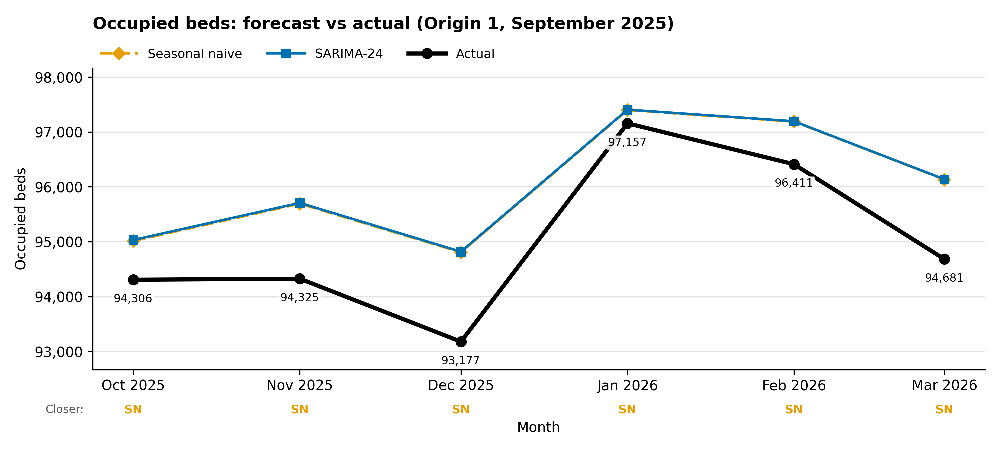
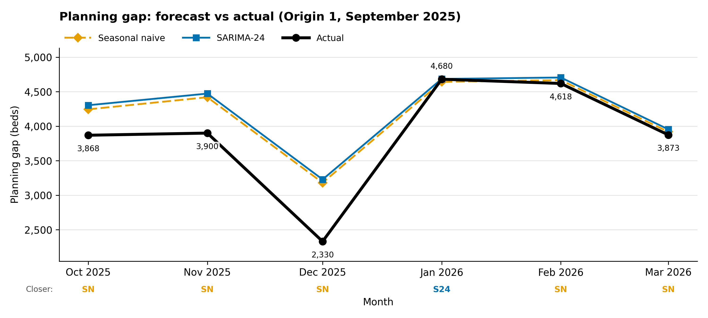
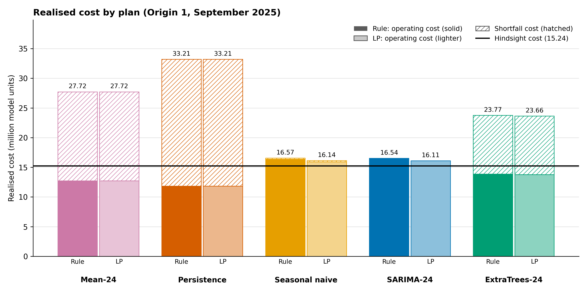
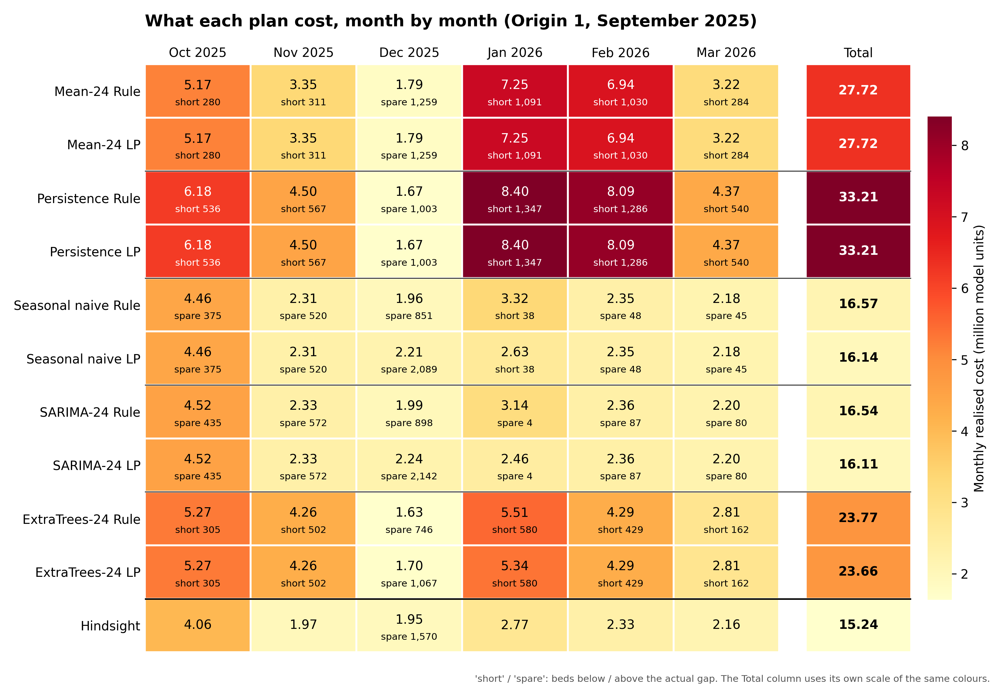
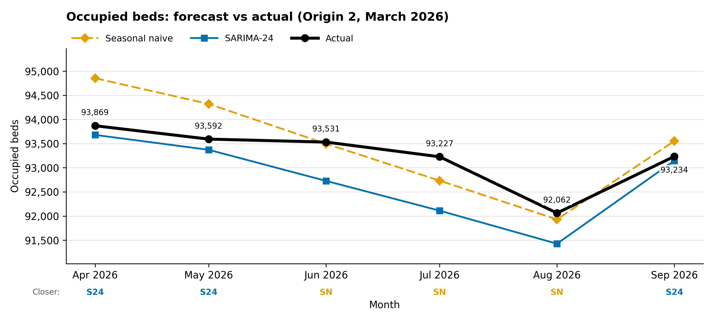
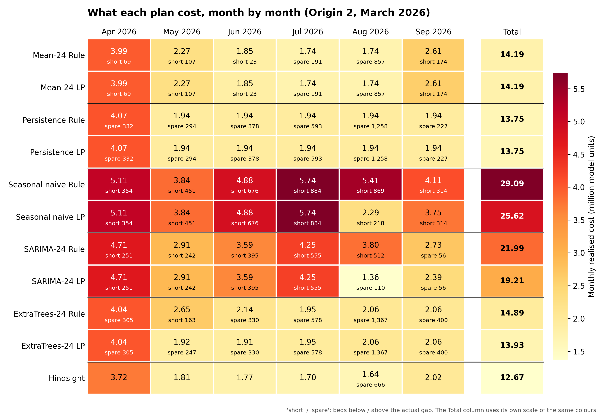

# Which forecast gives the best hospital capacity plan?

## Question

Hospitals in England need enough general and acute beds every month. We forecast bed numbers six months ahead and turn each forecast into a plan for extra beds. Which forecasting method, paired with which way of making the plan, gives the cheapest plan once the real numbers are known, and how much better is it than simple baselines and than simply following the forecast?

## Method

Five methods forecast occupied beds and available beds six months ahead, each from the same 24 months of NHS England data: the 24-month mean (Mean-24), the last month repeated (Persistence), the same month one year earlier (Seasonal naive), a seasonal time-series model (SARIMA-24) and a tree-based machine-learning model (ExtraTrees-24). The two forecasts give the planning gap, occupied / 0.90 - available: the extra beds needed to keep occupancy at 90%. Each gap forecast is turned into a plan in two ways. The Rule opens exactly the forecast gap each month. The LP (a linear program) finds the cheapest plan for the forecast gap, so it may keep beds open through a short dip instead of closing and reopening them. A bed costs 500 a month to run, 550 to open and 300 to close; each missing bed costs 5,000 a month. A plan starts with no extra beds, can hold at most 15,000 and can open or close at most 5,000 in a month. Each plan is then held fixed and costed against the actual gap. Hindsight is the LP solved with the actual gaps: no plan can cost less.

| Origin | Training window (24 months) | Forecast months |
| --- | --- | --- |
| Origin 1: September 2025 | October 2023 - September 2025 | October 2025 - March 2026 |
| Origin 2: March 2026 | April 2024 - March 2026 | April 2026 - September 2026 |

### How we pick a winner

These rules were written down and hashed before any forecast in this run was computed (config SHA-256 `8406460d682a6d5341579b30e6a9d576dd149fa6050b871697b101b6d6d56be9`).

- **Joint best.** At each origin the 10 plans are ranked by realised cost. Plans within 1% of that origin's hindsight cost of the cheapest plan are "joint best".
- **Overall ranking.** Plans are ranked by combined excess over hindsight: cost minus hindsight cost, added over the two origins.
- **Clear winner.** A plan that is joint best at both origins, or that beats the overall runner-up by more than the 1% band at each origin. Otherwise there is no clear winner.
- **Best forecast.** The method with the lowest mean gap MAE (mean absolute error) across the two origins. It is "clear" only if it is the lowest at both origins by more than 5 beds.

The rules were fixed in advance, but the test is not blind: the outcome months had already been used in earlier tests in this project.

## Origin 1: September 2025

Forecast months: October 2025 - March 2026. The figures show Seasonal naive and SARIMA-24 against the actual values; all five methods are in the table.

**Occupied beds:** Seasonal naive was closer in 6 of 6 months. Best of all five methods: ExtraTrees-24 (MAE 677 beds).

**Available beds:** SARIMA-24 was closer in 6 of 6 months. Best of all five methods: ExtraTrees-24 (MAE 764 beds).

**Planning gap:** Seasonal naive was closer in 5 of 6 months and SARIMA-24 in 1. Best of all five methods: Seasonal naive (MAE 313 beds).

| Forecast | Decision | Gap MAE (beds) | Mean signed gap error (beds) | Operating cost | Shortfall cost | Total | Excess over hindsight |
| --- | --- | ---: | ---: | ---: | ---: | ---: | ---: |
| Mean-24 | Rule | 709 | 289 | 12.74 | 14.98 | 27.72 | 12.48 |
| Mean-24 | LP | 709 | 289 | 12.74 | 14.98 | 27.72 | 12.48 |
| Persistence | Rule | 880 | 545 | 11.83 | 21.38 | 33.21 | 17.97 |
| Persistence | LP | 880 | 545 | 11.83 | 21.38 | 33.21 | 17.97 |
| Seasonal naive | Rule | 313 | -300 | 16.38 | 0.19 | 16.57 | 1.33 |
| Seasonal naive | LP | 313 | -300 | 15.95 | 0.19 | 16.14 | 0.90 |
| SARIMA-24 | Rule | 346 | -346 | 16.54 | 0.00 | 16.54 | 1.31 |
| SARIMA-24 | LP | 346 | -346 | 16.11 | 0.00 | 16.11 | 0.87 |
| ExtraTrees-24 | Rule | 454 | 205 | 13.88 | 9.89 | 23.77 | 8.54 |
| ExtraTrees-24 | LP | 454 | 205 | 13.77 | 9.89 | 23.66 | 8.42 |
| Hindsight | LP | - | - | 15.24 | 0.00 | 15.24 | 0.00 |

Costs in millions of model units. Mean signed gap error = actual - forecast: above zero means the forecast was too low.

**Result.** SARIMA-24 LP was the cheapest plan (16.11m, 0.87m above hindsight), and Seasonal naive LP (16.14m) was joint best with it. Seasonal naive had the most accurate gap forecast (MAE 313 beds). The LP was cheaper than the Rule by 0.43m for Seasonal naive, 0.44m for SARIMA-24 and 0.11m for ExtraTrees-24; for the two flat forecasts (Mean-24, Persistence) the Rule and the LP give the same plan.

## Origin 2: March 2026

Forecast months: April 2026 - September 2026. The figures show Seasonal naive and SARIMA-24 against the actual values; all five methods are in the table.

**Occupied beds:** Seasonal naive was closer in 3 of 6 months and SARIMA-24 in 3. Best of all five methods: Seasonal naive (MAE 449 beds).

**Available beds:** Seasonal naive was closer in 1 of 6 months and SARIMA-24 in 5. Best of all five methods: SARIMA-24 (MAE 262 beds).

**Planning gap:** SARIMA-24 was closer in 6 of 6 months. Best of all five methods: Mean-24 (MAE 237 beds).

| Forecast | Decision | Gap MAE (beds) | Mean signed gap error (beds) | Operating cost | Shortfall cost | Total | Excess over hindsight |
| --- | --- | ---: | ---: | ---: | ---: | ---: | ---: |
| Mean-24 | Rule | 237 | -113 | 12.33 | 1.87 | 14.19 | 1.52 |
| Mean-24 | LP | 237 | -113 | 12.33 | 1.87 | 14.19 | 1.52 |
| Persistence | Rule | 514 | -514 | 13.75 | 0.00 | 13.75 | 1.08 |
| Persistence | LP | 514 | -514 | 13.75 | 0.00 | 13.75 | 1.08 |
| Seasonal naive | Rule | 591 | 591 | 11.36 | 17.73 | 29.09 | 16.42 |
| Seasonal naive | LP | 591 | 591 | 11.14 | 14.48 | 25.62 | 12.95 |
| SARIMA-24 | Rule | 335 | 316 | 12.21 | 9.78 | 21.99 | 9.32 |
| SARIMA-24 | LP | 335 | 316 | 12.00 | 7.22 | 19.21 | 6.54 |
| ExtraTrees-24 | Rule | 524 | -469 | 14.08 | 0.81 | 14.89 | 2.22 |
| ExtraTrees-24 | LP | 524 | -469 | 13.93 | 0.00 | 13.93 | 1.26 |
| Hindsight | LP | - | - | 12.67 | 0.00 | 12.67 | 0.00 |

Costs in millions of model units. Mean signed gap error = actual - forecast: above zero means the forecast was too low.

**Result.** Persistence was the cheapest plan (13.75m, 1.08m above hindsight; its Rule and LP plans are the same), and no other plan was within the tie band. Mean-24 had the most accurate gap forecast (MAE 237 beds). Seasonal naive LP and SARIMA-24 LP, joint best at Origin 1, ranked 9th and 7th: their gap forecasts were below the actual gap in 6 and 5 of 6 months.

## Both origins together

| Plan | Origin 1 cost | Origin 1 rank | Origin 2 cost | Origin 2 rank | Combined excess over hindsight | Overall rank |
| --- | ---: | --- | ---: | --- | ---: | --- |
| SARIMA-24 LP | 16.11 | 1 (joint best) | 19.21 | 7 | 7.41 | 1 |
| ExtraTrees-24 LP | 23.66 | 5 | 13.93 | 3 | 9.69 | 2 |
| SARIMA-24 Rule | 16.54 | 3 | 21.99 | 8 | 10.63 | 3 |
| ExtraTrees-24 Rule | 23.77 | 6 | 14.89 | 6 | 10.76 | 4 |
| Seasonal naive LP | 16.14 | 2 (joint best) | 25.62 | 9 | 13.85 | 5 |
| Mean-24 Rule | 27.72 | 7= | 14.19 | 4= | 14.00 | 6= |
| Mean-24 LP | 27.72 | 7= | 14.19 | 4= | 14.00 | 6= |
| Seasonal naive Rule | 16.57 | 4 | 29.09 | 10 | 17.76 | 8 |
| Persistence LP | 33.21 | 9= | 13.75 | 1= (joint best) | 19.05 | 9= |
| Persistence Rule | 33.21 | 9= | 13.75 | 1= (joint best) | 19.05 | 9= |

Costs in millions of model units. Hindsight cost: 15.24m at Origin 1 and 12.67m at Origin 2, so the tie bands are 0.15m and 0.13m. "=" marks a shared rank: for a flat forecast the Rule and the LP give the same plan, and their costs differ by less than 1 model unit (solver rounding).

| Plan | Value of optimisation | Saving vs Persistence | Saving vs Seasonal naive | Avoidable cost removed, vs Persistence LP | Avoidable cost removed, vs Seasonal naive LP | Gap forecast skill vs Seasonal naive |
| --- | ---: | ---: | ---: | ---: | ---: | ---: |
| Mean-24 Rule | 0.00 / 0.00 / 0.00 | 5.49 / -0.44 / 5.05 | -11.15 / 14.90 / 3.75 | 31% / -41% / 26% | -1,285% / 88% / -1% | -1.27 / 0.60 / -0.05 |
| Mean-24 LP | 0.00 / 0.00 / 0.00 | 5.49 / -0.44 / 5.05 | -11.58 / 11.42 / -0.16 | 31% / -41% / 26% | -1,285% / 88% / -1% | -1.27 / 0.60 / -0.05 |
| Persistence Rule | 0.00 / 0.00 / 0.00 | 0.00 / 0.00 / 0.00 | -16.64 / 15.35 / -1.29 | 0% / 0% / 0% | -1,894% / 92% / -38% | -1.81 / 0.13 / -0.54 |
| Persistence LP | 0.00 / 0.00 / 0.00 | 0.00 / 0.00 / 0.00 | -17.07 / 11.87 / -5.21 | 0% / 0% / 0% | -1,894% / 92% / -38% | -1.81 / 0.13 / -0.54 |
| Seasonal naive Rule | 0.43 / 3.48 / 3.91 | 16.64 / -15.35 / 1.29 | 0.00 / 0.00 / 0.00 | 93% / -1,422% / 7% | -48% / -27% / -28% | 0.00 / 0.00 / 0.00 |
| Seasonal naive LP | 0.43 / 3.48 / 3.91 | 17.07 / -11.87 / 5.21 | 0.00 / 0.00 / 0.00 | 95% / -1,100% / 27% | 0% / 0% / 0% | 0.00 / 0.00 / 0.00 |
| SARIMA-24 Rule | 0.44 / 2.78 / 3.21 | 16.67 / -8.24 / 8.43 | 0.03 / 7.10 / 7.13 | 93% / -764% / 44% | -45% / 28% / 23% | -0.11 / 0.43 / 0.25 |
| SARIMA-24 LP | 0.44 / 2.78 / 3.21 | 17.10 / -5.46 / 11.64 | 0.03 / 6.40 / 6.43 | 95% / -506% / 61% | 3% / 49% / 46% | -0.11 / 0.43 / 0.25 |
| ExtraTrees-24 Rule | 0.11 / 0.96 / 1.07 | 9.44 / -1.14 / 8.30 | -7.20 / 14.20 / 7.00 | 53% / -106% / 44% | -847% / 83% / 22% | -0.45 / 0.11 / -0.08 |
| ExtraTrees-24 LP | 0.11 / 0.96 / 1.07 | 9.55 / -0.19 / 9.37 | -7.52 / 11.68 / 4.16 | 53% / -17% / 49% | -835% / 90% / 30% | -0.45 / 0.11 / -0.08 |

Each cell shows Origin 1 / Origin 2 / both origins; money in millions of model units. **Value of optimisation** = Rule cost - LP cost for the same forecast. **Saving** = baseline cost - plan cost, with the same decision method on both sides (Rule against Rule, LP against LP); below zero means the plan cost more than the baseline. **Avoidable cost removed** = (baseline LP cost - plan cost) / (baseline LP cost - hindsight cost); 100% would match hindsight, and the figure becomes large and negative when the baseline was already close to hindsight. **Skill** = 1 - gap MAE / Seasonal naive gap MAE; above zero is more accurate than Seasonal naive. Skill for occupied and available beds is in `outputs/clean_checkpoint/improvements.csv`.

## Answer

There is no clear winner: no plan was joint best at both origins (Origin 1: SARIMA-24 LP and Seasonal naive LP; Origin 2: Persistence, whose Rule and LP plans are the same). SARIMA-24 LP ranked first overall (7.41m above hindsight over both origins) and SARIMA-24 had the lowest mean gap MAE (341 beds), but it is not a clear best forecast: Seasonal naive was more accurate at Origin 1 and Mean-24 at Origin 2. Over both origins SARIMA-24 LP cost 11.64m less than Persistence LP, 6.43m less than Seasonal naive LP and 3.21m less than following its own forecast with the Rule, although at Origin 2 it cost 5.46m more than Persistence LP; the LP was never worse than the Rule, apart from rounding of less than 1 model unit where the two give the same plan. Two non-overlapping six-month windows show whether a ranking repeats once; they do not establish a general ranking. Costs are illustrative model units (validated: False).

## Methodology notes

A review of this design was written before anything was run (`outputs/clean_checkpoint/methodology_review.md`). Nothing was rated "must change". The points below need to be kept in mind when reading the results.

- **Fair in information.** Every method sees the same 24 months and faces the same six months, costs, limits and scoring. Hindsight uses the same LP.
- **Costs are lopsided.** A missing bed costs ten times as much as a spare bed, and neither decision method adds a safety margin. A forecast that is too high is protected; a forecast that is too low is punished. The cheapest plan is therefore not always the most accurate forecast. Read the mean signed gap error together with the MAE.
- **SARIMA-24 (departure).** It is fitted on all 24 months as labels. The project's original procedure dropped the first 12 months and needed at least 30 labels, so it could not run on a 24-month window. One seasonal difference leaves about 12 observations. All 4 fits converged.
- **ExtraTrees-24 (departure).** Its settings were selected earlier for occupied beds and are reused for available beds. Every fit had 12 training rows for 16 features. The results describe this model with very little data, not the model family in general.
- **Fixed in advance, not blind.** The rules were hashed before any forecast. But October 2025 - September 2026 actuals had been used in earlier, separate tests, and the model settings, the 24-month window and both origins were chosen with knowledge of that earlier work.
- **Data.** The October 2026 NHS England publication is used throughout (SHA-256 checked). NHS revised September 2026 between the September and October 2026 publications (available -87, occupied -2).
- **Start and end.** Each window starts from zero extra beds and has no closing charge at the end. This is the same for every plan, including hindsight.
- **Wording of the winner rule.** If more than one plan had met the "clear winner" definition, all would have been reported as joint winners. This did not arise.
- **Verification.** All checks in `outputs/clean_checkpoint/verification.md` pass: unit tests, date and constraint checks, independent recomputation of costs and rules, a full rerun, and a second LP solver. Origin 1 reproduces the earlier September 2025 results of this repository to within rounding error. Frozen-plan SHA-256: `7269b6c2aed2186de75d86a150be635a546ece970f78ba95dfe62f94949d6c86`.

Code: `scripts/clean_checkpoint/`. Results: `outputs/clean_checkpoint/`.

## Limitations

- Two origins only. Their training windows share 18 of 24 months, so the two tests are not independent.
- Small samples: each model sees 24 months. Model settings are fixed, not tuned.
- Point forecasts only. No plan includes a safety margin or a measure of uncertainty.
- Univariate models; no outside drivers such as weather, flu or staffing.
- Occupied and available beds are forecast separately and combined into the gap afterwards.
- National monthly totals; no trust or regional detail.
- A retrospective test on final published figures, not on the figures available at each origin.
- Costs are illustrative model units, not NHS cash.
