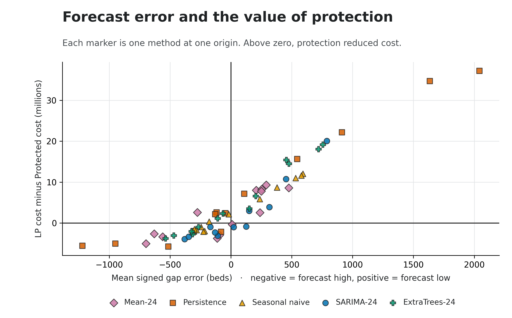
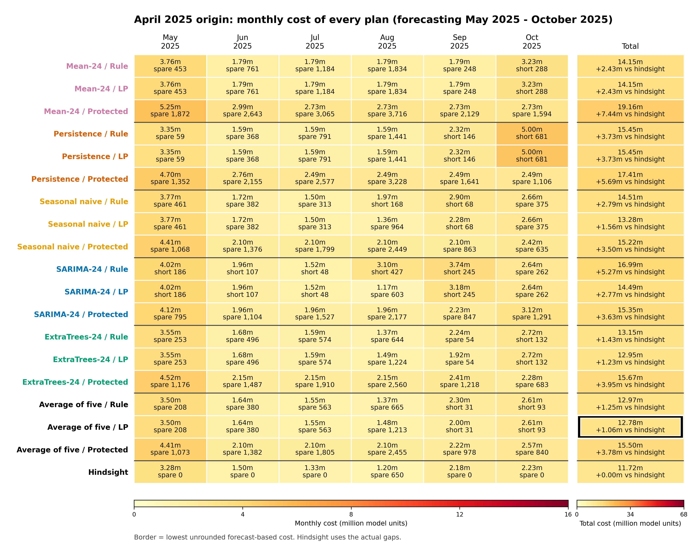
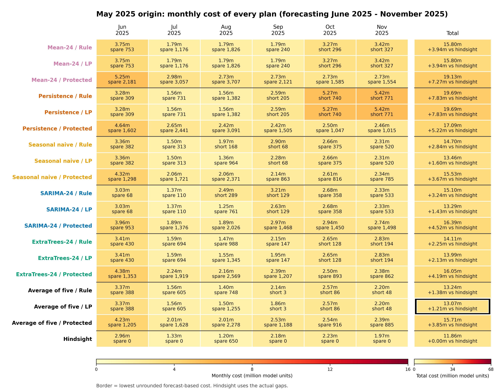
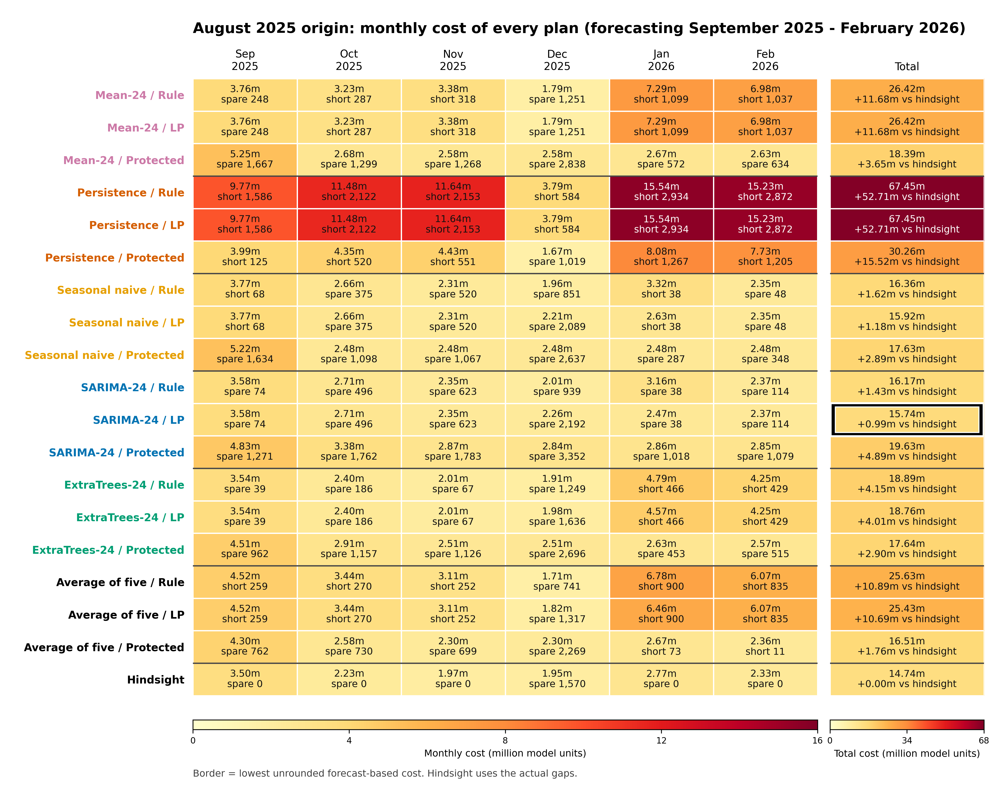
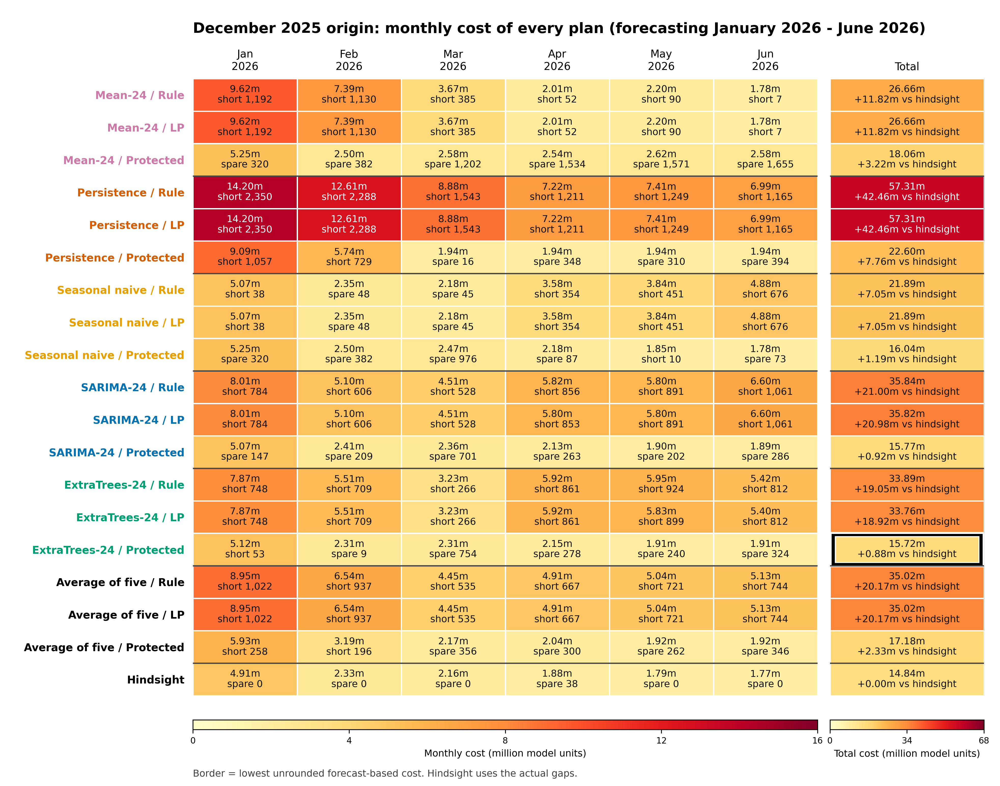
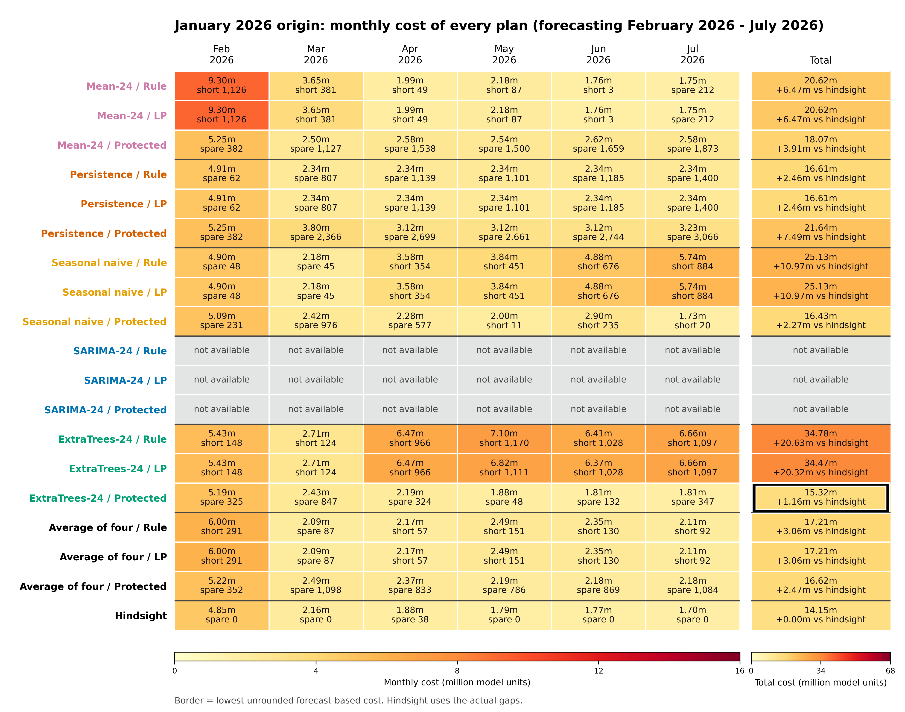

# Frozen bed-capacity plans: forecast, optimise, protect

## Question

If NHS England must fix its bed schedule six months ahead, how many extra general and acute beds should it keep open each month? Does optimising the schedule save money over following the forecast? When does protection against forecast error pay, and does averaging five forecasts improve the plan?

## Results at a glance

Across the five individual methods, optimisation saved money in all 30 forecasts with a dip and tied in the other 33, so it never materially cost more than following the forecast. In those monthly comparisons, protection helped in 26 of 29 under-forecasts and 8 of 34 over-forecasts. In the 23-origin primary test, protection lowered mean cost for every method. The Average of five trailed Seasonal naive with optimisation alone, but its Protected plan had the lowest mean cost, 3.13m above Hindsight compared with 3.66m for Seasonal naive Protected.

## Method

An origin is the last month of observed data. Each method uses the 24 months ending at that origin to forecast occupied and available beds separately. The gap is **occupied / 0.90 − available**, the extra beds needed to meet the 90% occupancy target. We fix all six monthly decisions at the origin.

**Mean-24** repeats the training average, **Persistence** repeats the latest observation and **Seasonal naive** repeats the value from the same month a year earlier. **SARIMA-24** uses a fixed seasonal time-series model, and **ExtraTrees-24** uses a fixed tree ensemble with past observations and calendar features. The **Average of five** weights the methods equally for each series, using an **Average of four** in October 2025 and January 2026 when SARIMA-24 failed to converge.

The **Rule** follows the forecast gap within the capacity limits. **LP** uses linear programming to choose the lowest-cost schedule for the same forecast. **Hindsight** chooses a schedule using the actual gaps and the same limits. When comparing LP with the Rule, we count cost differences within 1e-6 times the Rule cost as ties.

Extra capacity starts at zero, carries over between months and is capped at 15,000 beds. It can change by up to 5,000 beds per month. Running a bed costs 500 per month, opening one costs 550 and closing one costs 300. Each missing bed costs 5,000 per month. There is no closure charge after the final month. Costs are illustrative model units (validated: False).

### How protection works

The **Protected** plan uses sample average approximation (SAA). Each scenario adds a past six-month sequence of errors from the same method to its current forecast. Protected chooses the single schedule with the lowest average cost across those scenarios. A missing bed costs 5,000 per month, compared with about 500 to run a spare bed.

In September 2025, protection used about 30 scenarios. It raised SARIMA-24's plan by roughly 700 to 1,400 beds per month when the forecast already ran high. Spare bed-months rose from 3,320 to 9,291 and cost rose from 16.11m to 19.46m. Persistence ran low. Its Protected plan eliminated an LP shortfall of 4,276 bed-months and cut cost from 33.21m to 17.55m.

| Forecast | Direction (signed error in beds) | LP cost · short / spare | Protected cost · short / spare | Saving from protection |
| --- | --- | --- | --- | --- |
| Mean-24 | Too low (+289.5) | 27.72m · 2,996 / 1,259 | 18.42m · 0 / 7,778 | +9.30m |
| Persistence | Too low (+545.5) | 33.21m · 4,276 / 1,003 | 17.55m · 0 / 6,328 | +15.66m |
| Seasonal naive | Too high (-300.3) | 16.14m · 38 / 3,078 | 17.61m · 0 / 6,413 | -1.47m |
| SARIMA-24 | Too high (-346.0) | 16.11m · 0 / 3,320 | 19.46m · 0 / 9,291 | -3.35m |
| ExtraTrees-24 | Too low (+205.4) | 23.66m · 1,978 / 1,067 | 17.05m · 0 / 5,295 | +6.61m |
| Average of five | Too low (+78.8) | 21.17m · 1,424 / 1,512 | 17.01m · 0 / 5,477 | +4.16m |

Signed error is the actual gap minus the forecast gap, averaged over the six months. The short and spare figures sum missing and unused bed-months across that window. A positive saving means Protected cost less than LP.

## How to read the heatmaps

Each forecast has separate Rule, LP and Protected rows. Monthly cells show realised cost in millions and the number of beds short or spare, rounded to whole beds. Pale yellow marks low costs and deep red marks high costs. All heatmaps use the same scales, **0–16m for monthly cells** and **0–68m for totals**. The Total column also gives the cost above Hindsight. A thick border marks the cheapest available forecast-based plan before rounding. Grey cells mark unavailable forecasts.

## Main origin: September 2025

[Vector heatmap](figures/readme_heatmaps/origin_2025-09.svg)

Flat forecasts left Mean-24 and Persistence short in January and February, their two most expensive LP months. In December, LP kept beds open that the Rule would have closed. Over the six months, LP saved 0.43m for Seasonal naive and 0.44m for SARIMA-24. The Average of five ran 79 beds low, and protection cut its cost from 21.17m to 17.01m. It was the cheapest Protected plan. SARIMA-24 LP was cheapest overall at 16.11m.

## Protection depends on the forecast

[Vector scatter plot](figures/monthly_origins/protection_vs_error_direction.svg)

Each dot represents one of the five individual methods at one origin. The more the actual gap exceeded the forecast, the more protection tended to save (Spearman rank correlation **0.926**). A forecast that ran high across six months could still leave beds short in an individual month. The direction of the error is unknown when the schedule is fixed.

## Did averaging the forecasts help?

The primary test gives equal weight to 23 origins. It excludes September 2025 and March 2026, the two origins that suggested averaging. Excess cost is the difference between a plan's six-month cost and the cost of Hindsight at the same origin.

| Forecast (ranked by LP cost) | Mean LP excess | Mean Protected excess | Extra planned beds | Forecast uncertainty margin (beds) | 90% upper forecast coverage |
| --- | --- | --- | --- | --- | --- |
| Seasonal naive | 4.30m | 3.66m | 1,009 | 1,802 | 95.7% (132/138) |
| Average of five | 6.00m | 3.13m | 1,072 | 1,374 | 99.3% (137/138) |
| ExtraTrees-24 | 6.88m | 3.94m | 1,032 | 1,424 | 96.4% (133/138) |
| Mean-24 | 7.28m | 6.38m | 1,942 | 2,970 | 100.0% (138/138) |
| SARIMA-24 | 10.48m | 4.54m | 1,122 | 1,619 | 94.2% (130/138) |
| Persistence | 14.52m | 7.53m | 1,711 | 2,419 | 92.8% (128/138) |

The extra planned beds column gives the average monthly increase in capacity from LP to Protected. The forecast uncertainty margin is the distance from the point forecast to its 90% upper forecast. Coverage is the share of actual gaps at or below that upper forecast.

Seasonal naive cost 1.70m less per origin than the Average of five with LP. Protection saved the Average of five 2.87m per origin and moved it from second to first place. It had the smallest forecast uncertainty margin and the third-smallest increase in planned capacity.

### Where the costs and added beds went

Costs (in millions) and short or spare bed-months are means per six-month window, rounded after averaging. Operating cost covers running, opening and closing beds. The last column totals the bed-months that Protected added across all 23 origins. If LP was short in a month, all beds added that month count in the first group, even those beyond the shortage. Additions in months with spare LP capacity count in the second group.

| Forecast | Plan | Operating total | Running | Opening | Closing | Shortfall cost | Short / spare bed-months | Added in LP-short / LP-spare months |
| --- | --- | --- | --- | --- | --- | --- | --- | --- |
| Average of five | LP | 12.91m | 10.47m | 2.26m | 0.19m | 6.50m | 1,300 / 1,708 | — |
| Average of five | Protected | 16.42m | 13.69m | 2.66m | 0.08m | 0.12m | 23 / 6,866 | 75,067 / 72,937 |
| Seasonal naive | LP | 13.79m | 10.74m | 2.66m | 0.38m | 3.93m | 785 / 1,746 | — |
| Seasonal naive | Protected | 16.79m | 13.77m | 2.80m | 0.23m | 0.28m | 57 / 7,070 | 68,798 / 70,397 |
| ExtraTrees-24 | LP | 13.23m | 10.69m | 2.33m | 0.20m | 7.06m | 1,412 / 2,269 | — |
| ExtraTrees-24 | Protected | 16.60m | 13.79m | 2.74m | 0.07m | 0.75m | 150 / 7,199 | 58,154 / 84,279 |

Compared with Seasonal naive Protected, the Protected plan for the Average of five saved 0.37m per origin on running, opening and closing combined, and 0.17m on shortages. Lower shortfall costs accounted for 0.63m of its 0.81m saving over ExtraTrees-24 Protected. It averaged 23 short and 6,866 spare bed-months per origin, fewer of both than either comparison plan.

All five forecasts ran high at the February 2025 origin and low at the December 2025 origin. Averaging kept the error in the same direction in both windows.

## Every origin: April 2025 to April 2026

| Origin | Forecast months | Cheapest available plan | Excess over hindsight | Protection helped most? |
| --- | --- | --- | --- | --- |
| Apr 2025 | May 2025 – Oct 2025 | Average of five LP | 1.06m | No (0 of 6) |
| May 2025 | Jun 2025 – Nov 2025 | Average of five LP | 1.21m | No (1 of 6) |
| Jun 2025 | Jul 2025 – Dec 2025 | ExtraTrees-24 LP | 1.18m | No (1 of 6) |
| Jul 2025 | Aug 2025 – Jan 2026 | Seasonal naive LP | 1.92m | Half (3 of 6) |
| Aug 2025 | Sep 2025 – Feb 2026 | SARIMA-24 LP | 0.99m | Yes (4 of 6) |
| Sep 2025 | Oct 2025 – Mar 2026 | SARIMA-24 LP | 0.87m | Yes (4 of 6) |
| Oct 2025 | Nov 2025 – Apr 2026 | ExtraTrees-24 Protected | 1.02m | Yes (5 of 5) |
| Nov 2025 | Dec 2025 – May 2026 | ExtraTrees-24 Protected | 2.06m | Yes (6 of 6) |
| Dec 2025 | Jan 2026 – Jun 2026 | ExtraTrees-24 Protected | 0.88m | Yes (6 of 6) |
| Jan 2026 | Feb 2026 – Jul 2026 | ExtraTrees-24 Protected | 1.16m | Yes (4 of 5) |
| Feb 2026 | Mar 2026 – Aug 2026 | Average of five Rule (LP ties within tolerance) | 0.89m | Half (3 of 6) |
| Mar 2026 | Apr 2026 – Sep 2026 | Seasonal naive Protected | 0.89m | No (2 of 6) |
| Apr 2026 | May 2026 – Oct 2026 | Seasonal naive Protected | 0.95m | Half (3 of 6) |

Protection helped when a forecast's Protected plan cost less than its LP plan. The counts include the average and use only the methods available at each origin. In February 2026 the Rule for the Average of five had the lowest unrounded cost. Its LP plan tied within tolerance.

<b>Apr 2025 origin</b> - cheapest: Average of five LP; protection helped 0 of 6 forecasts

[Vector heatmap](figures/readme_heatmaps/origin_2025-04.svg)

The Average of five overestimated the gap by 282 beds on average. Its most expensive LP month was May 2025 (3.50m). LP kept 548 more beds open than the Rule in Aug 2025 and saved 0.19m over the six months. Protected cost 2.72m more than LP.

<b>May 2025 origin</b> - cheapest: Average of five LP; protection helped 1 of 6 forecasts

[Vector heatmap](figures/readme_heatmaps/origin_2025-05.svg)

The Average of five overestimated the gap by 267 beds on average. Its most expensive LP month was Jun 2025 (3.37m). LP kept 508 more beds open than the Rule in Aug 2025 and saved 0.18m over the six months. Protected cost 2.65m more than LP.

<b>Jun 2025 origin</b> - cheapest: ExtraTrees-24 LP; protection helped 1 of 6 forecasts

[Vector heatmap](figures/readme_heatmaps/origin_2025-06.svg)

ExtraTrees-24 overestimated the gap by 536 beds on average. Its most expensive LP month was Jul 2025 (3.14m). LP kept 217 more beds open than the Rule in Aug 2025 and saved 0.08m over the six months. Protected cost 3.76m more than LP.

<b>Jul 2025 origin</b> - cheapest: Seasonal naive LP; protection helped 3 of 6 forecasts

[Vector heatmap](figures/readme_heatmaps/origin_2025-07.svg)

Seasonal naive overestimated the gap by 245 beds on average. Its most expensive LP month was Sep 2025 (2.90m). LP kept 1,238 more beds open than the Rule in Dec 2025 and saved 0.43m over the six months. Protected cost 0.95m more than LP.

<b>Aug 2025 origin</b> - cheapest: SARIMA-24 LP; protection helped 4 of 6 forecasts

[Vector heatmap](figures/readme_heatmaps/origin_2025-08.svg)

SARIMA-24 overestimated the gap by 381 beds on average. Its most expensive LP month was Sep 2025 (3.58m). LP kept 1,253 more beds open than the Rule in Dec 2025 and saved 0.44m over the six months. Protected cost 3.89m more than LP.

<b>Sep 2025 origin</b> - cheapest: SARIMA-24 LP; protection helped 4 of 6 forecasts

[Vector heatmap](figures/readme_heatmaps/origin_2025-09.svg)

SARIMA-24 overestimated the gap by 346 beds on average. Its most expensive LP month was Oct 2025 (4.52m). LP kept 1,244 more beds open than the Rule in Dec 2025 and saved 0.44m over the six months. Protected cost 3.35m more than LP.

<b>Oct 2025 origin</b> - cheapest: ExtraTrees-24 Protected; protection helped 5 of 5 forecasts

[Vector heatmap](figures/readme_heatmaps/origin_2025-10.svg)

ExtraTrees-24 underestimated the gap by 477 beds on average. Its most expensive LP month was Jan 2026 (6.71m). The largest LP shortage was in Apr 2026. Protected cut it from 962 to 0 beds and saved 14.52m over the six months compared with LP.

<b>Nov 2025 origin</b> - cheapest: ExtraTrees-24 Protected; protection helped 6 of 6 forecasts

[Vector heatmap](figures/readme_heatmaps/origin_2025-11.svg)

ExtraTrees-24 underestimated the gap by 457 beds on average. May 2026 was its most expensive LP month (7.03m) and had the largest shortage (1,147 beds). Protected cut that shortage to 0 and saved 15.42m over the six months compared with LP.

<b>Dec 2025 origin</b> - cheapest: ExtraTrees-24 Protected; protection helped 6 of 6 forecasts

[Vector heatmap](figures/readme_heatmaps/origin_2025-12.svg)

ExtraTrees-24 underestimated the gap by 720 beds on average. Its most expensive LP month was Jan 2026 (7.87m). The largest LP shortage was in May 2026. Protected cut it from 899 to 0 beds and saved 18.04m over the six months compared with LP.

<b>Jan 2026 origin</b> - cheapest: ExtraTrees-24 Protected; protection helped 4 of 5 forecasts

[Vector heatmap](figures/readme_heatmaps/origin_2026-01.svg)

ExtraTrees-24 underestimated the gap by 755 beds on average. May 2026 was its most expensive LP month (6.82m) and had the largest shortage (1,111 beds). Protected cut that shortage to 0 and saved 19.15m over the six months compared with LP.

<b>Feb 2026 origin</b> - cheapest: Average of five Rule (LP ties within tolerance); protection helped 3 of 6 forecasts

[Vector heatmap](figures/readme_heatmaps/origin_2026-02.svg)

The Average of five overestimated the gap by 79 beds on average. Its highest Rule cost was 4.21m in the first month, Mar 2026. LP tied the Rule within tolerance. Protected cost 2.10m more than LP.

<b>Mar 2026 origin</b> - cheapest: Seasonal naive Protected; protection helped 2 of 6 forecasts

[Vector heatmap](figures/readme_heatmaps/origin_2026-03.svg)

Seasonal naive underestimated the gap by 591 beds on average. Jul 2026 was its most expensive LP month (5.74m) and had the largest shortage (884 beds). Protected cut that shortage to 0 and saved 12.06m over the six months compared with LP.

<b>Apr 2026 origin</b> - cheapest: Seasonal naive Protected; protection helped 3 of 6 forecasts

[Vector heatmap](figures/readme_heatmaps/origin_2026-04.svg)

Seasonal naive underestimated the gap by 579 beds on average. Jul 2026 was its most expensive LP month (5.74m) and had the largest shortage (884 beds). Protected cut that shortage to 0 and saved 11.63m over the six months compared with LP.

## Findings

For the individual methods, LP saved money on every dip (a fall followed by a rise) and tied the Rule otherwise. Protection mainly helped forecasts that ran low. Counting the average, it helped 21 of 22 forecasts at the October 2025–January 2026 origins and 2 of 18 at the April–June 2025 origins. SARIMA-24 LP was cheapest in September 2025 and Seasonal naive Protected in March 2026. In the primary test, the Average of five ranked second to Seasonal naive with LP and first with protection. Its Protected plan had fewer short and spare bed-months than Seasonal naive Protected or ExtraTrees-24 Protected. Its 90% upper forecast covered 137 of 138 monthly gaps (99.3%).

In short, optimising the frozen plan never cost more than following the forecast and saved money whenever the forecast dipped; protection then lowered the average cost for every forecast, most of all when forecasts ran low; and averaging the five forecasts before protecting gave the cheapest plan on average.

## Data and code

- `outputs/clean_checkpoint/O1_sep2025/` — [totals.csv](outputs/clean_checkpoint/O1_sep2025/totals.csv)
- `outputs/clean_checkpoint/O2_mar2026/` — [totals.csv](outputs/clean_checkpoint/O2_mar2026/totals.csv)
- `outputs/fair_comparison/O1_sep2025/` — [totals.csv](outputs/fair_comparison/O1_sep2025/totals.csv)
- `outputs/fair_comparison/O2_mar2026/` — [totals.csv](outputs/fair_comparison/O2_mar2026/totals.csv)
- `outputs/fair_comparison_rolling/` — [plans.csv](outputs/fair_comparison_rolling/plans.csv)
- `outputs/forecast_combination/` — [actuals.csv](outputs/forecast_combination/actuals.csv), [banks.csv](outputs/forecast_combination/banks.csv), [config.json](outputs/forecast_combination/config.json), [costs.csv](outputs/forecast_combination/costs.csv), [coverage.csv](outputs/forecast_combination/coverage.csv), [decomposition_summary.csv](outputs/forecast_combination/decomposition_summary.csv), [endpoints.csv](outputs/forecast_combination/endpoints.csv), [forecasts.csv](outputs/forecast_combination/forecasts.csv), [monthly_costs.csv](outputs/forecast_combination/monthly_costs.csv), [origin_metrics.csv](outputs/forecast_combination/origin_metrics.csv), [plans.csv](outputs/forecast_combination/plans.csv), [quantiles.csv](outputs/forecast_combination/quantiles.csv)
- `outputs/monthly_origins/` — [availability.csv](outputs/monthly_origins/availability.csv), [costs.csv](outputs/monthly_origins/costs.csv), [interpretation.json](outputs/monthly_origins/interpretation.json), [method_origin.csv](outputs/monthly_origins/method_origin.csv), [monthly_costs.csv](outputs/monthly_origins/monthly_costs.csv)
