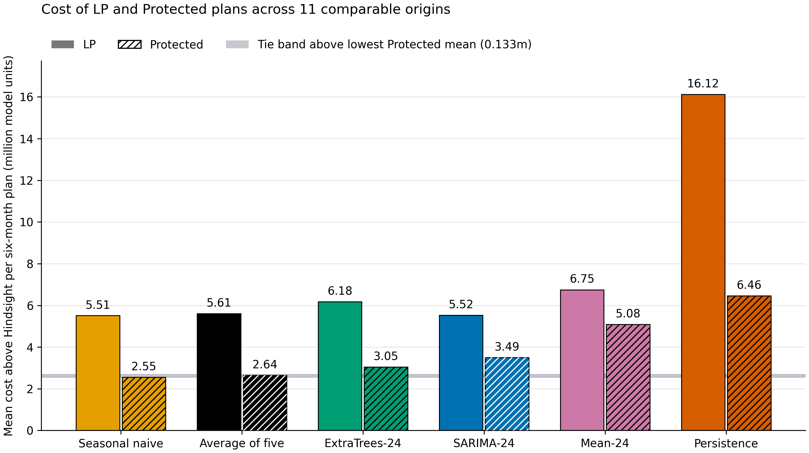
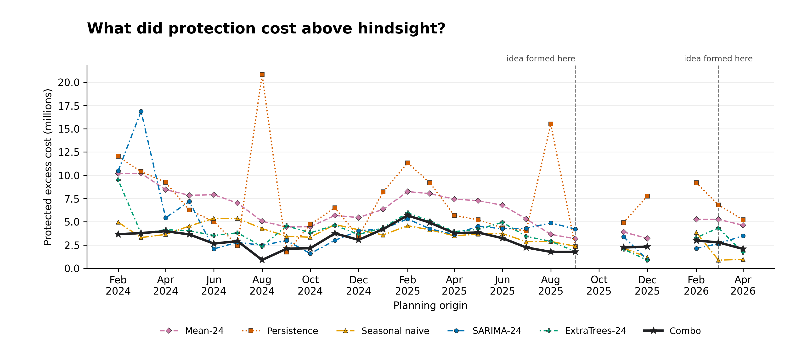
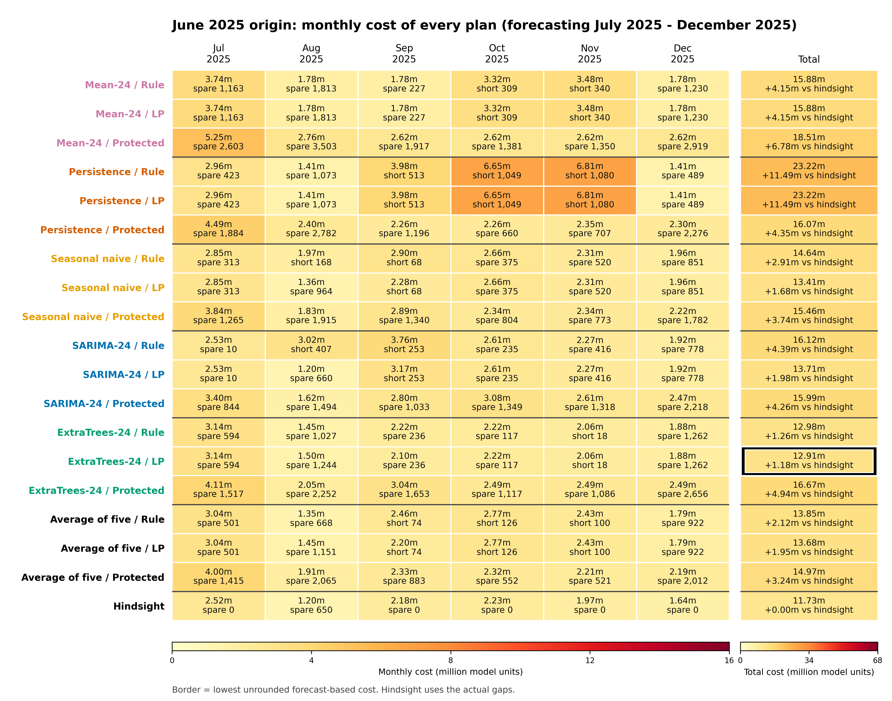
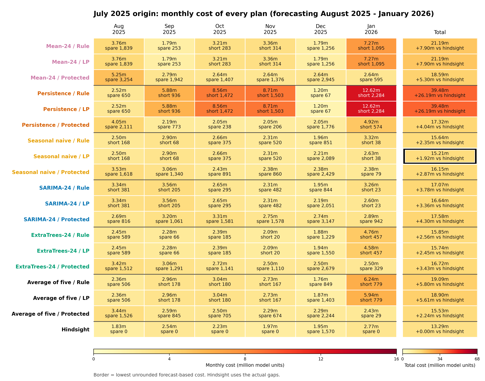
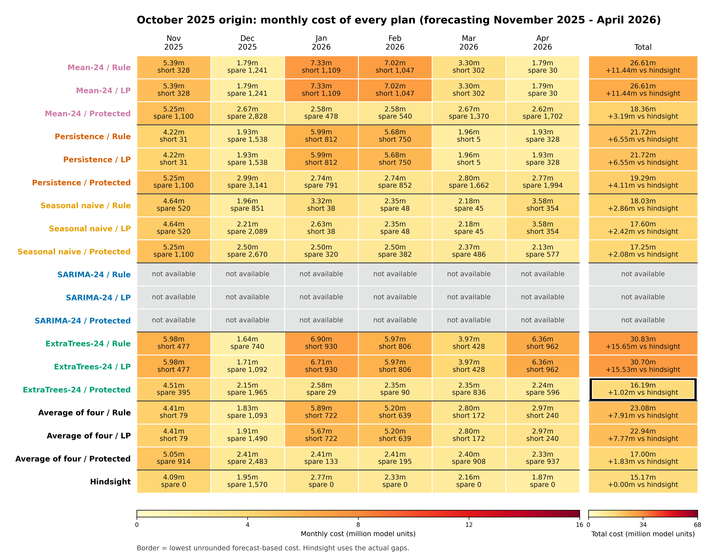
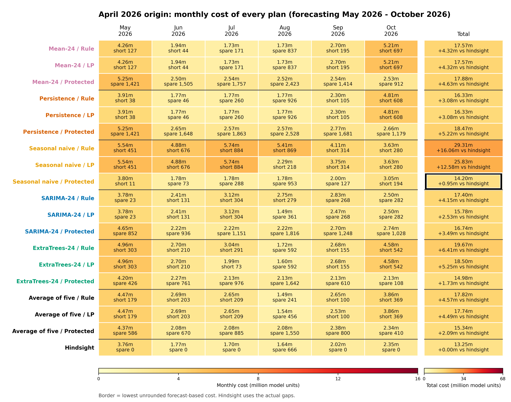

# Frozen bed-capacity plans: forecast, optimise, protect

## 1. The problem

How many extra general and acute beds should NHS England keep open if it must fix the next six months’ schedule today? We use five forecasts and their average to compare three ways of planning: follow the forecast (Rule), optimise the schedule (LP), or optimise with protection against forecast error (Protected). The first two origins gave different winners.

In September 2025, SARIMA-24 LP was cheapest at 0.87m above Hindsight, and protecting that forecast increased its cost by 3.35m.

In March 2026, Seasonal naive Protected was cheapest at 0.89m above Hindsight, saving 12.06m compared with Seasonal naive LP.

Two months, two different answers. So we repeated the same experiment from every month, April 2025 to April 2026, to see what holds.

## 2. What we did

At each of the 13 starting months (origins), we used only data available then. Each method forecast occupied and available beds for the next six months. We froze Rule, LP and Protected schedules for each forecast and their average, then compared their realised costs with Hindsight, the cheapest schedule possible with the actual gaps known. SARIMA-24 failed to fit in October 2025 and January 2026, so the average used the four available methods at those origins and comparisons across all methods use the other 11.

Mean-24 repeats the 24-month training average, Persistence repeats the latest observation and Seasonal naive repeats the same month a year earlier. SARIMA-24 uses a fixed seasonal time-series model and ExtraTrees-24 uses a fixed tree ensemble with past observations and calendar features. At each origin, for each forecast month, the Average of five is the plain average of the five methods' forecasts for that month (occupied and available beds averaged separately, then the gap computed).

The planning gap is **occupied / 0.90 − available**, the extra beds needed for 90% occupancy, and extra capacity starts at zero, carries over up to a limit of 15,000 beds and can change by up to 5,000 beds per month. Running costs 500 per bed-month, opening costs 550 per bed, closing costs 300 per bed and shortages cost 5,000 per missing bed-month, with no closure charge after the final month. Costs are illustrative model units (validated: False).

### How protection works

The **Protected** plan uses sample average approximation (SAA). Each scenario adds a past six-month sequence of errors from the same method to its current forecast. Protected chooses the single schedule with the lowest average cost across those scenarios. A missing bed costs 5,000 per month, compared with about 500 to run a spare bed.

In September 2025, protection used about 30 scenarios. It raised SARIMA-24's plan by roughly 700 to 1,400 beds per month when the forecast already ran high. Spare bed-months rose from 3,320 to 9,291 and cost rose from 16.11m to 19.46m. Persistence ran low. Its Protected plan eliminated an LP shortfall of 4,276 bed-months and cut cost from 33.21m to 17.55m.

### How to read the heatmaps

Each forecast has separate Rule, LP and Protected rows. Monthly cells show realised cost in millions and the number of beds short or spare, rounded to whole beds. Pale yellow marks low costs and deep red marks high costs. All heatmaps use the same scales, **0–16m for monthly cells** and **0–68m for totals**. The Total column also gives the cost above Hindsight. A thick border marks the cheapest available forecast-based plan before rounding. Grey cells mark unavailable forecasts. Read “+X vs hindsight” as the extra cost over the whole six-month plan. A single month can mislead because opening, closing and carrying beds forward shift costs between months.

## 3. What we found

There are two questions here.

### Question A: which approach - follow the forecast, optimise, or optimise and protect?

There is a clear winner: optimise and protect.

At every starting month, LP never materially cost more than the Rule for any of the five individual methods. It saved money in all 30 forecasts with a dip (a fall followed by a rise) and tied in the 33 without one. Differences within 1e-6 times the Rule cost count as ties.

Each cell shows the six-month saving from optimising the same forecast.

Across the 11 comparable origins, protection roughly halved the gap to Hindsight for Seasonal naive, the Average of five and ExtraTrees-24.

| Method | Optimised only (LP) | Optimised + protected |
| --- | ---: | ---: |
| Seasonal naive | 5.51m | 2.55m |
| Average of five | 5.61m | 2.64m |
| ExtraTrees-24 | 6.18m | 3.05m |
| SARIMA-24 | 5.52m | 3.49m |
| Mean-24 | 6.75m | 5.08m |
| Persistence | 16.12m | 6.46m |

Average cost above the perfect plan, per six-month plan.

[Vector figure](figures/readme_story/approach_lp_vs_protected.svg)

### Question B: which forecasting method?

There is no clean winner. Two are tied at the top:

- Seasonal naive with protection averaged 2.55m above Hindsight.
- The Average of five with protection averaged 2.64m above Hindsight.

They are 0.09m apart, inside the tie band of about 0.133m, so they are effectively equal. The band is the mean of 1% of each comparable origin’s Hindsight cost. All other methods are outside it.

Over the longer pre-registered test (23 origins, 2024–2026, excluding September 2025 and March 2026), the Average of five with protection had the lowest mean cost (3.13m above Hindsight versus 3.66m for Seasonal naive with protection).

Each line shows a Protected plan’s cost above Hindsight, with SARIMA-24 varying more across origins than the Average of five (labelled Combo).

## 4. Why did September and March disagree?

Protection depended on which way the forecast missed. In September, SARIMA-24 and Seasonal naive forecast too high, so protection added beds that were not needed. In March, both forecast too low, so the extra beds reduced shortages.

Across all months, protection helped in 26 of 29 forecasts that ran too low and only 8 of 34 that ran too high. The direction is unknown when the plan is frozen, but protection lowered cost on average.

Each dot pairs one method’s average forecast error at one origin with the saving from protecting its plan.

**September 2025**

| Forecast | Direction (signed error in beds) | LP cost · short / spare | Protected cost · short / spare | Saving from protection |
| --- | --- | --- | --- | --- |
| Mean-24 | Too low (+289.5) | 27.72m · 2,996 / 1,259 | 18.42m · 0 / 7,778 | +9.30m |
| Persistence | Too low (+545.5) | 33.21m · 4,276 / 1,003 | 17.55m · 0 / 6,328 | +15.66m |
| Seasonal naive | Too high (-300.3) | 16.14m · 38 / 3,078 | 17.61m · 0 / 6,413 | -1.47m |
| SARIMA-24 | Too high (-346.0) | 16.11m · 0 / 3,320 | 19.46m · 0 / 9,291 | -3.35m |
| ExtraTrees-24 | Too low (+205.4) | 23.66m · 1,978 / 1,067 | 17.05m · 0 / 5,295 | +6.61m |
| Average of five | Too low (+78.8) | 21.17m · 1,424 / 1,512 | 17.01m · 0 / 5,477 | +4.16m |

Signed error is the actual gap minus the forecast gap, averaged over the six months. The short and spare figures sum missing and unused bed-months across that window. A positive saving means Protected cost less than LP.

## 5. Every origin: April 2025 to April 2026

| Origin | Forecast months | Cheapest available plan | Excess over hindsight | Protection helped most? |
| --- | --- | --- | --- | --- |
| Apr 2025 | May 2025 – Oct 2025 | Average of five LP | 1.06m | No (0 of 6) |
| May 2025 | Jun 2025 – Nov 2025 | Average of five LP | 1.21m | No (1 of 6) |
| Jun 2025 | Jul 2025 – Dec 2025 | ExtraTrees-24 LP | 1.18m | No (1 of 6) |
| Jul 2025 | Aug 2025 – Jan 2026 | Seasonal naive LP | 1.92m | Half (3 of 6) |
| Aug 2025 | Sep 2025 – Feb 2026 | SARIMA-24 LP | 0.99m | Yes (4 of 6) |
| Sep 2025 | Oct 2025 – Mar 2026 | SARIMA-24 LP | 0.87m | Yes (4 of 6) |
| Oct 2025 | Nov 2025 – Apr 2026 | ExtraTrees-24 Protected | 1.02m | Yes (5 of 5) |
| Nov 2025 | Dec 2025 – May 2026 | ExtraTrees-24 Protected | 2.06m | Yes (6 of 6) |
| Dec 2025 | Jan 2026 – Jun 2026 | ExtraTrees-24 Protected | 0.88m | Yes (6 of 6) |
| Jan 2026 | Feb 2026 – Jul 2026 | ExtraTrees-24 Protected | 1.16m | Yes (4 of 5) |
| Feb 2026 | Mar 2026 – Aug 2026 | Average of five Rule (LP ties within tolerance) | 0.89m | Half (3 of 6) |
| Mar 2026 | Apr 2026 – Sep 2026 | Seasonal naive Protected | 0.89m | No (2 of 6) |
| Apr 2026 | May 2026 – Oct 2026 | Seasonal naive Protected | 0.95m | Half (3 of 6) |

Protection helped when a forecast's Protected plan cost less than its LP plan. The counts include the average and use only the methods available at each origin. In February 2026 the Rule for the Average of five had the lowest unrounded cost. Its LP plan tied within tolerance.

<b>Apr 2025 origin</b> - cheapest: Average of five LP; protection helped 0 of 6 forecasts

[Vector heatmap](figures/readme_heatmaps/origin_2025-04.svg)

The Average of five overestimated the gap by 282 beds on average. Its most expensive LP month was May 2025 (3.50m). LP kept 548 more beds open than the Rule in Aug 2025 and saved 0.19m over the six months. Protected cost 2.72m more than LP.

<b>May 2025 origin</b> - cheapest: Average of five LP; protection helped 1 of 6 forecasts

[Vector heatmap](figures/readme_heatmaps/origin_2025-05.svg)

The Average of five overestimated the gap by 267 beds on average. Its most expensive LP month was Jun 2025 (3.37m). LP kept 508 more beds open than the Rule in Aug 2025 and saved 0.18m over the six months. Protected cost 2.65m more than LP.

<b>Jun 2025 origin</b> - cheapest: ExtraTrees-24 LP; protection helped 1 of 6 forecasts

[Vector heatmap](figures/readme_heatmaps/origin_2025-06.svg)

ExtraTrees-24 overestimated the gap by 536 beds on average. Its most expensive LP month was Jul 2025 (3.14m). LP kept 217 more beds open than the Rule in Aug 2025 and saved 0.08m over the six months. Protected cost 3.76m more than LP.

<b>Jul 2025 origin</b> - cheapest: Seasonal naive LP; protection helped 3 of 6 forecasts

[Vector heatmap](figures/readme_heatmaps/origin_2025-07.svg)

Seasonal naive overestimated the gap by 245 beds on average. Its most expensive LP month was Sep 2025 (2.90m). LP kept 1,238 more beds open than the Rule in Dec 2025 and saved 0.43m over the six months. Protected cost 0.95m more than LP.

<b>Aug 2025 origin</b> - cheapest: SARIMA-24 LP; protection helped 4 of 6 forecasts

[Vector heatmap](figures/readme_heatmaps/origin_2025-08.svg)

SARIMA-24 overestimated the gap by 381 beds on average. Its most expensive LP month was Sep 2025 (3.58m). LP kept 1,253 more beds open than the Rule in Dec 2025 and saved 0.44m over the six months. Protected cost 3.89m more than LP.

<b>Sep 2025 origin</b> - cheapest: SARIMA-24 LP; protection helped 4 of 6 forecasts

[Vector heatmap](figures/readme_heatmaps/origin_2025-09.svg)

SARIMA-24 overestimated the gap by 346 beds on average. Its most expensive LP month was Oct 2025 (4.52m). LP kept 1,244 more beds open than the Rule in Dec 2025 and saved 0.44m over the six months. Protected cost 3.35m more than LP.

<b>Oct 2025 origin</b> - cheapest: ExtraTrees-24 Protected; protection helped 5 of 5 forecasts

[Vector heatmap](figures/readme_heatmaps/origin_2025-10.svg)

ExtraTrees-24 underestimated the gap by 477 beds on average. Its most expensive LP month was Jan 2026 (6.71m). The largest LP shortage was in Apr 2026. Protected cut it from 962 to 0 beds and saved 14.52m over the six months compared with LP.

<b>Nov 2025 origin</b> - cheapest: ExtraTrees-24 Protected; protection helped 6 of 6 forecasts

[Vector heatmap](figures/readme_heatmaps/origin_2025-11.svg)

ExtraTrees-24 underestimated the gap by 457 beds on average. May 2026 was its most expensive LP month (7.03m) and had the largest shortage (1,147 beds). Protected cut that shortage to 0 and saved 15.42m over the six months compared with LP.

<b>Dec 2025 origin</b> - cheapest: ExtraTrees-24 Protected; protection helped 6 of 6 forecasts

[Vector heatmap](figures/readme_heatmaps/origin_2025-12.svg)

ExtraTrees-24 underestimated the gap by 720 beds on average. Its most expensive LP month was Jan 2026 (7.87m). The largest LP shortage was in May 2026. Protected cut it from 899 to 0 beds and saved 18.04m over the six months compared with LP.

<b>Jan 2026 origin</b> - cheapest: ExtraTrees-24 Protected; protection helped 4 of 5 forecasts

[Vector heatmap](figures/readme_heatmaps/origin_2026-01.svg)

ExtraTrees-24 underestimated the gap by 755 beds on average. May 2026 was its most expensive LP month (6.82m) and had the largest shortage (1,111 beds). Protected cut that shortage to 0 and saved 19.15m over the six months compared with LP.

<b>Feb 2026 origin</b> - cheapest: Average of five Rule (LP ties within tolerance); protection helped 3 of 6 forecasts

[Vector heatmap](figures/readme_heatmaps/origin_2026-02.svg)

The Average of five overestimated the gap by 79 beds on average. Its highest Rule cost was 4.21m in the first month, Mar 2026. LP tied the Rule within tolerance. Protected cost 2.10m more than LP.

<b>Mar 2026 origin</b> - cheapest: Seasonal naive Protected; protection helped 2 of 6 forecasts

[Vector heatmap](figures/readme_heatmaps/origin_2026-03.svg)

Seasonal naive underestimated the gap by 591 beds on average. Jul 2026 was its most expensive LP month (5.74m) and had the largest shortage (884 beds). Protected cut that shortage to 0 and saved 12.06m over the six months compared with LP.

<b>Apr 2026 origin</b> - cheapest: Seasonal naive Protected; protection helped 3 of 6 forecasts

[Vector heatmap](figures/readme_heatmaps/origin_2026-04.svg)

Seasonal naive underestimated the gap by 579 beds on average. Jul 2026 was its most expensive LP month (5.74m) and had the largest shortage (884 beds). Protected cut that shortage to 0 and saved 11.63m over the six months compared with LP.

## 6. Answer

We repeated the experiment from every month, April 2025 to April 2026. The approach has a clear winner on average: optimise the plan and add protection. Optimisation never materially cost more than following the forecast, and protection roughly halved the gap to the perfect plan for Seasonal naive, the Average of five and ExtraTrees-24. Seasonal naive and the Average of five, both with protection, were effectively tied at the top across the comparable months. September and March differed because protection helped most often when forecasts ran low, and the direction of the error changed between the two windows.

## Data and code

- `outputs/clean_checkpoint/O1_sep2025/` — [totals.csv](outputs/clean_checkpoint/O1_sep2025/totals.csv)
- `outputs/clean_checkpoint/O2_mar2026/` — [totals.csv](outputs/clean_checkpoint/O2_mar2026/totals.csv)
- `outputs/fair_comparison/O1_sep2025/` — [totals.csv](outputs/fair_comparison/O1_sep2025/totals.csv)
- `outputs/fair_comparison/O2_mar2026/` — [totals.csv](outputs/fair_comparison/O2_mar2026/totals.csv)
- `outputs/fair_comparison_rolling/` — [plans.csv](outputs/fair_comparison_rolling/plans.csv)
- `outputs/forecast_combination/` — [actuals.csv](outputs/forecast_combination/actuals.csv), [banks.csv](outputs/forecast_combination/banks.csv), [config.json](outputs/forecast_combination/config.json), [costs.csv](outputs/forecast_combination/costs.csv), [coverage.csv](outputs/forecast_combination/coverage.csv), [decomposition_summary.csv](outputs/forecast_combination/decomposition_summary.csv), [endpoints.csv](outputs/forecast_combination/endpoints.csv), [forecasts.csv](outputs/forecast_combination/forecasts.csv), [monthly_costs.csv](outputs/forecast_combination/monthly_costs.csv), [origin_metrics.csv](outputs/forecast_combination/origin_metrics.csv), [plans.csv](outputs/forecast_combination/plans.csv), [quantiles.csv](outputs/forecast_combination/quantiles.csv)
- `outputs/monthly_origins/` — [availability.csv](outputs/monthly_origins/availability.csv), [costs.csv](outputs/monthly_origins/costs.csv), [interpretation.json](outputs/monthly_origins/interpretation.json), [method_origin.csv](outputs/monthly_origins/method_origin.csv), [monthly_costs.csv](outputs/monthly_origins/monthly_costs.csv)
